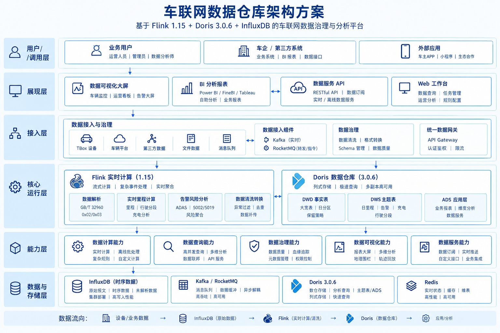
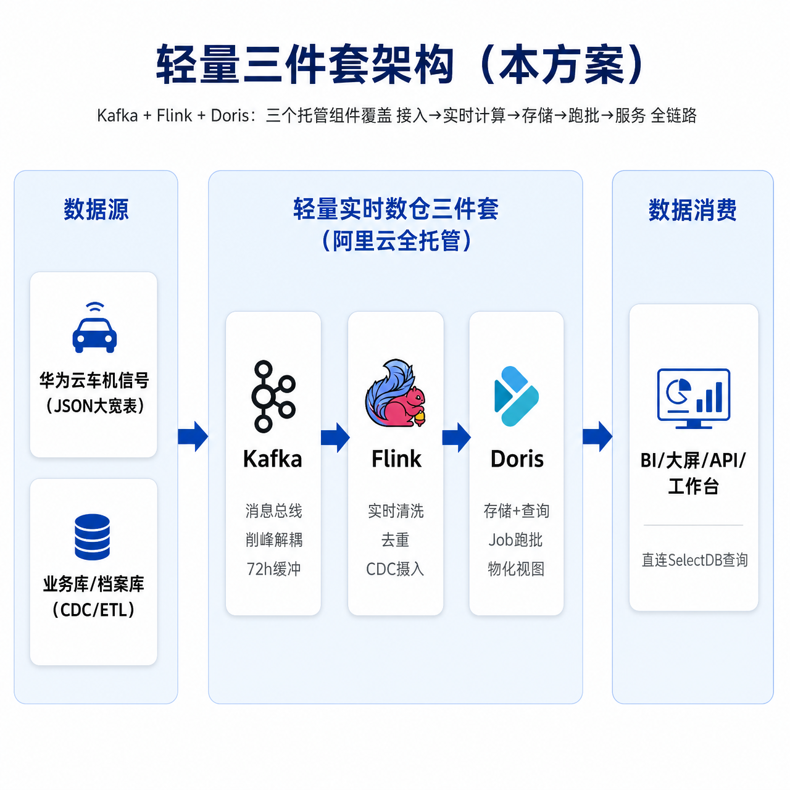
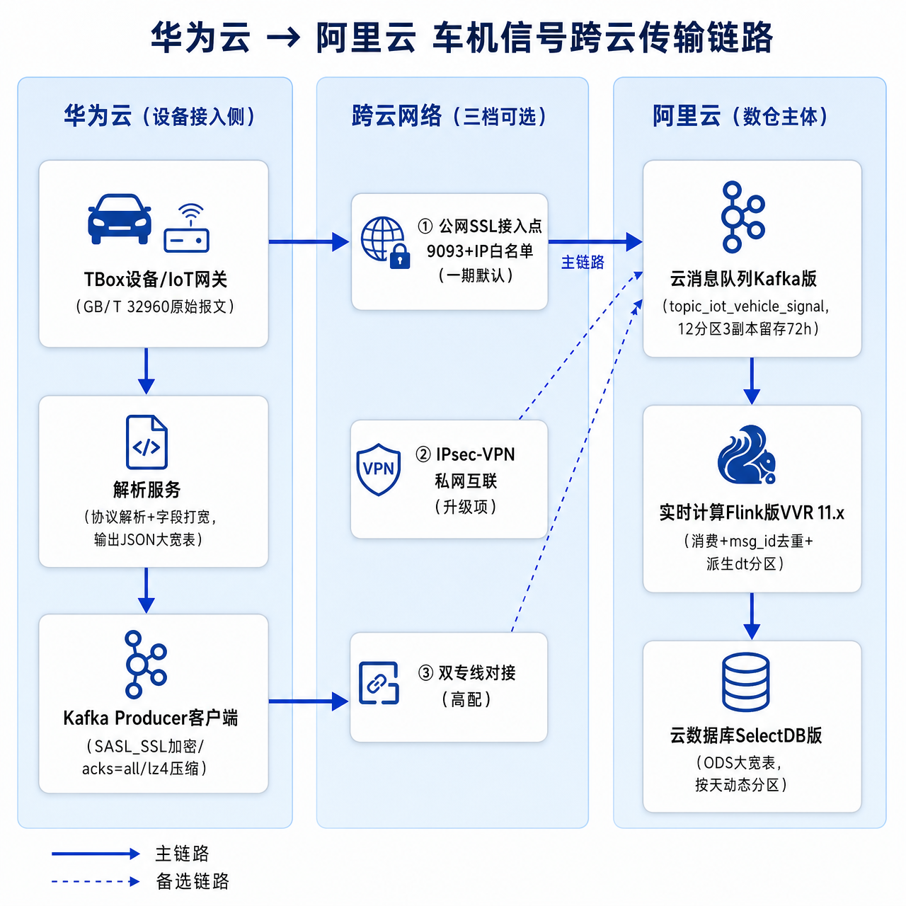
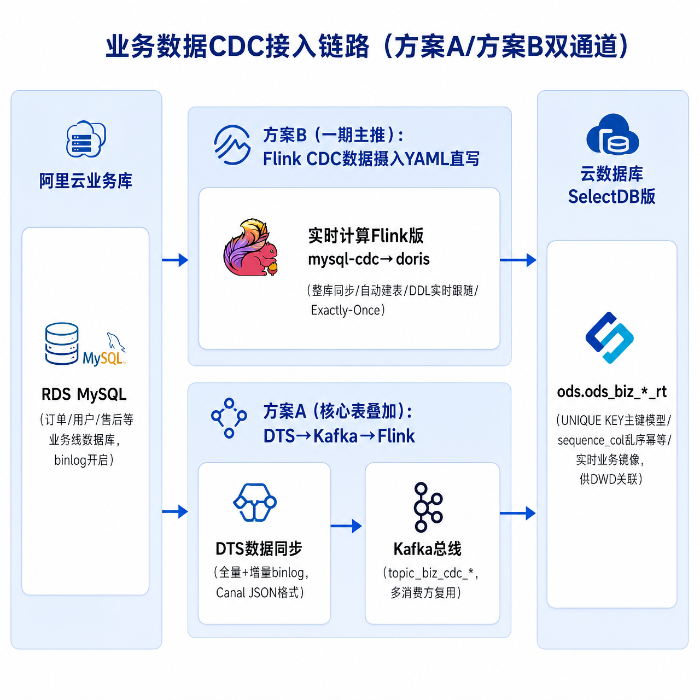
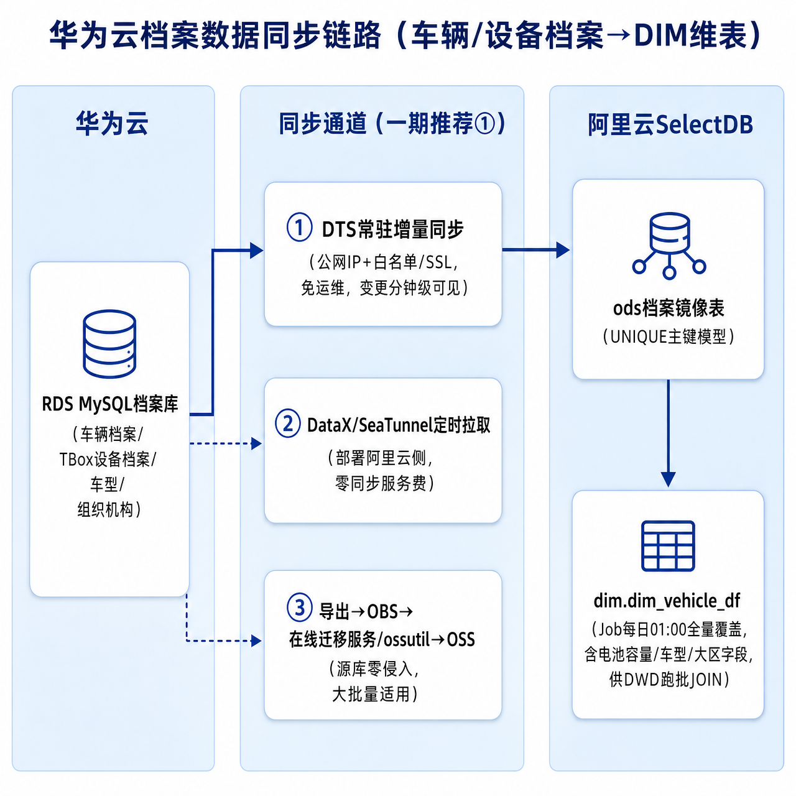
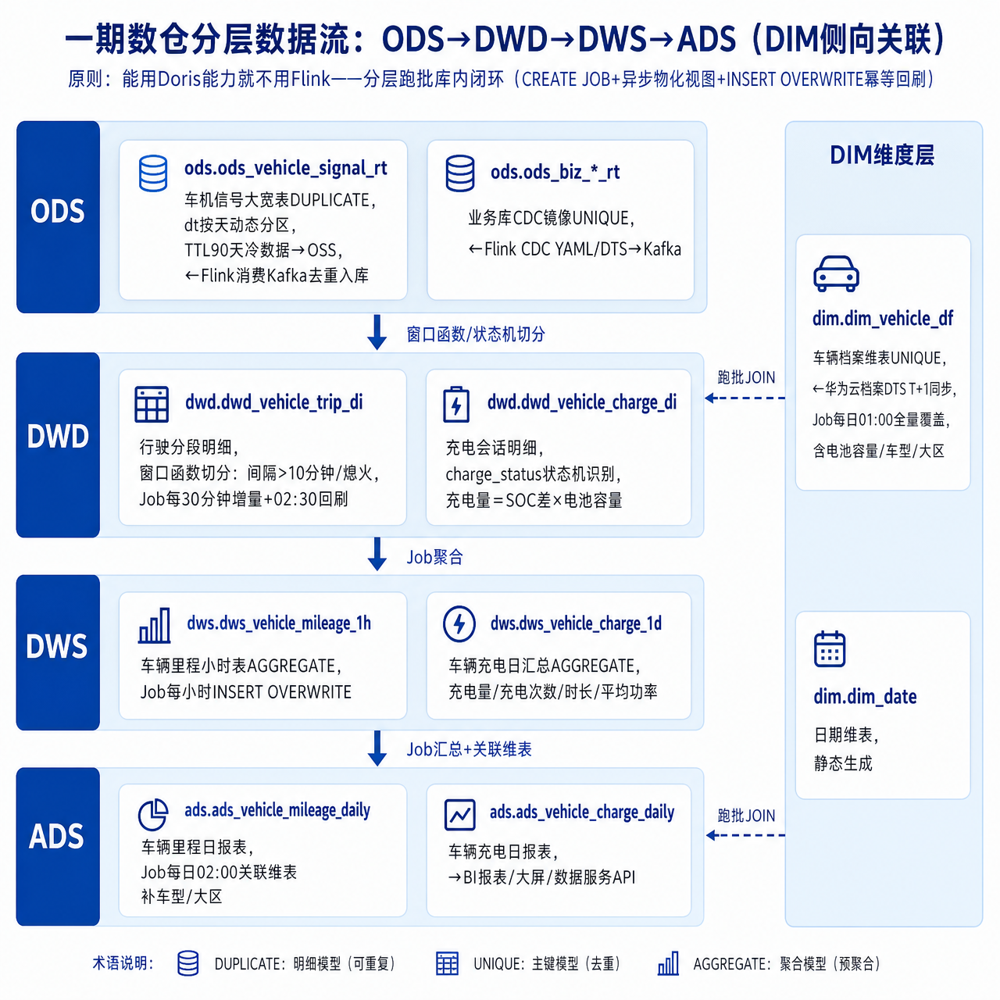

—— 基于阿里云 Kafka + 实时计算 Flink 版 + 云数据库 SelectDB（Apache Doris）的轻量实时数仓

> 版本：v1.1 | 日期：2026-09-21 | 密级：内部

---

## 第1章 项目背景与总体架构

### 1.1 现状

公司车辆数据链路与主业务数据分处两朵云：车辆数据链路运行在华为云，TBox 上报报文经华为云 IoT 网关接入、由解析服务完成 GB/T 32960 协议解析；订单、用户、售后等主业务数据在阿里云关系型数据库服务（Relational Database Service，RDS）中。华为云侧除车辆接入外无其他核心资产，长期维持两套云资源带来跨云专线、双账号运维与账单管理成本，华为云相对"鸡肋"。

原数仓架构《车联网数据仓库架构方案》基于自建 Apache Flink 1.15 + Apache Doris 3.0.6 + InfluxDB：设备数据先落 InfluxDB 保存原始报文与时序数据，再由 Flink 实时计算（解析 GB/T 32960 0x02/0x03、实时里程、ADAS 告警分析、清洗转换）写入 Doris 3.0.6 的 DWD 大宽表（日分区）与 DWS 主题表，上层由 Power BI/FineBI/Tableau、数据可视化大屏与数据服务 API 消费；消息侧同时存在 Kafka 与 RocketMQ（用于下行指令转发），另有 Redis 做缓存。该架构组件多、自建重，InfluxDB 与 Doris 之间形成双写双存，扩缩容与版本升级均需人工介入。

### 1.2 目标与约束

- **轻量**：一期只保留「Kafka + Flink + Doris」三个核心组件，其余能力（时序库、第二消息总线、独立缓存）不新增、不沿用。
- **低成本**：全部组件采用阿里云全托管形态，按量/包年包月可弹性组合；存储依托对象存储服务（Object Storage Service，OSS）降本——SelectDB 官方口径单位存储成本相比传统数仓可降低 90% 以上（[SelectDB 产品初识](https://help.aliyun.com/zh/selectdb/getting-started/preparations)）。
- **可演进**：数据链路以 Kafka 大宽表 JSON 报文为唯一接口契约，华为云解析服务后续平移或替换不影响下游；数仓按 ODS/DWD/DIM/DWS/ADS 五层建模，主题与粒度的扩展在层内演进。
- **边界约束**：华为云侧短期保留（车辆接入与协议解析仍在华为云完成），本方案不改造华为云链路，只定义其向阿里云投递数据的接口。

### 1.3 总体架构


*图：车联网数据仓库建设方案总体架构图*

主链路为：华为云解析服务将解析后的车机信号以 JSON 大宽表写入阿里云 Kafka 唯一主链路 Topic `topic_iot_vehicle_signal`（消息 key 为 vin），Flink 消费后经 Stream Load 写入 SelectDB 的 `ods.ods_vehicle_signal_rt`，数仓内部按五层逐层加工，最终供 BI、大屏与 API 消费。跨云写入走 Kafka 公网 SSL 接入点（9093，SASL_SSL），公网环境强制鉴权与加密（[Kafka 接入点对比](https://www.alibabacloud.com/help/zh/apsaramq-for-kafka/cloud-message-queue-for-kafka/product-overview/comparison-among-endpoints)）。两条辅助链路以虚线标注：阿里云 RDS 业务库经 DTS / Flink CDC 进入 ODS 层（`ods.ods_biz_{源表名}_rt`）；华为云 RDS 车辆档案库经 T+1 ETL 进入 DIM 层（`dim.dim_vehicle_df`）。

### 1.4 与原架构的对照

| 原组件                  | 新组件                                                 | 调整原因                                                                                                                                                                                                                                                  |
| -------------------- | --------------------------------------------------- | ----------------------------------------------------------------------------------------------------------------------------------------------------------------------------------------------------------------------------------------------------- |
| InfluxDB（原始报文/时序）    | 取消，原始报文留存于 SelectDB ODS 层                           | SelectDB 存算分离，数据单副本全量存 OSS、热数据自动驻留云盘缓存（[SelectDB 数据缓存](https://help.aliyun.com/zh/selectdb/data-cache)），原始报文留存与分层查询由一套引擎承载，减少组件与双写一致性负担                                                                                                               |
| Kafka + RocketMQ 双总线 | 仅 Kafka（一期）                                         | 一期无下行指令场景，保留单一总线降低运维面；RocketMQ 接入能力保留为二期选项，Flink 内置 RocketMQ connector 可直接扩展（[Flink 支持哪些连接器](https://help.aliyun.com/zh/flink/realtime-flink/developer-reference/)）                                                                                   |
| 自建 Flink 1.15        | 实时计算 Flink 版 VVR 11.x（Flink 1.20）                   | 全托管免运维、按 CU 弹性扩缩容；VVR 11.x 为当前最新大版本且内置 Kafka/SelectDB/mysql-cdc connector（[Flink 版本选择](https://help.aliyun.com/zh/flink/realtime-flink/use-cases/migrating-self-built-low-version-flink-jar-jobs-to-fully-managed-realtime-compute-for-apache-flink)） |
| 自建 Doris 3.0.6       | 云数据库 SelectDB 版（内核对应 Doris 3.1，SelectDB Core 4.1.x） | 4.1.3 起支持 Doris 3.1.4 全部功能，存算分离天然落在 OSS（[SelectDB 内核发布记录](https://help.aliyun.com/zh/selectdb/product-overview/kernel-release-record)），免去集群扩缩容与版本升级                                                                                                   |
| 仅车机数据单一来源            | 新增 RDS 业务 CDC、华为云档案 ETL 两条链路                        | 主业务数据在阿里云，里程/充电分析需关联车辆档案与业务数据；Flink mysql-cdc 支持全量+增量无锁读取（[MySQL SQL 连接器](https://help.aliyun.com/zh/flink/realtime-flink/developer-reference/mysql-connector)）                                                                                       |

保留项：Kafka 作为实时总线、Doris 五层建模（DWD 大宽表日分区、DWS 主题表、ADS 应用层）与 GB/T 32960 解析职责划分均延续原架构，Flink 侧实时里程、告警分析与清洗转换的算子逻辑可在 VVR 11.x 上平移复用。调整项的共性目标是收敛组件数量：原架构 5 类存储/计算组件（InfluxDB、Kafka、RocketMQ、Doris、Redis）收敛为 3 个全托管产品，跨云数据面收敛为一条 SASL_SSL 加密通道，为第2章选型论证与后续章节的链路落地定下边界。

---

## 第2章 选型论证：为什么是 Kafka + Flink + Doris 轻量架构

本章回答一个必须向团队与上级交代清楚的问题：车联网数仓为什么不采用阿里云最"标准"的 DataWorks + MaxCompute + Hologres + DataHub 全家桶，而选择云消息队列 Kafka 版 + 实时计算 Flink 版 + 云数据库 SelectDB 版（Apache Doris 内核）的轻量三件套。论证按"决策背景 → 路线对比 → 业界证据 → 能力论据 → 前瞻铺垫"展开，关键事实均附来源。

### 2.1 决策背景：数据重力与云上归属

技术选型的第一约束不是功能清单，而是**数据重力（Data Gravity）**：数据在哪里产生和沉淀，计算与存储就应尽量部署在哪里，否则跨云、跨地域的数据搬运会持续消耗带宽成本与链路可靠性。

本方案面临的数据分布是明确的：

- **业务数据主体在阿里云**。车辆档案、订单、用户等核心业务库均运行于阿里云 RDS，未来数仓 ODS 层业务镜像（`ods.ods_biz_{源表名}_rt`）必须就近消费这些数据；若数仓建在他云，业务库 CDC 需跨云传输，网络链路成为长期成本与故障点。
- **华为云仅作为设备接入侧**。车机信号经华为云 IoT 平台接入并解析为统一 JSON 大宽表报文（含 `msg_id`、`vin`、`collect_time`、`soc` 等字段，见数据契约），职责止步于"解析与转发"，不建设任何数仓组件。
- **跨云衔接点收敛为单一 Topic**。解析后报文经公网 SSL 接入点（9093，SASL_SSL）写入阿里云 Kafka 的 `topic_iot_vehicle_signal`（12 分区、3 副本、保留 72 小时）。云消息队列 Kafka 版官方文档明确公网收发必须经 SSL 接入点并采用 SASL_SSL 鉴权加密（[接入点对比](https://www.alibabacloud.com/help/zh/apsaramq-for-kafka/cloud-message-queue-for-kafka/product-overview/comparison-among-endpoints)），跨云写入具备官方支持的安全通道。

由此，数仓落地阿里云是唯一符合数据重力原则的选择；真正需要论证的是"在阿里云上选哪套组件"。

### 2.2 两种路线对比：重型全家桶 vs 轻量三件套

阿里云官方大数据体系的重型路线为：DataHub（消息总线）+ MaxCompute（离线数仓）+ Hologres（实时 OLAP）+ DataWorks（集成开发与调度），面向拥有专职数据平台团队、离线实时双链路并行、需要完善数据治理能力的中大型组织。本项目的实际约束是：团队规模小、以车机信号实时链路为主、一期报表需求固定、要求快速上线。两条路线对比如下：

| 对比维度 | DataWorks + MaxCompute + Hologres + DataHub（重型） | Kafka + Flink + Doris/SelectDB（轻量） |
|---|---|---|
| 核心组件数量 | 4 个以上（消息、离线仓、实时仓、调度治理各自独立），另需外围同步工具 | 3 个，全部为全托管云服务 |
| 链路形态 | 离线（MaxCompute）与实时（Hologres）双链路并存，口径需人工对齐 | Kafka→Flink→Doris 单链路，流批在 Doris 内统一 |
| 专职运维人力 | 需离线、实时、调度三方向均有专人，典型 3 人以上 | 1 名数据工程师可兼管，Doris 仅 FE/BE 两类进程且由云托管 |
| 最小起步成本量级 | 四套产品分别计费，治理/调度能力按付费版本解锁，起步成本高 | Kafka Serverless 按流量、Flink 按 CU、SelectDB 按 CCU+OSS 存储，可按最小档位起步 |
| 调度能力 | DataWorks 全套 DAG 编排/补数/告警，但一期用不满 | Doris 内建 CREATE JOB + 异步物化视图定时刷新覆盖一期跑批 |
| 能力冗余度 | 数据地图、血缘、质量监控等对一期冗余 | 无冗余，能力即所需 |
| 适用团队阶段 | 平台化、多业务线、数十人数据团队 | 初创期/小规模团队、单业务线、快迭代 |

这张表的判断依据有三点。其一，**成本结构不同**：重型路线四套产品分别计费且存在最低消费形态，而轻量三件套计费颗粒度很细——实时计算 Flink 版按 CU 计量、支持包年包月与按量付费，管控资源仅固定 2 CU（[Flink 计费项](https://www.alibabacloud.com/help/zh/flink/realtime-flink/product-overview/billable-items)）；SelectDB 存算分离、数据单副本全量存 OSS，官方口径单位存储成本相比传统数仓可降低 90% 以上（[产品初识](https://help.aliyun.com/zh/selectdb/getting-started/preparations)）。其二，**运维复杂度不同**：Doris 不依赖 Hadoop 生态，只有 FE/BE 两类进程，思必驰反馈"使用 Doris 三年时间中花费的运维时间非常少"（[思必驰一体化数仓实践](https://cn.selectdb.com/blog/21)）。其三，**迭代速度不同**：单链路 + SQL 即开发，新增报表只需在 Doris 内建物化视图或 Job，无需在离线与实时两套系统间同步口径。需要诚实说明：重型路线并非"不好"，而是其治理与平台化能力超出当前需求；未来业务线扩张时，DataWorks 仍可作为外挂调度与治理层平滑接入（7.8 节详述），当前选择不构成路线锁定。

### 2.3 业界证据：头部企业的同款架构实践

轻量路线不是小团队的权宜之计，而是已被多家领先企业在车联网与实时数仓场景生产验证的主流架构。以下案例均来自可公开访问的署名实践文章：

| 公司 | 场景 | 技术栈 | 关键数字 | 来源 |
|---|---|---|---|---|
| 长安汽车 | 车联网数据分析平台：CAN 总线信号宽表、DTC 故障码实时查询、智能诊断 | Kafka + Flink + Doris（Stream Load、聚合模型 REPLACE_IF_NOT_NULL 宽表） | 支撑 400 万辆车连接、每日百亿级数据处理；数据新鲜度 T+1→T+0；约 10 亿行宽表秒级查询 | [SelectDB 官网案例](https://www.selectdb.com/blog/119) |
| 极越汽车 | 车端信号实时入仓、抛锚预警、BI 平台 2.0、用户画像 CDP | Kafka/Pulsar/RocketMQ + Flink + Doris，ODS-DWD-DWS-ADS-DIM 全部分层在 Doris 内完成 | 近十套生产集群、节点规模接近百台、数据总量数百 TB | [SelectDB 官网案例](https://www.selectdb.com/blog/498) |
| 蔚来汽车 | 统一 OLAP 数仓，车端数据经 Kafka/Flink 入 Doris（**限 2021-2023 年实践**） | Kafka + Flink + Spark + Doris（Routine Load 对接 Flink/Kafka） | 聚合后 Doris 内数据量约百亿级，性能满足需求 | [Apache Doris 官方 Wiki](https://github.com/apache/doris/wiki/The-Application-of-Apache-Doris-in-NIO) |
| 途虎养车 | 统一 OLAP 底座：用户画像、BI 报表、即席分析、实时大屏 | 一套 Doris（Broker Load + Stream Load + Flink CDC）替换 Hive+HBase+MySQL+Trino | P90 查询延迟 52 秒→7 秒（降约 86%）；人群圈选 60 秒→3 秒内；T+1→分钟级 | [SelectDB 官网](https://www.selectdb.com/blog/1716) / [InfoQ](https://www.infoq.cn/article/QULg64hlN1FKcHNmb1wJ) |
| 易车 | 汽车互联网湖仓一体平台，实时多维分析、BI 报表 | Kafka + Flink CDC + Doris + Paimon/Hive（Catalog 联邦） | 逐步替换 Druid、Kudu、HBase、MongoDB、ClickHouse 等近 10 种引擎，技术栈大幅收敛 | [SelectDB 官网](https://www.selectdb.com/blog/1640) |
| 思必驰 | 车机语音交互场景实时+离线一体化数仓（数据源含车机终端日志） | MQTT/HTTP + Kafka + Flink/Spark Connector + Doris，替换 Hive+Kylin+HBase+MySQL | 极简运维、不依赖 Hadoop 生态，三年运维投入极少 | [SelectDB 官网](https://cn.selectdb.com/blog/21) |

第一段分析：**这些案例与本方案在数据形态上几乎同构**。长安汽车的链路是"车端 CAN 信号经 4G 传至云端网关写入 Kafka，由 Flink 处理后经 Stream Load 实时写入 Doris"，并借助聚合模型 REPLACE_IF_NOT_NULL 构建 CAN 信号宽表（[长安汽车案例](https://www.selectdb.com/blog/119)）——与本方案"华为云解析 JSON 报文 → `topic_iot_vehicle_signal` → Flink → `ods.ods_vehicle_signal_rt` 大宽表"逐一对应。长安同时提供了一手反例：其早期以 Hive 为核心的重架构存在"Hive 导入慢、T+1 无法满足实时需求、10 亿级大表查询慢、还需导出 MySQL 提供服务"的明确痛点（同前来源）。极越汽车则证明了该架构的**规模上限**：近百台节点、数百 TB 数据、近十套生产集群全部以 Doris 为底座（[极越汽车案例](https://www.selectdb.com/blog/498)），说明轻量架构在业务量增长后仍可水平扩展，不存在"做大了推倒重来"的风险。

第二段分析：**组件收敛是这些案例共同的收益主线**。途虎养车用一套 Doris 承接原先 Hive、HBase、MySQL、Trino 四套系统的所有场景，P90 查询延迟下降约 86%（[途虎养车案例](https://www.selectdb.com/blog/1716)）；易车将维护近 10 种查询引擎的负担收敛为 Doris + Flink 两个引擎（[易车案例](https://www.selectdb.com/blog/1640)）。云厂商层面同样认可该组合：阿里云实时计算 Flink 版自 VVR 11.1 起内置 SelectDB 连接器，提供 Exactly-Once 语义并兼容 1.0 及以上 Apache Doris（[SelectDB 连接器官方文档](https://help.aliyun.com/zh/flink/realtime-flink/developer-reference/selectdb)）。需交代的诚实边界有两处：一是蔚来案例依据官方 Wiki 限定为 2021-2023 年的 Doris 实践，据社区信息其 2024 年后 OLAP 主力转向 StarRocks，引用仅证明该架构在车企场景的历史可行性；二是上述案例多由 SelectDB 官网（Doris 商业化公司）发布，存在厂商视角，已尽量以 InfoQ、Apache Doris 官方 Wiki 等第三方来源交叉印证。

### 2.4 Doris 一体化能力替代传统全家桶的论据

轻量路线成立的技术前提，是 Doris 3.x 已把传统"全家桶"中分散在多个组件里的能力内置进了单一引擎。对应本方案用到的每一项，均有官方文档佐证：

| 传统全家桶中的能力 | Doris 内建替代能力 | 官方依据 |
|---|---|---|
| 离线仓跑批引擎（Hive/MaxCompute） | CREATE JOB 定时执行 INSERT INTO SELECT（Job Scheduler，2.1 引入，秒级精度） | [Job Scheduler 官方文档](https://doris.apache.org/zh-CN/docs/3.x/admin-manual/workload-management/job-scheduler/) |
| 预聚合/报表加速 | 异步物化视图，REFRESH AUTO ON SCHEDULE 定时增量刷新、支持多表 JOIN 与分区上卷 | [异步物化视图官方文档](https://doris.apache.org/zh-CN/docs/3.x/query-acceleration/materialized-view/async-materialized-view/functions-and-demands/) |
| Kafka 消费组件 | Routine Load 常驻任务直连 Kafka，支持 JSON + jsonpaths 列映射 | [Routine Load 官方文档](https://doris.apache.org/zh-CN/docs/3.x/data-operate/import/import-way/routine-load-manual/) |
| 数据生命周期管理 | 动态分区按天自动增删分区 + Storage Policy 冷数据下沉对象存储 | [动态分区](https://doris.apache.org/zh-CN/docs/3.x/table-design/data-partitioning/dynamic-partitioning/) / [远程分层存储](https://doris.apache.org/zh-CN/docs/3.x/table-design/tiered-storage/remote-storage/) |
| Hadoop 底座 | 无依赖，仅 FE/BE 两类进程，兼容 MySQL 协议 | [思必驰实践佐证](https://cn.selectdb.com/blog/21) |

落到本方案的调度约定上：DWD 层由 CREATE JOB 每 30 分钟执行 INSERT INTO SELECT 完成行驶分段与充电会话切分，DWS/ADS 层由异步物化视图每小时及每日 02:00 定时刷新——整条 ODS→DWD→DWS→ADS 链路在 Doris 库内闭环，不需额外部署调度平台。

关于"库内跑批能否替代离线仓"的性能疑问，Doris 社区官方方案文章的口径是：同等数据量、任务、资源与并发下，Doris 跑批比 Hive 快 8-10 倍、比 Spark 快 2-3 倍（[Doris 实时数仓与湖仓一体方案](https://www.cnblogs.com/huft/p/18286903)）。该数字为厂商/社区口径，本方案仅作方向性佐证而非承诺指标；量化收益另可参照 SelectDB 在 FFA 2022 的官方分享：采用 Flink+Doris 一体化架构后"服务器资源节省 30%，数据存储磁盘占用节省 60%"（[Apache Flink X Apache Doris 构建实时数仓架构](https://zhuanlan.zhihu.com/p/614504609)）。其机制在于消除"离线仓与 OLAP 各存一份"的双份存储：ODS 到 ADS 全部落在 Doris 单副本 OSS 存储上，物化视图直接基于库内明细表构建。

同时必须交代能力边界：Job Scheduler 当前**不支持任务间 DAG 依赖编排**，DO 子句仅支持单条 INSERT，官方文档明确 DAG JOB 尚在未来规划中（[Job Scheduler 官方文档](https://doris.apache.org/zh-CN/docs/3.x/admin-manual/workload-management/job-scheduler/)）。一期以"时间错开"规避；未来出现复杂依赖、补数与告警需求时，再引入 DolphinScheduler 或以 DataWorks SelectDB 节点作外层调度（[SelectDB 集成 DataWorks](https://help.aliyun.com/zh/selectdb/integrate-with-dataworks)），届时只增加调度外壳，不改变数仓主体架构。

### 2.5 前瞻性：CDC 接入阿里云业务库为 ODS 铺路

本章选型同时为二期埋好了接口。一期 ODS 仅承载车机信号大宽表 `ods.ods_vehicle_signal_rt`；二期需把阿里云 RDS 中的车辆档案、订单等业务表镜像为 ODS 层业务表（契约预定义的 `ods.ods_biz_{源表名}_rt`，UNIQUE KEY 模型），支撑车辆-订单-用户关联分析。

轻量三件套对此已有现成通路：实时计算 Flink 版内置 MySQL CDC 连接器，基于增量快照算法实现全量+增量一体读取，支持 CTAS/CDAS 整库同步（[MySQL SQL 连接器官方文档](https://help.aliyun.com/zh/flink/realtime-flink/developer-reference/mysql-connector)）；SelectDB 侧支持通过 Flink CDC 同步 MySQL 等数据源的存量与增量（[通过 Flink 导入数据至 SelectDB](https://www.alibabacloud.com/help/zh/selectdb/import-data-through-flink)）。即业务库 CDC 接入不引入任何新组件，仅在既有 Flink + SelectDB 上新增同步作业，DTS 投递的 `topic_biz_cdc_{库名}` 消息亦可复用同一 Kafka 实例。CDC 表设计与一致性保障细节在第5章展开，本章仅确认：所选架构对该演进方向零障碍。



---

## 第3章 阿里云产品选型与规格

本章将第2章确定的「Kafka + Flink + Doris」自建技术栈映射到阿里云全托管产品，逐项给出版本、规格档位、计费模式与网络接入方式，作为第4~6章链路设计的直接依据。

### 3.1 产品映射表

| 自建组件                   | 阿里云产品                             | 本方案选型形态                                                    | 官方文档                                                                                                                                                                   |
| ---------------------- | --------------------------------- | ---------------------------------------------------------- | ---------------------------------------------------------------------------------------------------------------------------------------------------------------------- |
| Apache Kafka           | 云消息队列 Kafka 版（ApsaraMQ for Kafka） | 公网/VPC 实例，非 Serverless 专业版或 Serverless（视带宽评估）              | [实例规格类型](https://help.aliyun.com/zh/apsaramq-for-kafka/cloud-message-queue-for-kafka/product-overview/instance-editions)                                               |
| Apache Flink           | 实时计算 Flink 版（Ververica 全托管）       | VVR 11.x 工作空间，按量付费起步                                       | [计费项](https://www.alibabacloud.com/help/zh/flink/realtime-flink/product-overview/billable-items)                                                                       |
| Apache Doris           | 云数据库 SelectDB 版                   | 非 Serverless，SelectDB Core 4.1.x（Doris 3.1 内核），生产包年包月、开发按量 | [内核发布记录](https://help.aliyun.com/zh/selectdb/product-overview/kernel-release-record)                                                                                   |
| MySQL CDC（Debezium 自建） | 数据传输服务 DTS                        | MySQL→Kafka 增量同步链路                                         | [RDS MySQL 同步至 Kafka](https://help.aliyun.com/zh/dts/user-guide/synchronize-data-from-an-apsaradb-rds-for-mysql-instance-to-a-message-queue-for-apache-kafka-instance) |
| 数据湖底座/冷存               | 对象存储 OSS                          | SelectDB 存算分离的默认存储层                                        | [SelectDB 产品架构](https://help.aliyun.com/zh/selectdb/product-overview/product-architecture)                                                                             |
| 跨云网络                   | VPC / VPN 网关（IPsec-VPN）           | 一期公网 SASL_SSL + 白名单，二期视流量升级 VPN                            | [IPsec 连接（双隧道）](https://help.aliyun.com/zh/vpn/sub-product-ipsec-vpn/user-guide/create-and-manage-ipsec-vpn-connections-dual-tunnel)                                   |

映射逻辑：三件核心组件均选用与开源版协议/接口完全兼容的全托管产品——SelectDB 100% 兼容 Apache Doris（[Flink SelectDB 连接器](https://help.aliyun.com/zh/flink/realtime-flink/developer-reference/selectdb)），云消息队列 Kafka 版兼容 0.11~3.x 客户端（[实例规格类型](https://help.aliyun.com/zh/apsaramq-for-kafka/cloud-message-queue-for-kafka/product-overview/instance-editions)），实时计算 Flink 版使用 VVR（Ververica Runtime）引擎并内置所需 Connector。自建方案中的 ZooKeeper、副本运维、Broker 扩缩容等职责全部移交云厂商，团队只保留数据建模与作业开发两类工作。DTS 承担业务库 CDC 投递（产出 `topic_biz_cdc_{库名}`），OSS 不单独采购，随 SelectDB 实例按量计存储费。

### 3.2 SelectDB：内核版本、存算分离与计费

**内核版本对应关系。**SelectDB 内核以「SelectDB Core」版本号发布，与 Apache Doris 的对应关系如下（[内核发布记录](https://help.aliyun.com/zh/selectdb/product-overview/kernel-release-record)）：

| SelectDB Core | 对应 Apache Doris | 说明 |
|---|---|---|
| 4.1.x | 3.1.x（4.1.3 起支持 3.1.4 全部功能） | 本方案选用 |
| 5.0.x / 26.0.x | 4.0.x（5.0.5 合入 4.0.7） | 在售更新系列 |
| 26.1.x | 4.1.x（26.1.1 合入 4.1.2） | 当前最新 |
| 4.0.x | 2.1.0 → 3.0.x | 上一代 |
| 3.0.x | 2.0.x | 逐步退出 |

一期选用 **SelectDB Core 4.1.x（Doris 3.1 内核）** 而非最新的 26.1 系列，理由有三：其一，3.1 是经过多个小版本修复的稳定代际，内核发布记录显示 4.1 系列持续修复「扩缩容、冷热分层和 cache 预热」与「存算分离模式下的 Compaction 隔离」等生产关键项；其二，本方案依赖的异步物化视图、Job Scheduler（CREATE JOB 定时 INSERT INTO SELECT）、自动分区在 3.1 上均已成熟可用，第6章跑批链路直接建立在 CREATE JOB 之上；其三，VVR 内置 SelectDB 连接器「兼容 1.0 及以上 Apache Doris」（[SelectDB 连接器](https://help.aliyun.com/zh/flink/realtime-flink/developer-reference/selectdb)），版本匹配无风险。

**架构与规格。**SelectDB 为云原生存算分离架构：存储层固定使用 OSS，计算层按 CCU（1 CCU = 1 核 4GB，取值 4~1024 核）配置，热数据缓存在云盘（单节点缓存上限为计算核数的 500 倍 GB）（[如何创建 SelectDB 集群](https://help.aliyun.com/zh/selectdb/new-cluster)、[产品架构](https://help.aliyun.com/zh/selectdb/product-overview/product-architecture)）。该架构即 Doris 3.x 存算分离的云上实现：数据单副本全量持久化在 OSS（对应数据契约 `replication_num = 1`），冷热分层由系统自动完成——热数据驻留云盘缓存、冷数据留存 OSS 按需回源（[SelectDB 数据缓存](https://help.aliyun.com/zh/selectdb/data-cache)），官方称单位存储成本较传统数仓可降低 90% 以上（[产品初识](https://help.aliyun.com/zh/selectdb/getting-started/preparations)）。数据契约中的 `iot_cold_policy`（cooldown_ttl 90 天）即落在此机制上。规格建议：生产实例 8 CCU 起步 + 500GB 缓存，后续按查询并发与 Compaction 压力在线扩容；多集群（计算组）能力可在后期用于读写隔离。

**计费模式。**非 Serverless 版支持包年包月与按量付费，计费项为计算资源（CCU）+ 缓存空间 + 存储资源（按量，华东 1 示例价 160.725 元/CCU/月、缓存 1.00 元/GB/月、存储 0.0003 元/GB/小时）（[计费规则](https://help.aliyun.com/zh/selectdb/product-overview/billing-item-new-version)）；2026 年 8 月 15 日起 FE 节点开始计费，FeSize ≤ 4 CU 免费（[FE 计费公告](https://help.aliyun.com/zh/selectdb/product-overview/notice-selectdb-fe-node-billing)）。另有 Serverless 版按 SCU 秒级统计、小时出账（[Serverless 计费](https://help.aliyun.com/zh/selectdb/product-overview/billing-for-apsaradb-for-selectdb-serverless)）。**结论：生产为 7×24 稳定负载，选非 Serverless 包年包月以锁定单价；开发环境负载间歇，选非 Serverless 按量付费，用后即释。**

### 3.3 实时计算 Flink 版：VVR 版本与 CU 计费

**VVR 与 Flink 版本对应**（[版本选择](https://help.aliyun.com/zh/flink/realtime-flink/use-cases/migrating-self-built-low-version-flink-jar-jobs-to-fully-managed-realtime-compute-for-apache-flink)）：

| VVR 版本 | 对应 Flink | 定位 |
|---|---|---|
| 6.0.7 | 1.15 | 保守迁移可选 |
| 8.0.11 | 1.17 | 上一大版本 LTS |
| 11.x（11.1~11.8） | 1.20 | 当前最新大版本，本方案选用 |

选择 11.x 的决定性依据是 **SelectDB 连接器仅在 VVR 11.1 及以上版本内置**（[SelectDB 连接器](https://help.aliyun.com/zh/flink/realtime-flink/developer-reference/selectdb)），固定 `connector = 'doris'`，经 FE HTTP 端口（8080）以 Stream Load 写入并提供 Exactly-Once 语义；若选 8.0.11 则需自行上传自定义连接器 JAR，增加依赖管理成本。同时 Kafka 连接器的 `__raw_key__/__raw_value__` 原始消息元数据列要求 VVR 11.4+（[Kafka 连接器](https://help.aliyun.com/zh/flink/realtime-flink/developer-reference/kafka-connector)），MySQL CDC 连接器（`connector = 'mysql-cdc'`，支持无锁增量快照与整库同步）最新能力要求 11.8+（[MySQL SQL 连接器](https://help.aliyun.com/zh/flink/realtime-flink/developer-reference/mysql-connector)）。三个内置 Connector（kafka / doris / mysql-cdc）即第 3、4 章链路的全部计算依赖，无需自维护任何 JAR。

**计费形态。**工作空间支持包年包月、按量付费、混合计费三种，以 CU（Compute Unit）计量，平台为 Serverless 架构、支持作业级秒级弹性；每个工作空间固定约 2 CU 管控资源，按量付费按分钟统计 CU 用量（示例单价：包年包月 180 元/CU/月、按量 0.38 元/CU/小时）（[计费项](https://www.alibabacloud.com/help/zh/flink/realtime-flink/product-overview/billable-items)、[混合计费](https://help.aliyun.com/zh/flink/realtime-flink/product-overview/hybrid-pricing)）。**结论：一期仅 2~3 个流作业（信号清洗入库 + CDC 入仓），按量付费起步成本最低；作业常驻且 CU 水位稳定后转包年包月或混合计费。**

### 3.4 云消息队列 Kafka 版：版本、规格与接入点

**服务端版本**：非 Serverless 实例支持 2.2.x~2.6.x，Serverless 实例支持 3.3.x，客户端兼容 0.11~3.x（[使用限制](https://help.aliyun.com/zh/apsaramq-for-kafka/cloud-message-queue-for-kafka/product-overview/limits)、[实例规格类型](https://help.aliyun.com/zh/apsaramq-for-kafka/cloud-message-queue-for-kafka/product-overview/instance-editions)）。规格系列上，标准版（高写）消息最多存 7 天，专业版为专享实例、支持 TopicTTL 定制存储与跨可用区 SLA 99.99%，非 Serverless 流量档位为 alikafka.hw.2xlarge~12xlarge；Serverless 版发送能力预留 60~51300 MB/s、消息存 1~365 天、支持 1.2~2 倍无损弹性（[如何选择实例规格](https://www.alibabacloud.com/help/zh/apsaramq-for-kafka/cloud-message-queue-for-kafka/support/how-to-select-an-instance-edition)、[弹性策略](https://help.aliyun.com/zh/apsaramq-for-kafka/cloud-message-queue-for-kafka/user-guide/elastic-strategy)）。本方案数据契约要求 `topic_iot_vehicle_signal` retention 72h，标准版与专业版均可满足。**决策依据：一期车机信号峰值带宽若 < 60 MB/s，选 Serverless 标准版/专业版（按预留带宽计费、免分区与磁盘规划）；若峰值高且水位平稳，非 Serverless 专业版（alikafka.hw.2xlarge 起）单价更优。需在 POC 阶段以真实车端流量压测后定版。**

**接入点是跨云写入的关键配置。**四类接入点对比（[接入点对比](https://www.alibabacloud.com/help/zh/apsaramq-for-kafka/cloud-message-queue-for-kafka/product-overview/comparison-among-endpoints)、[查看接入点](https://help.aliyun.com/zh/apsaramq-for-kafka/cloud-message-queue-for-kafka/user-guide/view-endpoints)）：

| 接入点 | 网络 | 端口 | 协议 | 适用场景 |
|---|---|---|---|---|
| 默认接入点 | VPC | 9092 | PLAINTEXT | 同 VPC 内收发，无鉴权；Flink 版同 VPC 消费走此口 |
| SASL 接入点 | VPC | 9094 | SASL_PLAINTEXT | VPC 内需鉴权的收发 |
| SSL 接入点 | VPC | 9095 | SASL_SSL | VPC 内加密收发 |
| SSL 接入点（公网） | 公网 | 9093 | SASL_SSL | 华为云车机数据跨云写入；必须购买「公网/VPC」实例类型 |

官方强制「公网环境必须对消息进行鉴权与加密，SASL 的 PLAIN 机制必须与 SSL 一起用作传输层」（[接入点对比](https://www.alibabacloud.com/help/zh/apsaramq-for-kafka/cloud-message-queue-for-kafka/product-overview/comparison-among-endpoints)），因此 9093 只接受 SASL_SSL。安全基线：公网白名单从默认 0.0.0.0/0 收敛为华为云出口 EIP（[白名单配置](https://help.aliyun.com/zh/apsaramq-for-kafka/cloud-message-queue-for-kafka/user-guide/configure-a-whitelist)）。与 Flink 版集成：两者同 VPC 部署时，Flink 作业经 9092 默认接入点内网消费，流量免费且延迟最低；内置 Kafka 连接器支持源表/结果表/CDC 数据摄入全形态（[支持哪些连接器](https://help.aliyun.com/zh/flink/realtime-flink/developer-reference/)）。

### 3.5 网络：公网 / VPN / 专线三档选择

车机数据在华为云、数仓在阿里云，跨云传输通道三档对比如下（依据跨云链路调研（原 research 笔记已移除，结论已并入下表）及 [VPN 网关接入](https://help.aliyun.com/zh/dts/connect-a-data-center-to-a-vpc-using-ipsec-vpn)、[华为云云专线](https://support.huaweicloud.com/productdesc-dc/zh-cn_topic_0032053183.html)）：

| 维度 | 公网 SASL_SSL（一期） | IPsec-VPN 互联（二期可选） | 专线（CEN + 华为云 DC） |
|---|---|---|---|
| 带宽 | 受实例公网带宽与公网质量限制，跨云同区域延迟约 10~30ms | 单隧道 1Gbps（标准）/3Gbps（大型），双隧道冗余 | 单线路最大 400Gbps，低时延有 SLA |
| 月成本量级 | 零额外网络费，仅实例规格费 | 数百元/月/网关 × 两端 | 双线端口费 + 带宽费，万元级/月起，建设周期数周 |
| 适用数据量 | 中等（峰值百 MB/s 以内） | 中大流量、要求私网传输 | 大规模或合规禁止走公网 |
| 安全性 | TLS 加密 + SASL 鉴权 + IP 白名单 | 加密隧道承载于公网，私网地址可达 | 物理隔离，最高 |

**结论：一期采用公网 SASL_SSL（9093）+ 白名单收敛**，落地周期以天计、零专线成本，车机 JSON 流量在中等规模内完全够用；**当日均流量增长至公网带宽成为瓶颈、或安全评审要求私网传输时，二期升级为 IPsec-VPN**——打通后 Kafka 侧无需换实例，仅需将写入端点从公网 9093 切换为 VPC 9092/9094。专线仅在大规模车队全量接入或强合规场景下评估，组网需与两云厂商及运营商确认（置信度中）。

### 3.6 环境规划与命名规范

**实例划分。**dev 与 prod 物理隔离，避免开发作业冲击生产链路：

| 产品 | prod | dev |
|---|---|---|
| SelectDB | 非 Serverless 包年包月，8 CCU + 500GB 缓存起步 | 非 Serverless 按量付费，4 CCU，用后即释 |
| 实时计算 Flink 版 | 独立工作空间，按量付费起步 | 独立工作空间，按量付费 |
| 云消息队列 Kafka 版 | 公网/VPC 实例（Serverless 或专业版，按 POC 压测定版） | 共用实例 + 独立 Topic 前缀，或小型 Serverless 实例 |

**命名规范（与全局数据契约一致）。**SelectDB 内固定 5 个 database：`ods` / `dwd` / `dim` / `dws` / `ads`；表名后缀约定 `_rt`（实时）、`_di`（每日增量）、`_df`（每日全量）、`_1h` / `_1d`（小时/天粒度），如 `ods.ods_vehicle_signal_rt`、`dwd.dwd_vehicle_trip_di`。Kafka Topic 命名：车机信号主链路 `topic_iot_vehicle_signal`（12 分区、3 副本、retention 72h，消息 key = vin）；业务库 CDC 消息 `topic_biz_cdc_{库名}`（DTS 投递）。dev 环境的 Topic 与实例资源统一加 `dev_` 前缀或在独立实例内复用同名规范，保证作业 SQL 在两环境间仅差接入点与库名参数。后续章节中所有建表语句、Flink DDL 与调度配置均严格引用上述命名，不再另行定义。

---

## 第4章 华为云数据接入链路与 ODS 设计

车机信号主链路是本数仓数据量最大、实时性要求最高的一条链路：车辆 T-Box 上报的原始报文在华为云侧完成协议解析后，以 JSON 大宽表报文的形式跨云写入阿里云云消息队列 Kafka 版（服务端 3.3.x Serverless 实例），再由实时计算 Flink 版（VVR 11.x，对应 Flink 1.20）消费清洗，写入云数据库 SelectDB 版（内核对应 Apache Doris 3.1）的 `ods.ods_vehicle_signal_rt`。本章按「网络通道 → Topic 与报文契约 → Flink 入库作业 → Doris 建表与冷热分离 → 备选链路」的顺序展开，所有表名、字段名、分区与冷热参数均与全局数据契约一致。

### 4.1 链路总览



*图：华为云 → 阿里云 车机信号跨云传输链路*

跨云网络提供三档选择，对应不同的成本与合规水位。第一档为**公网 SASL_SSL**：购买「公网/VPC」类型的 Kafka 实例后，实例同时暴露 VPC 默认接入点与公网 SSL 接入点（9093 端口，SASL_SSL），华为云侧应用使用标准 Kafka Producer SDK 经 TLS 加密直写，公网环境「SASL 的 PLAIN 机制必须与 SSL 一起用作传输层」以避免明文传输，见[接入点对比](https://www.alibabacloud.com/help/zh/apsaramq-for-kafka/cloud-message-queue-for-kafka/product-overview/comparison-among-endpoints)与[使用 SSL 接入点以 PLAIN 机制收发消息](https://help.aliyun.com/zh/apsaramq-for-kafka/cloud-message-queue-for-kafka/getting-started/send-and-subscribe-to-messages-by-using-an-ssl-endpoint-with-plain-authentication)。第二档为 **IPsec-VPN 私网互联**：阿里云 VPC 建 VPN 网关、用户网关指向华为云侧网关公网 IP，建立 IPsec 隧道后 Kafka 走 VPC 接入点（9092/9094），单隧道带宽 1 Gbps（大型 3 Gbps），见[通过 IPsec-VPN 将数据中心接入 VPC](https://help.aliyun.com/zh/dts/connect-a-data-center-to-a-vpc-using-ipsec-vpn)。第三档为**双专线对接**：阿里云物理专线 + VBR 接入 CEN，华为云侧用云专线（Direct Connect，单线路最大 400 Gbps，见[华为云云专线产品介绍](https://support.huaweicloud.com/productdesc-dc/zh-cn_topic_0032053183.html)）在用户 IDC 或交换中心对接。

| 网络档位 | 传输路径 | 时延/带宽特征 | 成本量级 | 适用条件 |
|---|---|---|---|---|
| 公网 SASL_SSL | SSL 接入点 9093 + 白名单 | 跨云同区域约 10~30 ms，受公网抖动影响 | 仅 Kafka 实例费，无专线费 | 一期默认，数据量中等、TLS 合规可接受 |
| IPsec-VPN | 私网隧道 → VPC 接入点 | 稳定性优于裸公网，隧道 1 Gbps | 双端 VPN 网关约数百元/月 | 信号量增长或要求私网传输时升级 |
| 双专线 | 专线 + VBR/CEN + DC | 低时延、有 SLA 保障 | 万元级/月起，建设周期数周 | 大规模车队或合规禁止走公网 |

三档方案对上层 Kafka 客户端完全透明——仅 bootstrap.servers 与接入点不同，报文格式、Topic 设计、Flink 作业与 Doris 建表均不受影响，因此可以先以公网档位落地，后续按流量与合规审计结论平滑升级，无需改造数据链路代码。

### 4.2 传输协议与 Topic 设计

主链路 Topic 为 `topic_iot_vehicle_signal`，承载华为云解析后的全部车机信号 JSON 报文，参数与数据契约一致：

| 参数 | 取值 | 设计依据 |
|---|---|---|
| 分区数 | 12 | 与 Flink 作业并行度对齐（并行度取分区数约数），单分区峰值压力可控 |
| 副本数 | 3 | 专业版跨可用区部署 SLA 99.99%，见[实例规格类型](https://help.aliyun.com/zh/apsaramq-for-kafka/cloud-message-queue-for-kafka/product-overview/instance-editions) |
| retention | 72 h | 覆盖周末级故障回溯窗口；Flink 作业停流 3 天内可完整追回 |
| 消息 key | vin | 同车报文哈希落同一分区，保证单车时序，为下游按 vin 窗口计算奠基 |
| 消息格式 | JSON（UTF-8，单层大宽表） | 见4.3 字段契约 |

安全配置上必须同时满足三点：其一，公网/VPC 实例默认白名单为 `0.0.0.0/0`，须收敛为华为云出口 EIP 段，「建议您设置白名单来限制访问 IP」，见[配置白名单](https://help.aliyun.com/zh/apsaramq-for-kafka/cloud-message-queue-for-kafka/user-guide/configure-a-whitelist)；其二，强制 SASL_SSL 协议 + PLAIN 机制 + SSL 根证书，禁止任何明文接入；其三，为 Producer 单独开通 SASL 用户并按 Topic 授予写权限。华为云侧 Producer 关键参数如下：

```properties
bootstrap.servers=<instance-id>.kafka.aliyuncs.com:9093
security.protocol=SASL_SSL
sasl.mechanism=PLAIN
sasl.jaas.config=org.apache.kafka.common.security.plain.PlainLoginModule required \
  username="<sasl_user>" password="<sasl_password>";
ssl.truststore.location=/opt/certs/kafka.client.truststore.jks
acks=all                      # 三副本全部确认才返回成功，配合副本=3 防丢
enable.idempotence=true       # 幂等发送，规避重试导致的单分区内重复
retries=2147483647            # 可恢复错误无限重试（幂等前提下安全）
compression.type=lz4          # JSON 大宽表压缩比高，降低跨云公网带宽成本
linger.ms=20                  # 微攒批，提升吞吐
batch.size=262144             # 256 KB / 批
max.in.flight.requests.per.connection=5  # 幂等语义允许的最大在途请求数
```

`acks=all + 幂等 + 无限重试` 是跨公网链路的标准可靠性组合：公网抖动引发的重试在单分区内不会产生重复消息；跨分区/跨批的重复（如 Producer 进程重启重放）由下游 4.4节按 `msg_id` 去重兜底，构成端到端不丢不重。lz4 压缩对 JSON 文本的压缩比通常显著优于不压缩，直接摊薄公网传输成本；72 h 保留期内消息可追溯重放，为 Flink 作业升级、Savepoint 回滚提供缓冲。

### 4.3 ODS JSON 大宽表报文设计

华为云解析服务产出的报文为单层 JSON 大宽表，字段命名全部 snake_case，字段集合与全局数据契约完全一致。报文示例：

```json
{
  "msg_id": "8f3c2a1e-20260601-000017",
  "vin": "LFPH4ABC4P1234567",
  "msg_type": "realtime",
  "collect_time": 1748764800000,
  "send_time": 1748764800300,
  "vehicle_status": 1, "charge_status": 3, "run_mode": 1,
  "speed": 62.50, "mileage_total": 15234.60,
  "lon": 120.1550700, "lat": 30.2740840,
  "soc": 78, "soh": 96,
  "dc_voltage": 352.60, "dc_current": -18.40,
  "gear": 4, "acc_pedal": 23.50, "brake_pedal": 0.00,
  "motor_count": 1, "motor_list": ["{\"seq\":1,\"rpm\":8200,\"torque\":120.5}"],
  "max_voltage_battery": "B01-4.12", "min_voltage_battery": "B17-3.98",
  "max_temp": 36, "min_temp": 29,
  "alarm_level": 0, "alarm_codes": [],
  "charge_voltage_max": 450.00, "charge_current_max": 250.00, "charge_temp_max": 45,
  "ext_info": "{\"fw\":\"T2.3.1\"}",
  "source_cloud": "huawei",
  "schema_version": "1.0"
}
```

完整字段清单如下（类型为报文 JSON 逻辑类型，Doris 落库类型见4.5）：

| 字段 | 类型 | 说明 | 来源 |
|---|---|---|---|
| msg_id | STRING | 全局唯一消息 ID，端到端去重键 | 解析服务生成 |
| vin | STRING | 车架号，17 位 | GB/T 32960 报文头 |
| msg_type | STRING | login/logout/realtime/reissue/login_charge/heartbeat | GB/T 32960 命令单元映射 |
| collect_time | BIGINT | 车端采集时间，毫秒 epoch | GB/T 32960 数据采集时间 |
| send_time | BIGINT | 平台发送时间，毫秒 epoch | 解析服务追加 |
| vehicle_status | INT | 1 启动 / 2 熄火 / 3 其他 | GB/T 32960 整车数据 |
| charge_status | INT | 1 停车充电 / 2 行驶充电 / 3 未充电 / 4 充电完成 | GB/T 32960 整车数据 |
| run_mode | INT | 1 纯电 / 2 混动 / 3 燃油 | GB/T 32960 整车数据 |
| speed | DECIMAL(6,2) | 车速 km/h | GB/T 32960 整车数据 |
| mileage_total | DECIMAL(12,2) | 累计里程 km | GB/T 32960 整车数据 |
| lon / lat | DECIMAL(10,7) | 经纬度，WGS84 | GB/T 32960 位置数据 |
| soc | INT | 荷电状态 0-100 | GB/T 32960 整车数据 |
| soh | INT | 电池健康度 0-100 | 平台扩展字段 |
| dc_voltage / dc_current | DECIMAL(8,2) | 总电压 V / 总电流 A | GB/T 32960 驱动电机/电池数据 |
| gear | INT | 挡位 | GB/T 32960 整车数据 |
| acc_pedal / brake_pedal | DECIMAL(5,2) | 加速/制动踏板开度 % | GB/T 32960 整车数据 |
| motor_count | INT | 驱动电机个数 | GB/T 32960 电机数据 |
| motor_list | ARRAY\<STRING\> | 电机明细 JSON 字符串数组，ODS 保留原始 JSON | GB/T 32960 电机数据 |
| max_voltage_battery / min_voltage_battery | STRING | 最高/最低电压电池单体编号及值 | GB/T 32960 极值数据 |
| max_temp / min_temp | INT | 最高/最低温度值 ℃ | GB/T 32960 极值数据 |
| alarm_level | INT | 最高报警等级 0-3 | GB/T 32960 报警数据 |
| alarm_codes | ARRAY\<INT\> | 通用报警标志位列表 | GB/T 32960 报警数据 |
| charge_voltage_max / charge_current_max | DECIMAL(8,2) | 可充电储能最高允许电压/电流 | GB/T 32960 充电参数 |
| charge_temp_max | INT | 最高允许充电温度 ℃ | GB/T 32960 充电参数 |
| ext_info | STRING | 预留扩展 JSON 字符串 | 平台扩展字段 |
| source_cloud | STRING | 来源云标识，固定 "huawei" | 链路元数据 |
| schema_version | STRING | 报文结构版本，如 "1.0" | 解析服务追加 |

与 GB/T 32960 的对齐关系：`msg_type` 直接映射国标命令单元的命令标识——车辆登入（0x01）→ `login`、实时信息上报（0x02）→ `realtime`、补发信息上报（0x03）→ `reissue`、车辆登出（0x04）→ `logout`，`heartbeat` 与 `login_charge` 为平台自定义心跳与充电登入扩展。解析服务将国标二进制报文的各数据单元（整车、电机、电池电压/温度极值、报警、可充电储能装置）一次性拉平为大宽表字段，下游无需再做字节级解析。

`schema_version` 演进策略采用「只增不改」的兼容性约束：新增字段（如后续接入燃料电池数据单元）以新列追加、`schema_version` 升至 "1.1"，旧版本报文继续有效，Flink 作业与 Doris 表结构通过轻量加列（`ALTER TABLE ADD COLUMN`，Doris 3.x 秒级生效）向前兼容；禁止变更既有字段的含义、类型或删除字段，破坏性变更必须升大版本并新建 Topic。该策略保证 72 h 保留期内新旧版本报文混存时 Flink 作业可不间断消费，回放历史数据也不会因结构变化失败。

### 4.4 Flink 消费作业：Kafka → Doris ODS

Flink SQL 作业（VVR 11.x，connector 固定值 `kafka` / `doris`）由三部分组成：Kafka 源表（JSON 格式，开启解析容错并保留原始报文用于脏数据旁路）、Doris 结果表（底层走 Stream Load，两阶段提交保证 Exactly-Once，见[通过 Flink 导入数据到 SelectDB](https://www.alibabacloud.com/help/zh/selectdb/import-data-through-flink)）、以及按 `msg_id` 去重后的 INSERT。源表利用 VVR 11.4 及以上版本支持的 `__raw_value__` 元数据列保留原始消息，见[消息队列 Kafka 连接器](https://help.aliyun.com/zh/flink/realtime-flink/developer-reference/kafka-connector)。

```sql
-- ============ 1. Kafka 源表 ============
CREATE TABLE kafka_vehicle_signal_src (
  msg_id               STRING,
  vin                  STRING,
  msg_type             STRING,
  collect_time         BIGINT,
  send_time            BIGINT,
  vehicle_status       INT,
  charge_status        INT,
  run_mode             INT,
  speed                DECIMAL(6,2),
  mileage_total        DECIMAL(12,2),
  lon                  DECIMAL(10,7),
  lat                  DECIMAL(10,7),
  soc                  INT,
  soh                  INT,
  dc_voltage           DECIMAL(8,2),
  dc_current           DECIMAL(8,2),
  gear                 INT,
  acc_pedal            DECIMAL(5,2),
  brake_pedal          DECIMAL(5,2),
  motor_count          INT,
  motor_list           STRING,          -- 保留原始 JSON 数组字符串
  max_voltage_battery  STRING,
  min_voltage_battery  STRING,
  max_temp             INT,
  min_temp             INT,
  alarm_level          INT,
  alarm_codes          STRING,          -- 保留原始 JSON 数组字符串
  charge_voltage_max   DECIMAL(8,2),
  charge_current_max   DECIMAL(8,2),
  charge_temp_max      INT,
  ext_info             STRING,
  source_cloud         STRING,
  schema_version       STRING,
  raw_value            STRING METADATA FROM '__raw_value__',  -- 原始报文，脏数据旁路用
  -- 事件时间：由车端采集时间派生，容忍 10 分钟乱序/补传
  ts AS TO_TIMESTAMP_LTZ(collect_time, 3),
  WATERMARK FOR ts AS ts - INTERVAL '10' MINUTE
) WITH (
  'connector' = 'kafka',
  'topic' = 'topic_iot_vehicle_signal',
  'properties.bootstrap.servers' = '<instance-id>.kafka.aliyuncs.com:9092',
  'properties.group.id' = 'flink_ods_vehicle_signal',
  'scan.startup.mode' = 'earliest-offset',
  'format' = 'json',
  'json.ignore-parse-errors' = 'true'   -- 解析失败整行置 NULL，不炸作业
);

-- ============ 2. Doris 结果表（ods.ods_vehicle_signal_rt） ============
CREATE TABLE doris_vehicle_signal_sink (
  msg_id STRING, vin STRING, msg_type STRING,
  collect_time BIGINT, send_time BIGINT,
  vehicle_status INT, charge_status INT, run_mode INT,
  speed DECIMAL(6,2), mileage_total DECIMAL(12,2),
  lon DECIMAL(10,7), lat DECIMAL(10,7),
  soc INT, soh INT,
  dc_voltage DECIMAL(8,2), dc_current DECIMAL(8,2),
  gear INT, acc_pedal DECIMAL(5,2), brake_pedal DECIMAL(5,2),
  motor_count INT, motor_list STRING,
  max_voltage_battery STRING, min_voltage_battery STRING,
  max_temp INT, min_temp INT,
  alarm_level INT, alarm_codes STRING,
  charge_voltage_max DECIMAL(8,2), charge_current_max DECIMAL(8,2),
  charge_temp_max INT, ext_info STRING,
  source_cloud STRING, schema_version STRING,
  dt DATE,                              -- 分区列：由 collect_time 派生
  PRIMARY KEY (msg_id) NOT ENFORCED     -- 逻辑主键声明，供去重算子引用
) WITH (
  'connector' = 'doris',
  'fenodes' = '<selectdb_fe_host>:8080',
  'table.identifier' = 'ods.ods_vehicle_signal_rt',
  'username' = '<doris_user>',
  'password' = '<doris_password>',
  'sink.label-prefix' = 'flink_ods_vehicle_signal',
  'sink.properties.format' = 'json',
  'sink.properties.read_json_by_line' = 'true'
);

-- ============ 3. 脏数据旁路 Topic ============
CREATE TABLE kafka_vehicle_signal_dirty (
  raw_value STRING,
  err_reason STRING,
  dirty_time TIMESTAMP_LTZ(3)
) WITH (
  'connector' = 'kafka',
  'topic' = 'topic_iot_vehicle_signal_dirty',
  'properties.bootstrap.servers' = '<instance-id>.kafka.aliyuncs.com:9092',
  'format' = 'json'
);

-- ============ 4. 双流 INSERT：合法数据去重入 Doris，脏数据旁路 ============
BEGIN STATEMENT SET;

-- 合法数据：msg_id 非空，按 msg_id 去重（保留同 ID 中 collect_time 最新一条）
INSERT INTO doris_vehicle_signal_sink
SELECT
  msg_id, vin, msg_type, collect_time, send_time,
  vehicle_status, charge_status, run_mode,
  speed, mileage_total, lon, lat, soc, soh,
  dc_voltage, dc_current, gear, acc_pedal, brake_pedal,
  motor_count, motor_list, max_voltage_battery, min_voltage_battery,
  max_temp, min_temp, alarm_level, alarm_codes,
  charge_voltage_max, charge_current_max, charge_temp_max,
  ext_info, source_cloud, schema_version,
  TO_DATE(FROM_UNIXTIME(collect_time / 1000), 'yyyy-MM-dd') AS dt
FROM (
  SELECT *,
    ROW_NUMBER() OVER (PARTITION BY msg_id ORDER BY collect_time DESC) AS rn
  FROM kafka_vehicle_signal_src
  WHERE msg_id IS NOT NULL AND vin IS NOT NULL AND collect_time IS NOT NULL
) t
WHERE rn = 1;

-- 脏数据：JSON 解析失败（整行 NULL）或关键字段缺失，原始报文旁路
INSERT INTO kafka_vehicle_signal_dirty
SELECT raw_value, 'parse_or_required_field_missing' AS err_reason, CURRENT_TIMESTAMP
FROM kafka_vehicle_signal_src
WHERE msg_id IS NULL OR vin IS NULL OR collect_time IS NULL;

END;
```

设计要点有四。**事件时间与水印**：`ts` 由车端 `collect_time` 派生，水印容忍 10 分钟乱序，覆盖弱网环境车端本地缓存后的补传（reissue）报文；`dt` 分区列在 Flink 侧由 `collect_time` 按东八区派生，与数据契约「Flink 入库时由 collect_time 派生 dt 分区列」一致，车端跨天行驶的信号严格落在采集日分区。**按 msg_id 去重**：Doris 侧为 DUPLICATE 明细模型（不自动去重），跨云 Producer 重放与 Flink 故障恢复均可能引入重复，故在 Flink 内用 `ROW_NUMBER()` 按 `msg_id` 去重后写入，配合 Doris Sink 的两阶段提交（Checkpoint 预提交 + 提交）实现端到端 Exactly-Once；去重状态按 `msg_id` 哈希分布，生产上需配置状态 TTL（如 24 h）防止状态无限膨胀。**脏数据旁路**：`json.ignore-parse-errors=true` 使解析失败行字段全 NULL 而不中断作业，配合 `__raw_value__` 元数据把原始报文写入旁路 Topic `topic_iot_vehicle_signal_dirty`（该 Topic 为契约命名规范的链路补充，分区 12、retention 72 h），运维侧可离线修复后重放，避免「一条毒消息卡死主链路」。**Sink 一致性**：`sink.label-prefix` 保证 Stream Load Label 幂等，作业从 Checkpoint 恢复时已预提交未提交的批次可正确二阶段提交或回滚。

### 4.5 Doris ODS 建表设计

`ods.ods_vehicle_signal_rt` 是全仓唯一的车机信号明细源头表，后三章 DWD/DWS/ADS 全部以它为上游。采用 DUPLICATE 明细模型保留全部原始行（明细模型适合「日志、事件、行为分析等需要保留所有原始记录」的场景，见 [Doris 数据模型](https://doris.apache.org/zh-CN/docs/dev/table-design/data-model/intro/)），按天 RANGE 分区 + 动态分区管理生命周期，单副本，关联 90 天冷却的 Storage Policy：

```sql
CREATE TABLE IF NOT EXISTS ods.ods_vehicle_signal_rt (
  vin                  VARCHAR(17)     NOT NULL COMMENT '车架号',
  collect_time         BIGINT          NOT NULL COMMENT '车端采集时间，毫秒 epoch',
  msg_id               VARCHAR(64)     NOT NULL COMMENT '全局唯一消息 ID，去重键',
  dt                   DATE            NOT NULL COMMENT '采集日分区列，由 collect_time 派生',
  msg_type             VARCHAR(32)     NULL COMMENT 'login/logout/realtime/reissue/login_charge/heartbeat',
  send_time            BIGINT          NULL COMMENT '平台发送时间，毫秒 epoch',
  vehicle_status       INT             NULL COMMENT '1启动 2熄火 3其他',
  charge_status        INT             NULL COMMENT '1停车充电 2行驶充电 3未充电 4充电完成',
  run_mode             INT             NULL COMMENT '1纯电 2混动 3燃油',
  speed                DECIMAL(6,2)    NULL COMMENT '车速 km/h',
  mileage_total        DECIMAL(12,2)   NULL COMMENT '累计里程 km',
  lon                  DECIMAL(10,7)   NULL COMMENT '经度 WGS84',
  lat                  DECIMAL(10,7)   NULL COMMENT '纬度 WGS84',
  soc                  INT             NULL COMMENT '荷电状态 0-100',
  soh                  INT             NULL COMMENT '电池健康度 0-100',
  dc_voltage           DECIMAL(8,2)    NULL COMMENT '总电压 V',
  dc_current           DECIMAL(8,2)    NULL COMMENT '总电流 A',
  gear                 INT             NULL COMMENT '挡位',
  acc_pedal            DECIMAL(5,2)    NULL COMMENT '加速踏板开度 %',
  brake_pedal          DECIMAL(5,2)    NULL COMMENT '制动踏板开度 %',
  motor_count          INT             NULL COMMENT '驱动电机个数',
  motor_list           STRING          NULL COMMENT '电机明细原始 JSON 数组字符串',
  max_voltage_battery  VARCHAR(64)     NULL COMMENT '最高电压单体编号及值',
  min_voltage_battery  VARCHAR(64)     NULL COMMENT '最低电压单体编号及值',
  max_temp             INT             NULL COMMENT '最高温度 ℃',
  min_temp             INT             NULL COMMENT '最低温度 ℃',
  alarm_level          INT             NULL COMMENT '最高报警等级 0-3',
  alarm_codes          STRING          NULL COMMENT '通用报警标志位原始 JSON 数组',
  charge_voltage_max   DECIMAL(8,2)    NULL COMMENT '最高允许充电电压 V',
  charge_current_max   DECIMAL(8,2)    NULL COMMENT '最高允许充电电流 A',
  charge_temp_max      INT             NULL COMMENT '最高允许充电温度 ℃',
  ext_info             STRING          NULL COMMENT '预留扩展 JSON 字符串',
  source_cloud         VARCHAR(16)     NULL COMMENT '来源云标识，固定 huawei',
  schema_version       VARCHAR(16)     NULL COMMENT '报文结构版本，如 1.0'
) ENGINE=OLAP
DUPLICATE KEY(vin, collect_time, msg_id, dt)
COMMENT '车机信号 ODS 大宽表（华为云解析 JSON 实时入库）'
PARTITION BY RANGE(dt) ()
DISTRIBUTED BY HASH(vin) BUCKETS 10
PROPERTIES (
  "replication_num" = "1",
  "dynamic_partition.enable" = "true",
  "dynamic_partition.time_unit" = "DAY",
  "dynamic_partition.start" = "-180",
  "dynamic_partition.end" = "3",
  "dynamic_partition.prefix" = "p",
  "dynamic_partition.buckets" = "10",
  "dynamic_partition.create_history_partition" = "true",
  "dynamic_partition.history_partition_num" = "30",
  "storage_policy" = "iot_cold_policy"
);
```

关键设计逐条说明。**dt 列设计**：`dt` 为 DATE 类型分区列，由 Flink 作业在写入时从 `collect_time` 派生（见4.4 的 `TO_DATE(FROM_UNIXTIME(collect_time/1000))`）；该派生放在计算侧而非 Doris 生成列，是为了让 Routine Load 备选链路（4.6）也能用 COLUMNS 表达式 `dt = from_unixtime(collect_time/1000, '%Y-%m-%d')` 以同口径派生，两条入库路径产出完全一致的分区归属。**排序键**：`DUPLICATE KEY(vin, collect_time, msg_id, dt)` 使前缀索引按「车 → 时间」排序，按 vin 查时间序列（行驶分段、充电会话切分）可命中前缀索引减少扫描；按 Doris 建表规则「Key 列必须是表的前 K 列、分区列必须包含在 Key 列中」，分区列 `dt` 并入排序键末尾，不改变「车 → 时间」的排序语义。**分桶**：`HASH(vin) BUCKETS 10` 保证同车数据落同桶，车辆维度的聚合查询可做 Colocate 友好的本地聚合；分区级分桶数由 `dynamic_partition.buckets` 继承为 10。**动态分区参数**：`time_unit=DAY` 按天滚动；`start=-180` 自动删除 180 天前的在线分区（分区级 TTL，180 天在线可查询窗口）；`end=3` 预建未来 3 天分区，避免跨天时刻写入失败；`prefix=p` 分区命名形如 `p20260601`；`create_history_partition=true + history_partition_num=30` 在建表时补建最近 30 天历史分区，支撑上线初期的历史数据回补，语法与参数语义见[动态分区官方文档](https://doris.apache.org/zh-CN/docs/3.x/table-design/data-partitioning/dynamic-partitioning/)。**副本数=1**：SelectDB 存算分离架构下数据单副本全量持久化在 OSS、计算层云盘仅作热缓存，多副本无意义，见 [SelectDB 产品架构](https://help.aliyun.com/zh/selectdb/product-overview/product-architecture)。

冷热分离的 Resource 与 Storage Policy 定义如下（远程分层存储语法见 [Doris 3.x 分层存储文档](https://doris.apache.org/zh-CN/docs/3.x/table-design/tiered-storage/remote-storage/)）：

```sql
-- 1. 注册 OSS 作为远程存储 Resource（S3 兼容协议，建议内网 endpoint）
CREATE RESOURCE "iot_oss_resource"
PROPERTIES (
  "type" = "s3",
  "s3.endpoint" = "oss-cn-hangzhou-internal.aliyuncs.com",
  "s3.region" = "cn-hangzhou",
  "s3.bucket" = "iot-dw-cold",
  "s3.root.path" = "doris/cold/ods",
  "s3.access_key" = "<ak>",
  "s3.secret_key" = "<sk>",
  "s3.connection.maximum" = "50",
  "s3.connection.request.timeout" = "3000",
  "s3.connection.timeout" = "1000"
);

-- 2. 创建 Storage Policy：写入满 90 天的数据自动冷却下沉 OSS
CREATE STORAGE POLICY iot_cold_policy
PROPERTIES (
  "storage_resource" = "iot_oss_resource",
  "cooldown_ttl" = "7776000"        -- 90 天 × 86400 秒
);
```

分区生命周期由此形成三级流水：写入后 0~90 天数据驻留云盘缓存（热），支撑实时明细查询与 DWD 每 30 分钟的增量跑批；满 90 天由 `cooldown_ttl` 触发下沉 OSS（温），查询经 BE 本地 LRU Cache 回源，性能下降但存储成本显著降低；满 180 天由 `dynamic_partition.start=-180` 自动删除在线分区。官方约束需注意：远程存储数据只有 1 个副本（依赖对象存储自身冗余）、设置 Storage Policy 后不能取消、修改冷却参数只对未冷却数据生效，见[分层存储官方文档](https://doris.apache.org/zh-CN/docs/3.x/table-design/tiered-storage/remote-storage/)。另需说明：SelectDB 存算分离形态下全部数据本就持久化于 OSS，「冷热」主要体现为云盘缓存驻留与按访问频率的自动迁移，见 [SelectDB 数据缓存](https://help.aliyun.com/zh/selectdb/data-cache)；此处显式定义 `iot_cold_policy` 是契约约定的治理口径，使「90 天热窗口」成为可审计的显式策略而非系统黑盒行为，若实例为纯存算分离模式不支持表级 Storage Policy，则以系统自动冷热迁移为准、该策略退化为文档约定。

验证冷热与分区状态可用以下 SQL：

```sql
-- 查看分区清单与数据量
SHOW PARTITIONS FROM ods.ods_vehicle_signal_rt;

-- 查看动态分区调度状态
SHOW DYNAMIC PARTITION TABLES;

-- 查看表关联的存储策略
SHOW STORAGE POLICY USING FOR ods.ods_vehicle_signal_rt;

-- 查看单分区存储介质/冷却状态（Remote 即已下沉 OSS）
ADMIN SHOW REPLICA DISTRIBUTION FROM ods.ods_vehicle_signal_rt PARTITION(p20260601);
```

### 4.6 备选方案：Routine Load 直采 Kafka

当 ODS 入库不需要任何清洗（不去重、不派生复杂列、不做脏数据旁路）时，可省去 Flink，用 SelectDB 内置的 Routine Load 常驻任务直接订阅 Kafka JSON 报文，官方明确「Kafka 数据源优先选择 Routine Load」，见 [SelectDB 数据导入介绍](https://www.alibabacloud.com/help/zh/selectdb/data-import/)与[通过 Routine Load 导入至 SelectDB](https://help.aliyun.com/document_detail/2639224.html)，jsonpaths 列映射语法见 [Routine Load 官方文档](https://doris.apache.org/zh-CN/docs/3.x/data-operate/import/import-way/routine-load-manual/)：

```sql
CREATE ROUTINE LOAD ods.rl_vehicle_signal ON ods_vehicle_signal_rt
COLUMNS (
  msg_id, vin, msg_type, collect_time, send_time,
  vehicle_status, charge_status, run_mode,
  speed, mileage_total, lon, lat, soc, soh,
  dc_voltage, dc_current, gear, acc_pedal, brake_pedal,
  motor_count, motor_list, max_voltage_battery, min_voltage_battery,
  max_temp, min_temp, alarm_level, alarm_codes,
  charge_voltage_max, charge_current_max, charge_temp_max,
  ext_info, source_cloud, schema_version,
  dt = from_unixtime(collect_time / 1000, '%Y-%m-%d')   -- 同口径派生分区列
)
PROPERTIES (
  "format" = "json",
  "jsonpaths" = "[\"$.msg_id\",\"$.vin\",\"$.msg_type\",\"$.collect_time\",\"$.send_time\",\"$.vehicle_status\",\"$.charge_status\",\"$.run_mode\",\"$.speed\",\"$.mileage_total\",\"$.lon\",\"$.lat\",\"$.soc\",\"$.soh\",\"$.dc_voltage\",\"$.dc_current\",\"$.gear\",\"$.acc_pedal\",\"$.brake_pedal\",\"$.motor_count\",\"$.motor_list\",\"$.max_voltage_battery\",\"$.min_voltage_battery\",\"$.max_temp\",\"$.min_temp\",\"$.alarm_level\",\"$.alarm_codes\",\"$.charge_voltage_max\",\"$.charge_current_max\",\"$.charge_temp_max\",\"$.ext_info\",\"$.source_cloud\",\"$.schema_version\"]",
  "max_error_number" = "1000",
  "max_batch_interval" = "20",
  "max_batch_rows" = "200000"
)
FROM KAFKA (
  "kafka_broker_list" = "<instance-id>.kafka.aliyuncs.com:9092",
  "kafka_topic" = "topic_iot_vehicle_signal",
  "property.group.id" = "rl_ods_vehicle_signal",
  "property.kafka_default_offsets" = "OFFSET_END",
  "property.security.protocol" = "SASL_PLAINTEXT",
  "property.sasl.mechanism" = "PLAIN",
  "property.sasl.jaas.config" = "org.apache.kafka.common.security.plain.PlainLoginModule required username=\"<sasl_user>\" password=\"<sasl_password>\";"
);
```

两条链路的取舍逻辑：Flink 链路（4.4）的价值在于 `msg_id` 级去重、事件时间水印、脏数据旁路这三个纯搬运做不到的能力，代价是按 CU 计费的常驻计算资源（管控资源约 2 CU 起步，见 [Flink 计费项](https://www.alibabacloud.com/help/zh/flink/realtime-flink/product-overview/billable-items)）；Routine Load 链路零额外计算组件、链路最短、延迟为秒级攒批，但 DUPLICATE 表无法去重（重复报文需依赖上游幂等 Producer + DWD 层 `GROUP BY msg_id` 兜底）、解析失败行按 `max_error_number` 容忍度直接丢弃且无法保留原始报文。本方案主链路采用 Flink（车端补传与跨云重放使重复报文是常态而非例外），Routine Load 作为降级预案保留：当 Flink 平台故障或成本审计要求收缩 CU 时，可停作业、启任务，10 分钟内完成切换，且因 `dt` 派生口径一致，DWD 及以上分层无任何感知。

<div class="callout callout-note" markdown="1">
**📝 实施定稿（2026-10-09）**

ODS 首期实施未走本章 Flink/Routine Load 两条路线，改用 **doris-kafka-connector（Kafka Connect Distributed）**：数据源为 `dst-iot-transpond-service` 转发 topic（GB/T 32960 0x02/0x03），热字段 53 列打平 + 长尾 VARIANT（64 Subcolumn + Sparse），动态分区保留 90 天。定稿建表 SQL、Connector 配置与部署步骤见 [Kafka数据入库SelectDB方案](/2026/10/09/kafka-to-selectdb/)。
</div>

---

## 第5章 业务数据 CDC 接入设计

第4章的车机信号链路解决的是「设备侧数据入仓」，走的是「JSON 大宽报文 → Kafka → Flink → ODS 明细表」的路径；本章解决的是另一类源头——公司各业务线沉淀在阿里云 RDS MySQL 中的业务库（订单、用户、车辆销售/售后档案等）。两者的技术路径不同：业务库没有现成的消息队列出口，需要从 MySQL binlog 做变更数据捕获（Change Data Capture，CDC），把业务表镜像到数仓 ODS 层，供第7章 DWD 层与车机明细关联（如按 vin 关联订单归属门店、用户标签）。

### 5.1 场景与目标


*图：业务数据 CDC 接入链路（方案 A / 方案 B 双通道）*

**场景**：公司主要业务数据库为阿里云 RDS MySQL，按业务线分散在若干库中，表结构随业务迭代频繁变更（加列、改类型）。数仓侧需要一份与源库准实时一致的表镜像，作为 DWD 关联维度和后续 DWS/ADS 统计的事实补充。

**目标**：

- 以 `ods.ods_biz_{源表名}_rt` 命名规范在 `ods` 库中建立业务表实时镜像（见全局数据契约第 5 节），模型为 `UNIQUE KEY(业务主键)`；
- 端到端延迟控制在秒级~分钟级，支持全量初始化 + 增量无缝衔接；
- 源表 DDL 变更能自动或低成本地跟随到镜像表，避免每次业务发版都要人工改数仓表结构；
- 写入语义上保证「同主键最终为最新行」，binlog 乱序/重复投递不产生脏数据。

### 5.2 方案 A：DTS 数据同步 MySQL → Kafka → Flink → Doris

阿里云数据传输服务（Data Transmission Service，DTS）伪装为 MySQL Slave 拉取 binlog 解析增量变更，先全量初始化再增量同步，将变更记录投递到 Kafka Topic；下游由实时计算 Flink 版消费后写入 SelectDB（Doris）。按契约，DTS 投递的 Topic 命名为 `topic_biz_cdc_{库名}`。

**投递格式**：DTS 同步到 Kafka 支持三种消息格式——DTS Avro、Canal JSON、Shareplex JSON，压缩格式可选 LZ4（默认）/GZIP/Snappy（[DTS：RDS MySQL 同步至 Kafka](https://help.aliyun.com/zh/dts/user-guide/synchronize-data-from-an-apsaradb-rds-for-mysql-instance-to-a-message-queue-for-apache-kafka-instance)）。对数仓场景，Canal JSON 最便于 Flink SQL 直接用 `canal-json` 格式解析；DTS Avro 需维护 Schema 但体积更小。

**幂等与去重**：DTS 官方明确「同步到 Kafka 的数据不保证唯一性，但保证幂等性，即数据按顺序排列、重复数据的最新值排在后面」（[DTS：MySQL 为源同步操作指南](https://help.aliyun.com/zh/dts/user-guide/mysql-source-data-synchronization-operation-guide)）。因此下游 Flink 消费后写入 Doris 的 `UNIQUE KEY` 表时，必须以业务主键覆盖写，必要时借助 `sequence_col`（见5.5）消化重复与乱序消息，不能在下游假设消息唯一。

**成本结构**：库表结构同步和全量数据同步不收费，增量数据同步按链路规格（small/medium/large 等）按时计费（[DTS：RDS MySQL 同步至 Kafka](https://help.aliyun.com/zh/dts/user-guide/synchronize-data-from-an-apsaradb-rds-for-mysql-instance-to-a-message-queue-for-apache-kafka-instance)）；源库与 Kafka 同地域走内网，无额外网络费用。源库需开启 binlog（ROW 模式）并授予 REPLICATION CLIENT/SLAVE/SELECT 权限。

### 5.3 方案 B：Flink CDC 数据摄入 YAML 直写 Doris

实时计算 Flink 版（VVR 11.x，对应 Flink 1.20）内置 MySQL CDC 连接器，支持 MySQL 5.6/5.7/8.0.x/8.4，基于增量快照算法实现全量并发读取、全程无锁与断点续传（[实时计算 Flink 版：MySQL SQL 连接器](https://help.aliyun.com/zh/flink/realtime-flink/developer-reference/mysql-connector)）。在此之上，Flink CDC 3.x 提供「数据摄入 YAML」作业形态：一条 YAML 即可完成整库同步、自动建表、新增表同步、表结构变更（Schema Evolution）实时跟随与分库分表合并；相对于上一代 CTAS/CDAS 语法，YAML 作业「上游表结构变更立即同步，不用等新数据写入触发」，官方明确建议使用 YAML 开发数据摄入作业（[实时计算 Flink 版：数据摄入 YAML 作业开发](https://www.alibabacloud.com/help/zh/flink/realtime-flink/user-guide/develop-a-yaml-draft)）。写入端 Doris Sink 底层走 Stream Load，基于两阶段提交（Checkpoint Pre-commit + Commit）提供端到端 Exactly-Once 语义（[实时计算 Flink 版：SelectDB 连接器](https://help.aliyun.com/zh/flink/realtime-flink/developer-reference/selectdb)）。

完整 YAML 示例如下，将业务库 `biz_db` 整库同步到 SelectDB 的 `ods` 库，通过 route 正则把源表 `biz_db.<表名>` 统一映射为契约约定的 `ods.ods_biz_<表名>_rt`，并用 transform 做列投影（裁剪敏感列、追加同步时间列）：

```yaml
# biz-db-to-doris.yaml —— 业务库整库 CDC 同步到 ODS 镜像层
source:
  type: mysql
  hostname: rm-xxxxxxx.mysql.rds.aliyuncs.com
  port: 3306
  username: flink_cdc
  password: ${secret_values.mysql_pwd}
  tables: biz_db.\.*            # 正则匹配整库；可按需收敛为 biz_db.(order|user|vehicle_sale)
  server-id: 5400-5404          # server-id 段，避免与其他 CDC 作业冲突
  server-time-zone: Asia/Shanghai

sink:
  type: doris
  fenodes: selectdb-fe.xxx.selectdbfe.rds.aliyuncs.com:8080
  username: admin
  password: ${secret_values.doris_pwd}
  table.create.properties.light_schema_change: true   # 轻量 Schema Change，支撑 DDL 实时跟随
  table.create.properties.replication_num: 1          # 存算分离单副本（契约约定）

transform:                       # 投影：列裁剪 + 追加审计列（示例作用于订单表）
  - source-table: biz_db.order
    projection: order_id, vin, user_id, order_status, amount, channel, create_time, update_time
    description: 裁剪敏感列（手机号/身份证不入仓）

route:                           # 表名映射：biz_db.xxx → ods.ods_biz_xxx_rt
  - source-table: biz_db.(\w+)
    sink-table: ods.ods_biz_$1_rt

pipeline:
  name: biz-db-cdc-to-ods
  parallelism: 2
```

该配置中的整库同步、自动建表、route 表名映射能力与开源 Flink CDC 官方 MySQL → Doris 整库同步 YAML 结构一致（[Apache Flink CDC：MySQL 同步到 Doris](https://nightlies.apache.org/flink/flink-cdc-docs-release-3.5/zh/docs/get-started/quickstart/mysql-to-doris/)），Doris 官方文档同样明确 Flink CDC 整库同步可「自动建表并同步 DDL」（[Doris：Flink Doris Connector 整库同步](https://doris.apache.org/zh-CN/docs/dev/connection-integration/data-integration/flink-doris-connector/)）。网络上要求 RDS MySQL 与 Flink 工作空间同 VPC 或已打通，SelectDB 侧开放 Stream Load 访问（FE HTTP 端口）。

### 5.4 选型对比与一期建议

| 对比维度 | 方案 A：DTS → Kafka → Flink → Doris | 方案 B：Flink CDC YAML 直写 Doris |
|---|---|---|
| 端到端延迟 | 秒级~分钟级（多一跳 Kafka 中转） | 秒级（由 Checkpoint 间隔决定） |
| 是否经 Kafka | 是，`topic_biz_cdc_*` 沉淀 CDC 消息 | 否，binlog 直读直写 |
| 多消费方支持 | 天然支持，Kafka 上可挂任意下游 | 不支持，一份 binlog 只服务本作业 |
| DDL 自动跟随 | 弱，DDL 需额外 Topic 存储，自动建表能力弱 | 强，Schema Evolution 实时同步 + 自动建表 |
| 写入语义 | At-Least-Once，不保证唯一，下游需去重 | Exactly-Once（两阶段提交） |
| 成本 | 全量免费 + 增量按链路规格计费 + Kafka 实例费 | 仅 Flink 作业按 CU 计费 |
| 运维复杂度 | 免运维配置即用，但调优手段少、故障恢复依赖 DTS | 需维护 YAML 作业，全托管平台 + Savepoint 降低门槛 |

两方案并非互斥而是定位互补：方案 A 的核心价值在于 Kafka 总线的**解耦与多消费方**能力——CDC 消息落入 `topic_biz_cdc_*` 后，除数仓外还可供风控、搜索索引等其他系统订阅，代价是多一跳延迟与下游去重负担；方案 B 是「不经过 Kafka 一跳」的最短路径，整库同步与 DDL 实时跟随能力显著降低业务表高频发版下的数仓维护成本，且 Exactly-Once 语义免去了去重设计。**一期建议：以方案 B（Flink CDC YAML 直写）为主链路**，覆盖绝大多数业务表的 ODS 镜像需求；对订单、支付等确有多消费方诉求的核心表，**叠加方案 A** 由 DTS 额外投递一份到 Kafka 总线，数仓侧仍以方案 B 的镜像表为准，避免双写不一致。

### 5.5 ODS 业务表建表规范

规范要点（与全局数据契约一致）：

- 命名：`ods.ods_biz_{源表名}_rt`，由方案 B 的 route 规则自动保证；
- 模型：`UNIQUE KEY(业务主键)` 主键模型并开启 Merge-on-Write，同主键只保留最新行，天然消化 CDC 的 UPDATE/DELETE；
- 分区：按 `update_time` 做月分区（大表）或不分区（中小表）。注意 Doris 强制「分区列必须为 Key 列」，主键模型若以非主键的 `update_time` 直接分区会建表失败，将其并入 Key 又会破坏主键去重语义，因此需保留主键语义的镜像表按「不分区」落地（如下例），大表的生命周期管理依赖业务主键覆盖写而非分区 TTL；
- 乱序幂等：配置 `function_column.sequence_col` 指向源表 `update_time`，保证 binlog 乱序/重复到达时旧值不覆盖新值——Doris 导入支持以 sequence 列保证乱序覆盖语义（[Doris：Stream Load 导入](https://doris.apache.org/zh-CN/docs/3.x/data-operate/import/import-way/stream-load-manual/)）；
- 通用属性：`replication_num = 1`（存算分离，数据单副本存 OSS），分桶数 10。

完整示例（源表 `biz_db.order` 的镜像表）：

```sql
CREATE TABLE IF NOT EXISTS ods.ods_biz_order_rt (
    order_id     BIGINT          NOT NULL COMMENT '订单主键',
    vin          VARCHAR(17)     NULL COMMENT '车架号，关联车机数据',
    user_id      BIGINT          NULL COMMENT '用户ID',
    order_status INT             NULL COMMENT '订单状态',
    amount       DECIMAL(12,2)   NULL COMMENT '订单金额（元）',
    channel      VARCHAR(32)     NULL COMMENT '下单渠道',
    create_time  DATETIME        NULL COMMENT '创建时间',
    update_time  DATETIME        NOT NULL COMMENT '源表更新时间，sequence 列'
)
UNIQUE KEY(order_id)
DISTRIBUTED BY HASH(order_id) BUCKETS 10
PROPERTIES (
    "enable_unique_key_merge_on_write" = "true",
    "function_column.sequence_col" = "update_time",
    "replication_num" = "1"
);
```

### 5.6 注意事项

1. **DTS 链路必须设计去重**：DTS 官方明确投递 Kafka 的数据「不保证唯一但保证幂等」（[DTS：MySQL 为源同步操作指南](https://help.aliyun.com/zh/dts/user-guide/mysql-source-data-synchronization-operation-guide)），下游若以 Append 方式落表会产生重复行；本方案通过 `UNIQUE KEY` + `sequence_col` 将去重收敛到 Doris 主键模型内部完成，Flink 侧无需额外状态去重。
2. **CDAS 语法处于退役中**：阿里云官方已将 CDAS（CREATE DATABASE AS）整库同步语法标注为「退役中」，建议改用 Flink CDC 数据摄入 YAML 完成作业开发（[实时计算 Flink 版：CDAS 语句](https://help.aliyun.com/zh/flink/realtime-flink/developer-reference/create-database-as-statement)）；存量 CTAS/CDAS 作业应在二期前迁移至 YAML，避免后续版本不可用。
3. **server-id 规划**：多个 CDC 作业（含 DTS）共存时，MySQL 的 `server-id` 段必须全局唯一规划（如 DTS 链路用 5500 段、Flink CDC 用 5400-5404 段），冲突会导致 binlog 拉取失败。

---

## 第6章 华为云档案数据同步与 DIM 维表设计

### 6.1 场景与目标


*图：华为云档案数据同步链路（车辆/设备档案 → DIM 维表）*

车辆档案、TBox 设备档案、车型、组织机构四类基础数据维护在华为云 RDS MySQL 中（源表 `vehicle`、`tbox_device`、`vehicle_model`、`organization`）。下游数仓建在阿里云云数据库 SelectDB 版（内核对应 Apache Doris 3.1）上，第7章 DWD 明细层切分行驶分段与充电会话时，需按 `vin` 关联车辆档案（车型、大区、门店），并按 `battery_capacity_kwh` 以「SOC 差 × 电池标称容量」口径估算充电量（数据契约第 6 节）。本章目标是把这四类档案同步到 SelectDB 的 `dim` 库，产出 `dim.dim_vehicle_df` 供下游 JOIN。

同步频率定为 **T+1 全量覆盖**：档案量小（车辆十万级）、变更稀疏（建档、过户、换绑 TBox），每日 02:00 前完成 T-1 快照即可满足分析；遇重要变更（如新车批量投放当日报表）支持日内手动补跑。ODS 侧按契约命名建立镜像表 `ods.ods_biz_vehicle_rt`、`ods.ods_biz_tbox_device_rt`、`ods.ods_biz_vehicle_model_rt`、`ods.ods_biz_organization_rt`（UNIQUE KEY 业务主键模型），DIM 表由镜像表加工生成，保持「同步链路」与「维度建模」解耦。

### 6.2 跨云同步方案对比

候选方案有三个，差异集中在同步引擎、部署位置与计费模式上：

| 对比维度 | 方案A：DTS 跨云同步 | 方案B：DataX/SeaTunnel 定时拉取 | 方案C：OBS→OSS 文件链路 |
|---|---|---|---|
| 同步延迟 | 常驻「全量+增量」链路，分钟级 | 分钟级批量，T+1 足够 | 纯 T+1 |
| 运维成本 | 最低，全托管免运维 | 中，需维护 ECS/资源组与调度任务 | 中高，导出、迁移、装载三段编排 |
| 费用 | 结构迁移与全量免费，增量按链路规格计费 | 仅计算资源与流量费，零同步服务费 | 流量+存储+在线迁移服务费 |
| 源库侵入 | 增量走 binlog 压力小，但需开公网地址并放行 DTS IP 段 | 每次全量/条件扫描，可打只读实例 | 导出可完全落在备库，生产库零侵入 |
| 定时能力 | 不支持定时启动任务，T+1 全量需外部触发或改常驻增量 | 调度器（DolphinScheduler/DataWorks）自由编排 | 在线迁移服务支持定时/按修改时间过滤 |
| 适用场景 | 档案表少、变更需准实时、免运维 | 表多逻辑简单、成本敏感、团队有开源运维能力 | 大批量、湖仓底座、源库强隔离 |

**方案A** 用阿里云数据传输服务（Data Transmission Service，DTS）以公网 IP 方式接入华为云 RDS MySQL，阿里云官方提供了[华为云 RDS MySQL 迁移到阿里云教程](https://help.aliyun.com/zh/rds/apsaradb-rds-for-mysql/migrate-mysql-databases-from-huawei-cloud-to-alibaba-cloud)，并支持[以公网 IP 或数据库网关 DG 方式实现混合云跨云访问](https://www.alibabacloud.com/help/zh/dts/product-overview/product-function-node-dts-1)。关键约束是 DTS 官方 FAQ 明确「[暂时还不支持定时启动数据同步任务](https://help.aliyun.com/zh/dts/support/faq)」，周期性全量重跑不可行，正确姿势是建常驻「全量+增量」链路把 ODS 镜像表维护成准实时镜像，T+1 语义由下游 Doris Job 的调度时机实现。源库需开公网地址、配白名单并启用 SSL，存在公网暴露面，安全要求更高时可升级为 [IPsec-VPN 私网互联](https://help.aliyun.com/zh/dts/connect-a-data-center-to-a-vpc-using-ipsec-vpn)。

**方案B** 在阿里云侧（ECS 或 DataWorks 独享数据集成资源组）部署 [DataX](https://github.com/alibaba/DataX) 或 Apache SeaTunnel，经公网+白名单+SSL 定时「拉取」华为云数据——拉模式比推模式更易控制华为云出流量与安全边界。Doris 官方确认 [DataX、SeaTunnel 支持将 MySQL 数据同步到 Doris](https://doris.apache.org/zh-CN/docs/dev/data-operate/import/data-source/mysql/)，SeaTunnel 还提供 [MySQL CDC 到 Doris 的准实时配方](https://seatunnel.apache.org/zh-CN/docs/getting-started/recipes/mysql-cdc-to-doris/)。该方案零同步服务费，代价是自建并运维同步进程与调度依赖。

**方案C** 完全绕开数据库网络打通：华为云侧定时导出 CSV/Parquet 到对象存储服务（Object Storage Service，OBS），再由[阿里云在线迁移服务把 OBS 文件迁移到 OSS](https://help.aliyun.com/zh/data-online-migration/user-guide/how-to-migrate-data-from-obs-to-oss)（支持按文件名正则与修改时间过滤），或用 ossutil 脚本拉取，最后以 OSS 外表或批量导入入仓，方式对比见[阿里云 OSS 数据迁移概述](https://help.aliyun.com/zh/oss/user-guide/data-migration-overview)。它源库零侵入、适合大批量，但三段编排运维点最多，对十万级车辆档案属于过度设计。

### 6.3 推荐方案与实施步骤

一期推荐 **方案A**：DTS 常驻「全量+增量」链路把四张档案表同步为 ODS 镜像表，再由 Doris Job 每日加工到 `dim.dim_vehicle_df`。理由有三：其一，常驻增量链路让变更分钟级落入 ODS，日内补跑只需手动触发一次加工 Job，不必重传全量；其二，全托管免运维，与第5章业务库 CDC 复用同一套 DTS 运维体系；其三，结构迁移与全量阶段免费，仅增量链路按规格计费，十万级档案的费用可忽略。若后续档案表增多或成本敏感，可平滑降级为方案B：DTS 链路替换为 DataX 定时拉取，镜像表结构与加工 Job 均不变。

实施步骤清单：

1. **网络打通**：华为云 RDS MySQL 开启公网地址，白名单放行 DTS 服务器 IP 段，启用 SSL 连接；创建只读同步账号并授予 SELECT、REPLICATION CLIENT、REPLICATION SLAVE 权限。
2. **建镜像表**：在 SelectDB 按契约创建 `ods.ods_biz_vehicle_rt` 等四张 UNIQUE KEY 镜像表，主键分别为 `vin`、`device_id`、`model_id`、`org_id`。
3. **建 DTS 链路**：按官方教程创建「结构迁移+全量+增量」同步任务，目标端为承载镜像表的 MySQL 协议入口（SelectDB 兼容 MySQL 协议；若 DTS 目标类型限制，可先落 RDS MySQL 中转，再由 JDBC Catalog 拉入，一期默认直写）。
4. **数据校验**：全量完成后比对源目行数与主键抽样值；增量阶段注入一条测试变更验证分钟级可见性。
5. **切换上线**：配置 5.4 的每日加工 Job，灰度观察一周后由下游 DWD Job 正式引用 `dim.dim_vehicle_df`。

### 6.4 DIM 维表设计

车辆档案维表采用主键模型（Unique Key），这是 Doris 官方数据模型文档中「[实时维度表、订单、用户画像等按主键更新](https://doris.apache.org/zh-CN/docs/dev/table-design/data-model/intro/)」场景的标准选型；副本数、分桶数遵循数据契约的存算分离约定：

```sql
CREATE TABLE IF NOT EXISTS dim.dim_vehicle_df (
    vin                  VARCHAR(17)   NOT NULL COMMENT '车架号，17位',
    plate_no             VARCHAR(16)   COMMENT '车牌号',
    vehicle_model_id     BIGINT        COMMENT '车型ID',
    vehicle_model_name   VARCHAR(64)   COMMENT '车型名称',
    brand                VARCHAR(32)   COMMENT '品牌',
    energy_type          VARCHAR(16)   COMMENT '能源类型：BEV/PHEV/FUEL',
    battery_capacity_kwh DECIMAL(8,2)  COMMENT '电池标称容量kWh，充电量估算用',
    tbox_device_id       VARCHAR(32)   COMMENT 'TBox设备ID',
    tbox_iccid           VARCHAR(32)   COMMENT 'TBox SIM卡ICCID',
    org_id               BIGINT        COMMENT '组织机构ID',
    org_name             VARCHAR(64)   COMMENT '组织机构名称',
    region               VARCHAR(32)   COMMENT '大区',
    province             VARCHAR(32)   COMMENT '省份',
    city                 VARCHAR(32)   COMMENT '城市',
    dealer_name          VARCHAR(64)   COMMENT '门店/经销商',
    launch_date          DATE          COMMENT '投放日期',
    vehicle_status       VARCHAR(16)   COMMENT '车辆状态：在运/停运/报废',
    etl_date             DATE          COMMENT '加工日期'
)
UNIQUE KEY(vin)
COMMENT '车辆档案维表，T+1全量覆盖'
DISTRIBUTED BY HASH(vin) BUCKETS 10
PROPERTIES (
    "replication_num" = "1",
    "enable_unique_key_merge_on_write" = "true"
);
```

字段覆盖契约要求的核心分析维度：DWD/DWS 按车型、大区、门店聚合里程与充电指标，`battery_capacity_kwh` 支撑契约第 6 节的充电量估算口径；`tbox_device_id`、`org_id` 保留 ID 与名称双份，避免下游二次关联。不分区：十万级行数全量覆盖在秒级完成，分区徒增管理成本。

每日加工用 Doris 内置 Job Scheduler——[CREATE JOB 自 2.1 引入、支持 `EVERY 1 DAY` 周期触发且调度精度达秒级](https://doris.apache.org/zh-CN/docs/3.x/admin-manual/workload-management/job-scheduler/)，正好承接「T+1 全量覆盖」语义；DO 子句仅支持 INSERT 语句，`INSERT OVERWRITE` 属于合法的 INSERT 变体：

```sql
CREATE JOB job_dim_vehicle_df
    ON SCHEDULE EVERY 1 DAY STARTS '2025-01-01 01:00:00'
DO
INSERT OVERWRITE TABLE dim.dim_vehicle_df
SELECT
    v.vin,
    v.plate_no,
    v.model_id          AS vehicle_model_id,
    m.model_name        AS vehicle_model_name,
    m.brand,
    m.energy_type,
    m.battery_capacity_kwh,
    t.device_id         AS tbox_device_id,
    t.iccid             AS tbox_iccid,
    o.org_id,
    o.org_name,
    o.region,
    o.province,
    o.city,
    o.dealer_name,
    v.launch_date,
    v.vehicle_status,
    CURRENT_DATE()      AS etl_date
FROM ods.ods_biz_vehicle_rt v
LEFT JOIN ods.ods_biz_vehicle_model_rt  m ON v.model_id  = m.model_id
LEFT JOIN ods.ods_biz_tbox_device_rt    t ON v.tbox_id   = t.device_id
LEFT JOIN ods.ods_biz_organization_rt   o ON v.org_id    = o.org_id;
```

Job 排在 01:00，为 DTS 增量链路留追赶余量，也早于第7章 DWD Job（02:30）保证维表先行。采用全量覆盖而非拉链表：拉链的收益是节省历史存储并提供时点回查，代价是每日 diff 比对与闭链开链维护；十万级档案全量快照存储成本几乎为零，时点回查可经 ODS 镜像的 binlog 变更记录追溯，拉链的复杂度没有对应收益。若个别版本 Job 对 `INSERT OVERWRITE` 支持有差异，降级为外部调度（DataWorks SelectDB 节点）先 `TRUNCATE` 再 `INSERT INTO`，语义等价。

日期维表为静态一次性生成。Doris 3.x 不支持递归公共表表达式（Common Table Expression，CTE），改用内置 `numbers()` 表值函数生成日期序列：

```sql
CREATE TABLE IF NOT EXISTS dim.dim_date (
    dt            DATE         NOT NULL COMMENT '日期',
    year          SMALLINT     COMMENT '年',
    quarter       TINYINT      COMMENT '季度',
    month         TINYINT      COMMENT '月',
    day           TINYINT      COMMENT '日',
    week_of_year  TINYINT      COMMENT '年内周数',
    day_of_week   TINYINT      COMMENT '星期几，1=周日',
    day_name      VARCHAR(16)  COMMENT '星期名',
    is_weekend    TINYINT      COMMENT '是否周末：1是0否',
    is_month_end  TINYINT      COMMENT '是否月末'
)
DUPLICATE KEY(dt)
DISTRIBUTED BY HASH(dt) BUCKETS 1
PROPERTIES ("replication_num" = "1");

INSERT INTO dim.dim_date
SELECT
    d, YEAR(d), QUARTER(d), MONTH(d), DAYOFMONTH(d),
    WEEKOFYEAR(d), DAYOFWEEK(d), DAYNAME(d),
    IF(DAYOFWEEK(d) IN (1, 7), 1, 0),
    IF(d = LAST_DAY(d), 1, 0)
FROM (
    SELECT DATE_ADD('2020-01-01', INTERVAL number DAY) AS d
    FROM numbers("number" = "5844")
) t;
```

2020-01-01 至 2035-12-31 共 5844 天（含 4 个闰年），一次 INSERT 生成全部行；扩展年份区间改大 `numbers` 上界即可，因 DUPLICATE 模型下同 key 允许多行，重跑前应先 `TRUNCATE`。该表供 DWS/ADS 按周、月、周末口径聚合时关联。

### 6.5 DWD 关联维表的两种方式

DWD 明细关联 `dim_vehicle_df` 有两条技术路线：

| 对比维度 | 跑批时 JOIN dim 表 | Flink 实时 Lookup Join |
|---|---|---|
| 关联时机 | DWD Job 执行时取维表当前快照 | 流上逐条查维表，事件发生时刻取值 |
| 维表时效 | T+1 快照，与维表覆盖节奏一致 | 分钟级（依赖缓存刷新策略） |
| 实现成本 | DWD 的 INSERT 里加 LEFT JOIN，零新增组件 | 需维护 Flink 作业与维表缓存 |
| 历史一致性 | 当日全量回刷 T-1 时维表与明细口径自洽 | 维表后到的变更不会回补已关联的流数据 |
| 适用场景 | T+1/小时级分层跑批 | 秒级实时链路、明细必须即时带维度属性 |

跑批 JOIN 在 Doris 内一次 SQL 完成，与 5.4 的 Job 调度链无缝衔接；Flink 实时 Lookup Join 依赖 [Flink Doris Connector 的维表查询能力](https://doris.apache.org/zh-CN/docs/3.x/ecosystem/flink-doris-connector/)，以 Doris 表作 Lookup Source、按 `vin` 缓存热点维度行，适合毫秒~秒级链路。一期采用跑批 JOIN：DWD 由每 30 分钟的 Doris Job 加工（契约第 7 节），本就非秒级链路；且 `dim_vehicle_df` 每日全量覆盖与「DWS/ADS Job 每日 02:00 全量回刷 T-1」机制自洽——回刷时维表已是当日最新快照，重算口径一致。二期若上实时明细链路再引入 Lookup Join，维表无需改造即可复用。

---

## 第7章 一期数仓分层落地：车辆里程与充电场景

本章把第4章落地的 `ods.ods_vehicle_signal_rt`（车机信号大宽表）加工为两个业务场景的最终报表：**车辆里程小时表/日报表**与**充电量/充电次数**。全部加工链路为 ODS→DWD→DIM→DWS→ADS，跑批引擎遵循「能用 Doris 能力就不用 Flink」原则：Doris 3.1 内置的 Job Scheduler（CREATE JOB，自 2.1 引入，秒级调度精度，见 [Job Scheduler 官方文档](https://doris.apache.org/zh-CN/docs/3.x/admin-manual/workload-management/job-scheduler/)）与异步物化视图（自 2.1 引入，支持定时刷新与分区增量刷新，见[异步物化视图官方文档](https://doris.apache.org/zh-CN/docs/3.x/query-acceleration/materialized-view/async-materialized-view/functions-and-demands/)）足以覆盖本章全部 T+0.5h/T+1 口径；Flink 仅保留在 Kafka→ODS 的实时入库环节（第4章）。所有表名、字段、分区与调度约定与全局数据契约一致。

### 7.1 分层总览与原则：能用 Doris 就不用 Flink



*图：一期数仓分层数据流（ODS→DWD→DWS→ADS，DIM 侧向关联）*

| 层 | 表 | 模型/粒度 | 加工方式 | 新鲜度 |
|---|---|---|---|---|
| ODS | ods.ods_vehicle_signal_rt | DUPLICATE，信号明细 | Flink 实时写入（第4章） | 秒级 |
| DWD | dwd_vehicle_trip_di / dwd_vehicle_charge_di | DUPLICATE，trip/会话粒度 | CREATE JOB 每 30 min 窗口函数切分 | T+0.5h |
| DIM | dim_vehicle_df / dim_date | UNIQUE / 静态 | 第6章 Job 每日 01:00 产出 | T+1 |
| DWS | dws_vehicle_mileage_1h / dws_vehicle_charge_1d | AGGREGATE，vin×小时 / vin×天 | CREATE JOB 每小时重刷当日分区 | T+1h |
| ADS | ads_vehicle_mileage_daily / ads_vehicle_charge_daily | DUPLICATE，vin×天 + 车型/大区 | CREATE JOB 每日 02:00 汇总 | T+1 |

选型的判定逻辑只有一条：**跑批的计算语义能否用一条 `INSERT INTO SELECT` 表达**。能，则用 CREATE JOB 或异步物化视图在 SelectDB 内部完成，零新增组件、失败重跑即重放 SQL；不能（如毫秒级事件驱动、跨流 exactly-once 状态计算），才升级 Flink。本章的会话切分本质是窗口函数（LAG + 累计求和打会话编号），聚合本质是 GROUP BY，二者都是 Doris 的强项；官方对 Job Scheduler 的定位即为「周期性数据导入与 ETL 处理」，见[工作负载管理-作业调度](https://doris.apache.org/zh-CN/docs/3.x/admin-manual/workload-management/job-scheduler/)。需要注意的官方限制是：DO 子句目前仅支持 INSERT 语句，且任务间 DAG 依赖编排（DAG JOB）尚在未来规划中，因此跨层依赖只能靠 7.8 的时间错开编排保证。

该原则的收益是链路与运维面的收敛：ODS 以下只有 Flink 一个计算引擎，ODS 以上全部跑批沉淀为可版本化管理的 SQL 脚本，没有第二套作业集群要管；代价是新鲜度下限被锁定在分钟级——Job 最小调度周期为分钟，MV 官方亦明确不适合 1~5 分钟内新鲜度的场景。一期两个场景的业务诉求（小时表 T+1h、日报表 T+1）远在分钟级之上，代价不成立；若后续出现「充电进行中实时功率看板」类秒级诉求，再按第4章的 Flink 链路单独引出实时支线，分层表结构不受影响。

### 7.2 DWD 行驶明细：dwd_vehicle_trip_di

行驶分段（trip）切分口径与数据契约第 6 节严格一致：同一 vin，相邻信号 `collect_time` 间隔 > 10 分钟、或 `vehicle_status` 变为熄火（2），切分为新 trip；trip 里程 = `max(mileage_total) - min(mileage_total)`。建表遵循契约的 DUPLICATE 模型、`dt` 按天动态分区、单副本、90 天冷却策略；按 Doris 建表规则「Key 列必须是表的前 K 列、分区列必须包含在 Key 列中」，分区列 `dt` 并入 DUPLICATE KEY 末尾（明细模型 Key 仅用于排序，附加 `dt` 不改变契约排序语义）：

```sql
CREATE TABLE IF NOT EXISTS dwd.dwd_vehicle_trip_di (
  vin               VARCHAR(17)    NOT NULL COMMENT '车架号',
  trip_start_time   DATETIME       NOT NULL COMMENT 'trip 开始时间',
  dt                DATE           NOT NULL COMMENT '分区列：trip 起始日',
  trip_end_time     DATETIME       NOT NULL COMMENT 'trip 结束时间',
  trip_mileage_km   DECIMAL(10,2)  NULL COMMENT 'trip 里程 km = max-min(累计里程)',
  trip_duration_s   BIGINT         NULL COMMENT 'trip 时长 秒',
  start_mileage_km  DECIMAL(12,2)  NULL COMMENT '起始累计里程 km',
  end_mileage_km    DECIMAL(12,2)  NULL COMMENT '结束累计里程 km',
  max_speed         DECIMAL(6,2)   NULL COMMENT '最高车速 km/h',
  avg_speed         DECIMAL(6,2)   NULL COMMENT '平均车速 km/h',
  start_soc         INT            NULL COMMENT '起始 SOC',
  end_soc           INT            NULL COMMENT '结束 SOC',
  signal_cnt        BIGINT         NULL COMMENT 'trip 内信号条数',
  end_reason        VARCHAR(16)    NULL COMMENT '切分原因：FLAMEOUT熄火/GAP10MIN间隔超时/OPEN未闭合'
) ENGINE=OLAP
DUPLICATE KEY(vin, trip_start_time, dt)
COMMENT 'DWD 行驶分段明细（30 分钟增量 + 每日回刷）'
PARTITION BY RANGE(dt) ()
DISTRIBUTED BY HASH(vin) BUCKETS 10
PROPERTIES (
  "replication_num" = "1",
  "dynamic_partition.enable" = "true",
  "dynamic_partition.time_unit" = "DAY",
  "dynamic_partition.start" = "-180",
  "dynamic_partition.end" = "3",
  "dynamic_partition.prefix" = "p",
  "dynamic_partition.buckets" = "10",
  "dynamic_partition.create_history_partition" = "true",
  "dynamic_partition.history_partition_num" = "30",
  "storage_policy" = "iot_cold_policy"
);
```

切分逻辑用两层窗口函数实现：内层 `LAG` 计算与前一条信号的间隔并打「新 trip」标记（间隔 > 600000 ms 或前一条为熄火状态），外层对标记做累计求和得到单调递增的会话编号 `trip_seq`，再按 `(vin, trip_seq)` 聚合收口。`end_reason` 保留切分原因便于口径审计与异常排查（例如大量 GAP10MIN 意味着车端补传严重）。增量跑批每 30 分钟处理最近 6 小时的信号（覆盖弱网补传），已闭合的 trip 通过反连接（NOT IN 已存在的 vin + trip_start_time）去重，保证 DUPLICATE 表重复执行不产生重复行；当日未闭合的 trip（end_reason=OPEN）不写库，待下次增量或每日回刷闭合后写入：

```sql
CREATE JOB job_dwd_vehicle_trip_di_inc
  ON SCHEDULE EVERY 30 MINUTE STARTS '2025-01-01 00:05:00'
DO
INSERT INTO dwd.dwd_vehicle_trip_di
WITH seg AS (
  SELECT
    vin, collect_time, vehicle_status, speed, mileage_total, soc, dt,
    CASE WHEN collect_time - LAG(collect_time) OVER (PARTITION BY vin ORDER BY collect_time) > 600000
           OR LAG(vehicle_status) OVER (PARTITION BY vin ORDER BY collect_time) = 2
         THEN 1 ELSE 0 END AS new_trip
  FROM ods.ods_vehicle_signal_rt
  WHERE collect_time >= UNIX_TIMESTAMP(DATE_SUB(NOW(), INTERVAL 6 HOUR)) * 1000
),
sess AS (
  SELECT *,
    SUM(new_trip) OVER (PARTITION BY vin ORDER BY collect_time) AS trip_seq
  FROM seg
),
trip AS (
  SELECT
    vin,
    FROM_UNIXTIME(MIN(collect_time) / 1000)                 AS trip_start_time,
    FROM_UNIXTIME(MAX(collect_time) / 1000)                 AS trip_end_time,
    MAX(mileage_total) - MIN(mileage_total)                 AS trip_mileage_km,
    (MAX(collect_time) - MIN(collect_time)) / 1000          AS trip_duration_s,
    MIN(mileage_total)                                      AS start_mileage_km,
    MAX(mileage_total)                                      AS end_mileage_km,
    MAX(speed)                                              AS max_speed,
    AVG(speed)                                              AS avg_speed,
    MIN(soc)                                                AS start_soc,
    MAX(soc)                                                AS end_soc,
    COUNT(*)                                                AS signal_cnt,
    CASE WHEN MAX(CASE WHEN vehicle_status = 2 THEN 1 ELSE 0 END) = 1 THEN 'FLAMEOUT'
         WHEN MAX(collect_time) < UNIX_TIMESTAMP(NOW()) * 1000 - 600000 THEN 'GAP10MIN'
         ELSE 'OPEN' END                                    AS end_reason
  FROM sess
  GROUP BY vin, trip_seq
)
SELECT
  vin, trip_start_time, TO_DATE(trip_start_time) AS dt, trip_end_time,
  trip_mileage_km, trip_duration_s, start_mileage_km, end_mileage_km,
  max_speed, avg_speed, start_soc, end_soc, signal_cnt, end_reason
FROM trip t
WHERE end_reason <> 'OPEN'
  AND trip_mileage_km >= 0
  AND NOT EXISTS (
    SELECT 1 FROM dwd.dwd_vehicle_trip_di d
    WHERE d.vin = t.vin AND d.trip_start_time = t.trip_start_time
  );
```

增量跑批解决「快」，每日 02:30 的回刷解决「准」：跨天补传信号、23:59 前后未闭合的 trip，用 T-1 全量信号重切一次并整分区覆盖。动态分区命名形如 `p20260601`，回刷语句用 `INSERT OVERWRITE ... PARTITION` 保证幂等（该语法自 Doris 2.1.3 支持指定分区覆盖，见 [INSERT 官方文档](https://doris.apache.org/zh-CN/docs/dev/sql-manual/sql-statements/data-modification/DML/INSERT/)）：

```sql
CREATE JOB job_dwd_vehicle_trip_di_rewrite
  ON SCHEDULE EVERY 1 DAY STARTS '2025-01-01 02:30:00'
DO
INSERT OVERWRITE TABLE dwd.dwd_vehicle_trip_di PARTITION(p${backfill_dt})
WITH seg AS ( /* 与增量 Job 相同的 seg/sess/trip 三段 CTE，
                 仅将 WHERE 条件改为 dt = DATE_SUB(CURDATE(), INTERVAL 1 DAY) */ ... )
SELECT ... FROM trip;  -- 不再过滤 OPEN：跨天未闭合 trip 归入起始日并以 GAP10MIN 闭合
```

生产执行时 `${backfill_dt}` 由 7.8 的外部兜底调度或人工替换为 T-1 的具体分区名（如 `p20260601`）。回刷与增量两个 Job 的切分 SQL 必须保持同一口径，建议以视图（`CREATE VIEW dwd.v_trip_segment AS ...`）承载公共 CTE、两个 Job 分别引用，避免双份维护漂移。

窗口函数切分有两个已验证的边界语义需说明。其一，熄火切分以「前一条信号为熄火」判定新 trip 起点：车辆熄火前最后一条 `vehicle_status=2` 的信号仍归属于上一 trip（其结束即熄火点），重新启动后的第一条信号才开新 trip，与「里程 = max-min」口径自洽——熄火期间 `mileage_total` 不变，归属差异不影响里程结果，仅影响 trip 时长口径。其二，`WHERE` 过滤 6 小时窗口边界处的首条信号 `LAG` 为 NULL，不触发 new_trip，会并入窗口内其后信号所属会话；因该窗口起点之前 30 分钟内若有活跃行驶，对应 trip 已在上一轮增量中被判定为 OPEN 未入库，本轮窗口仍能从窗口内信号聚合出完整里程（`mileage_total` 是累计值，窗口内 max-min 不依赖窗口外数据），跨窗口会话由此天然续接，仅当某车持续行驶超过 6 小时中间无任何一轮 Job 覆盖时才需每日回刷兜底。

### 7.3 DWD 充电明细：dwd_vehicle_charge_di

充电会话识别口径与契约一致：`charge_status` 由非 1 变为 1（停车充电）会话开始，变为 4（充电完成）或相邻信号间隔 > 10 分钟会话结束；充电量 = SOC 差 × `dim.dim_vehicle_df.battery_capacity_kwh` 估算，电压电流积分结果作为校验字段 `charge_kwh_check`（V×A×s ÷ 3.6×10⁶ = kWh，充电时电流取绝对值）。建表：

```sql
CREATE TABLE IF NOT EXISTS dwd.dwd_vehicle_charge_di (
  vin                VARCHAR(17)    NOT NULL COMMENT '车架号',
  charge_start_time  DATETIME       NOT NULL COMMENT '充电开始时间',
  dt                 DATE           NOT NULL COMMENT '分区列：充电会话起始日',
  charge_end_time    DATETIME       NULL COMMENT '充电结束时间',
  start_soc          INT            NULL COMMENT '起始 SOC',
  end_soc            INT            NULL COMMENT '结束 SOC',
  charge_kwh         DECIMAL(10,3)  NULL COMMENT '充电量 kWh = SOC差×电池标称容量',
  charge_kwh_check   DECIMAL(10,3)  NULL COMMENT '校验字段：电压电流积分 kWh',
  charge_duration_s  BIGINT         NULL COMMENT '充电时长 秒',
  avg_power_kw       DECIMAL(10,3)  NULL COMMENT '平均功率 kW = kWh/h',
  end_reason         VARCHAR(16)    NULL COMMENT '结束原因：COMPLETE完成/GAP10MIN间隔超时/OPEN未闭合'
) ENGINE=OLAP
DUPLICATE KEY(vin, charge_start_time, dt)
COMMENT 'DWD 充电会话明细（30 分钟增量 + 每日回刷）'
PARTITION BY RANGE(dt) ()
DISTRIBUTED BY HASH(vin) BUCKETS 10
PROPERTIES (
  "replication_num" = "1",
  "dynamic_partition.enable" = "true",
  "dynamic_partition.time_unit" = "DAY",
  "dynamic_partition.start" = "-180",
  "dynamic_partition.end" = "3",
  "dynamic_partition.prefix" = "p",
  "dynamic_partition.buckets" = "10",
  "dynamic_partition.create_history_partition" = "true",
  "dynamic_partition.history_partition_num" = "30",
  "storage_policy" = "iot_cold_policy"
);
```

会话识别先过滤 `charge_status IN (1, 4)` 的相关信号（状态 4 作为终止锚点保留），再对过滤后序列打「新会话」标记：前一条已是 4（上一会话已闭合）、或间隔 > 10 分钟、或无前一条，即新会话开始。充电量估算在聚合后与 `dim_vehicle_df` 跑批 JOIN 完成（第6章 6.5 节已论证跑批 JOIN 与 T+1 口径自洽）：

```sql
CREATE JOB job_dwd_vehicle_charge_di_inc
  ON SCHEDULE EVERY 30 MINUTE STARTS '2025-01-01 00:10:00'
DO
INSERT INTO dwd.dwd_vehicle_charge_di
WITH rel AS (
  SELECT vin, collect_time, charge_status, soc, dc_voltage, dc_current
  FROM ods.ods_vehicle_signal_rt
  WHERE collect_time >= UNIX_TIMESTAMP(DATE_SUB(NOW(), INTERVAL 6 HOUR)) * 1000
    AND charge_status IN (1, 4)
),
seg AS (
  SELECT *,
    CASE WHEN LAG(charge_status) OVER (PARTITION BY vin ORDER BY collect_time) IS NULL
           OR LAG(charge_status) OVER (PARTITION BY vin ORDER BY collect_time) = 4
           OR collect_time - LAG(collect_time) OVER (PARTITION BY vin ORDER BY collect_time) > 600000
         THEN 1 ELSE 0 END AS new_sess
  FROM rel
),
sess AS (
  SELECT *,
    SUM(new_sess) OVER (PARTITION BY vin ORDER BY collect_time) AS sess_seq,
    collect_time - LAG(collect_time) OVER (PARTITION BY vin ORDER BY collect_time) AS gap_ms
  FROM seg
),
charge AS (
  SELECT
    vin,
    FROM_UNIXTIME(MIN(collect_time) / 1000)                              AS charge_start_time,
    FROM_UNIXTIME(MAX(collect_time) / 1000)                              AS charge_end_time,
    MIN(soc)                                                             AS start_soc,
    MAX(soc)                                                             AS end_soc,
    SUM(IFNULL(dc_voltage * ABS(dc_current) * IFNULL(gap_ms, 0), 0))
      / 1000.0 / 3600000.0                                               AS charge_kwh_check,
    (MAX(collect_time) - MIN(collect_time)) / 1000                       AS charge_duration_s,
    CASE WHEN MAX(CASE WHEN charge_status = 4 THEN 1 ELSE 0 END) = 1 THEN 'COMPLETE'
         WHEN MAX(collect_time) < UNIX_TIMESTAMP(NOW()) * 1000 - 600000 THEN 'GAP10MIN'
         ELSE 'OPEN' END                                                 AS end_reason
  FROM sess
  GROUP BY vin, sess_seq
)
SELECT
  c.vin, c.charge_start_time, TO_DATE(c.charge_start_time) AS dt,
  c.charge_end_time,
  c.start_soc, c.end_soc,
  ROUND((c.end_soc - c.start_soc) / 100.0 * d.battery_capacity_kwh, 3) AS charge_kwh,
  ROUND(c.charge_kwh_check, 3)                                         AS charge_kwh_check,
  c.charge_duration_s,
  ROUND((c.end_soc - c.start_soc) / 100.0 * d.battery_capacity_kwh
        / GREATEST(c.charge_duration_s, 1) * 3600, 3)                  AS avg_power_kw,
  c.end_reason
FROM charge c
LEFT JOIN dim.dim_vehicle_df d ON c.vin = d.vin
WHERE c.end_reason <> 'OPEN'
  AND c.end_soc > c.start_soc          -- 滤除 SOC 回退的异常会话
  AND NOT EXISTS (
    SELECT 1 FROM dwd.dwd_vehicle_charge_di x
    WHERE x.vin = c.vin AND x.charge_start_time = c.charge_start_time
  );
```

与 6.2 对称地配置 `job_dwd_vehicle_charge_di_rewrite`（每日 02:40，T-1 全量 `INSERT OVERWRITE PARTITION`）。两处口径要点：其一，`charge_kwh` 与 `charge_kwh_check` 的偏离度（|估算-校验|/校验 > 20%）是 7.9 数据质量监控的直接输入，SOC 跳变或电池容量档案缺失都会在偏离度上暴露；其二，维表未匹配的车辆 `charge_kwh` 为 NULL，仅落 `charge_kwh_check`，保证明细不丢。

### 7.4 DIM 引用说明

本章加工链只**引用**第6章产出的 `dim.dim_vehicle_df`（车型、大区、门店、`battery_capacity_kwh`）与 `dim.dim_date`（周/月/周末口径），不重建、不复制。维表由第6章 Job 每日 01:00 全量覆盖，早于本章 DWD 回刷（02:30/02:40）与 ADS 汇总（02:00 首刷取前一日已稳定的维表快照），调度时序天然保证「维表先行」。

### 7.5 DWS 车辆里程小时表：dws_vehicle_mileage_1h

契约粒度为 `vin × dt × hour`，聚合模型预合并。给出两种实现并对比：

**方案 (a)：异步物化视图**——直接以 DWD 为基表建 MV，定时自动刷新：

```sql
CREATE MATERIALIZED VIEW dws.dws_vehicle_mileage_1h
BUILD IMMEDIATE
REFRESH AUTO ON SCHEDULE EVERY 1 HOUR STARTS '2025-01-01 00:20:00'
PARTITION BY (dt)
DISTRIBUTED BY HASH(vin) BUCKETS 10
PROPERTIES ("replication_num" = "1")
AS
SELECT
  dt, vin, HOUR(trip_start_time) AS `hour`,
  SUM(trip_mileage_km)  AS mileage_km,
  COUNT(*)              AS trip_cnt,
  SUM(trip_duration_s)  AS drive_duration_s,
  AVG(avg_speed)        AS avg_speed
FROM dwd.dwd_vehicle_trip_di
GROUP BY dt, vin, HOUR(trip_start_time);
```

**方案 (b)：AGGREGATE 表 + CREATE JOB**——显式建表，每小时整分区重刷当日：

```sql
CREATE TABLE IF NOT EXISTS dws.dws_vehicle_mileage_1h (
  vin               VARCHAR(17)   NOT NULL COMMENT '车架号',
  dt                DATE          NOT NULL COMMENT '日期',
  `hour`            TINYINT       NOT NULL COMMENT '小时 0-23',
  mileage_km        DECIMAL(12,2) SUM  NULL COMMENT '小时里程 km',
  trip_cnt          BIGINT        SUM  NULL COMMENT 'trip 数',
  drive_duration_s  BIGINT        SUM  NULL COMMENT '行驶时长 秒'
) ENGINE=OLAP
AGGREGATE KEY(vin, dt, `hour`)
COMMENT 'DWS 车辆里程小时表'
PARTITION BY RANGE(dt) ()
DISTRIBUTED BY HASH(vin) BUCKETS 10
PROPERTIES (
  "replication_num" = "1",
  "dynamic_partition.enable" = "true", "dynamic_partition.time_unit" = "DAY",
  "dynamic_partition.start" = "-180", "dynamic_partition.end" = "3",
  "dynamic_partition.prefix" = "p", "dynamic_partition.buckets" = "10"
);

CREATE JOB job_dws_vehicle_mileage_1h
  ON SCHEDULE EVERY 1 HOUR STARTS '2025-01-01 00:20:00'
DO
INSERT OVERWRITE TABLE dws.dws_vehicle_mileage_1h PARTITION(p${today})
SELECT
  vin, dt, HOUR(trip_start_time) AS `hour`,
  SUM(trip_mileage_km), COUNT(*), SUM(trip_duration_s)
FROM dwd.dwd_vehicle_trip_di
WHERE dt = CURDATE()
GROUP BY dt, vin, HOUR(trip_start_time);
```

| 对比维度 | (a) 异步物化视图 | (b) AGGREGATE 表 + CREATE JOB |
|---|---|---|
| 增量刷新 | REFRESH AUTO 只刷有变化的基表分区，省计算 | 每次重刷当日分区，数据量可控但非增量 |
| 失败重跑 | 需手动 `REFRESH MATERIALIZED VIEW ... COMPLETE`，语义与定时刷新不同 | 重放同一 Job 即幂等（整分区覆盖） |
| 依赖编排 | 官方明确相关视图刷新时序需人工编排，跨 MV 嵌套时序脆弱 | 与 7.2/7.3 的 Job 统一进 7.8 的时间错开编排 |
| 口径灵活性 | 改动需 DROP 重建 MV | 改 Job 的 SQL 即生效 |
| 官方适用建议 | 不适合要求分钟级新鲜度、不建议全部 MV 高频定时刷新 | Job Scheduler 官方定位即周期性 ETL |

**一期选 (b)**。理由：DWD 增量 Job 每 30 分钟改写基表，MV 若每小时触发则刷新范围与时机不可细控，且官方明确提示 MV 不适合分钟级新鲜度与高频定时刷新场景、嵌套 MV 时序需人工编排（见[异步物化视图功能与需求](https://doris.apache.org/zh-CN/docs/3.x/query-acceleration/materialized-view/async-materialized-view/functions-and-demands/)）；方案 (b) 与全章其余分层任务共用一套 Job 编排、一份回刷手册，重跑语义统一为「重放 Job」。当日分区的整分区重刷在单车队规模下（十万级 vin × 24 行/天）为秒级，非增量刷新的成本可忽略。指标口径稳定、且需要 ON COMMIT 事件驱动刷新（2.1.4+，见[REFRESH 触发方式](https://doris.apache.org/zh-CN/docs/dev/sql-manual/sql-statements/table-and-view/async-materialized-view/CREATE-ASYNC-MATERIALIZED-VIEW/)）的二期场景再切 (a)。跨小时 trip 的里程归入起始小时，为契约允许的简化口径，日报表由小时表加总不受影响。

### 7.6 DWS 充电日汇总：dws_vehicle_charge_1d

充电场景的业务问题天然是日粒度（每日充电量、充电次数、平均功率、充电时长），故 DWS 直接落 `vin × dt`：

```sql
CREATE TABLE IF NOT EXISTS dws.dws_vehicle_charge_1d (
  vin                 VARCHAR(17)   NOT NULL COMMENT '车架号',
  dt                  DATE          NOT NULL COMMENT '日期',
  charge_kwh          DECIMAL(12,3) SUM  NULL COMMENT '当日充电量 kWh',
  charge_cnt          BIGINT        SUM  NULL COMMENT '充电次数',
  charge_duration_s   BIGINT        SUM  NULL COMMENT '充电总时长 秒',
  charge_kwh_check    DECIMAL(12,3) SUM  NULL COMMENT '校验口径充电量 kWh'
) ENGINE=OLAP
AGGREGATE KEY(vin, dt)
COMMENT 'DWS 车辆充电日汇总'
PARTITION BY RANGE(dt) ()
DISTRIBUTED BY HASH(vin) BUCKETS 10
PROPERTIES (
  "replication_num" = "1",
  "dynamic_partition.enable" = "true", "dynamic_partition.time_unit" = "DAY",
  "dynamic_partition.start" = "-180", "dynamic_partition.end" = "3",
  "dynamic_partition.prefix" = "p", "dynamic_partition.buckets" = "10"
);

CREATE JOB job_dws_vehicle_charge_1d
  ON SCHEDULE EVERY 1 HOUR STARTS '2025-01-01 00:25:00'
DO
INSERT OVERWRITE TABLE dws.dws_vehicle_charge_1d PARTITION(p${today})
SELECT
  vin, dt,
  SUM(charge_kwh), COUNT(*), SUM(charge_duration_s), SUM(charge_kwh_check)
FROM dwd.dwd_vehicle_charge_di
WHERE dt = CURDATE()
GROUP BY dt, vin;
```

平均功率不预存：非可加性指标存入 AGGREGATE 表没有语义正确的聚合类型，改在 ADS 由 `charge_kwh / charge_duration_s` 现算，保证任何上卷粒度（大区、车型、月）的平均功率口径一致。小时级重刷当日分区使「今日截至目前」的充电看板延迟不超过 1 小时；T-1 终值由 7.8 的每日回刷链兜底。

### 7.7 ADS 日报表：ads_vehicle_mileage_daily 与 ads_vehicle_charge_daily

ADS 面向报表消费，在 DWS 基础上关联 `dim_vehicle_df` 补充车型/大区/门店维度，DUPLICATE 明细模型保留任意维度下卷能力：

```sql
CREATE TABLE IF NOT EXISTS ads.ads_vehicle_mileage_daily (
  dt                  DATE          NOT NULL COMMENT '日期',
  vin                 VARCHAR(17)   NOT NULL COMMENT '车架号',
  plate_no            VARCHAR(16)   NULL COMMENT '车牌号',
  vehicle_model_name  VARCHAR(64)   NULL COMMENT '车型名称',
  region              VARCHAR(32)   NULL COMMENT '大区',
  dealer_name         VARCHAR(64)   NULL COMMENT '门店/经销商',
  mileage_km          DECIMAL(12,2) NULL COMMENT '当日里程 km',
  trip_cnt            BIGINT        NULL COMMENT '当日 trip 数',
  drive_duration_s    BIGINT        NULL COMMENT '行驶时长 秒',
  avg_speed           DECIMAL(6,2)  NULL COMMENT '平均车速 km/h'
) ENGINE=OLAP
DUPLICATE KEY(vin, dt)
COMMENT 'ADS 车辆里程日报表'
PARTITION BY RANGE(dt) ()
DISTRIBUTED BY HASH(vin) BUCKETS 10
PROPERTIES (
  "replication_num" = "1",
  "dynamic_partition.enable" = "true", "dynamic_partition.time_unit" = "DAY",
  "dynamic_partition.start" = "-180", "dynamic_partition.end" = "3",
  "dynamic_partition.prefix" = "p", "dynamic_partition.buckets" = "10"
);

CREATE TABLE IF NOT EXISTS ads.ads_vehicle_charge_daily (
  vin                 VARCHAR(17)   NOT NULL COMMENT '车架号',
  dt                  DATE          NOT NULL COMMENT '日期',
  plate_no            VARCHAR(16)   NULL COMMENT '车牌号',
  vehicle_model_name  VARCHAR(64)   NULL COMMENT '车型名称',
  region              VARCHAR(32)   NULL COMMENT '大区',
  dealer_name         VARCHAR(64)   NULL COMMENT '门店/经销商',
  charge_kwh          DECIMAL(12,3) NULL COMMENT '当日充电量 kWh',
  charge_cnt          BIGINT        NULL COMMENT '充电次数',
  charge_duration_s   BIGINT        NULL COMMENT '充电总时长 秒',
  avg_power_kw        DECIMAL(10,3) NULL COMMENT '平均功率 kW'
) ENGINE=OLAP
DUPLICATE KEY(vin, dt)
COMMENT 'ADS 车辆充电日报表'
PARTITION BY RANGE(dt) ()
DISTRIBUTED BY HASH(vin) BUCKETS 10
PROPERTIES (
  "replication_num" = "1",
  "dynamic_partition.enable" = "true", "dynamic_partition.time_unit" = "DAY",
  "dynamic_partition.start" = "-180", "dynamic_partition.end" = "3",
  "dynamic_partition.prefix" = "p", "dynamic_partition.buckets" = "10"
);
```

两个 ADS Job 均每日 02:00 触发，先刷出 T-1 首版（此时 DWD/DWS 的 T-1 数据已由前一日 30 分钟/小时增量加工收敛，覆盖率通常 > 99%），03:00 起的 DWD 回刷链完成后再由 03:30 终刷覆盖，见7.8 编排：

```sql
CREATE JOB job_ads_vehicle_mileage_daily
  ON SCHEDULE EVERY 1 DAY STARTS '2025-01-01 02:00:00'
DO
INSERT OVERWRITE TABLE ads.ads_vehicle_mileage_daily PARTITION(p${t1})
SELECT
  s.vin, s.dt, d.plate_no, d.vehicle_model_name, d.region, d.dealer_name,
  SUM(s.mileage_km)  AS mileage_km,
  SUM(s.trip_cnt)    AS trip_cnt,
  SUM(s.drive_duration_s) AS drive_duration_s,
  ROUND(SUM(s.mileage_km) / GREATEST(SUM(s.drive_duration_s), 1) * 3600, 2) AS avg_speed
FROM dws.dws_vehicle_mileage_1h s
LEFT JOIN dim.dim_vehicle_df d ON s.vin = d.vin
WHERE s.dt = DATE_SUB(CURDATE(), INTERVAL 1 DAY)
GROUP BY s.dt, s.vin, d.plate_no, d.vehicle_model_name, d.region, d.dealer_name;

CREATE JOB job_ads_vehicle_charge_daily
  ON SCHEDULE EVERY 1 DAY STARTS '2025-01-01 02:00:00'
DO
INSERT OVERWRITE TABLE ads.ads_vehicle_charge_daily PARTITION(p${t1})
SELECT
  s.vin, s.dt, d.plate_no, d.vehicle_model_name, d.region, d.dealer_name,
  SUM(s.charge_kwh)        AS charge_kwh,
  SUM(s.charge_cnt)        AS charge_cnt,
  SUM(s.charge_duration_s) AS charge_duration_s,
  ROUND(SUM(s.charge_kwh) / GREATEST(SUM(s.charge_duration_s), 1) * 3600, 3) AS avg_power_kw
FROM dws.dws_vehicle_charge_1d s
LEFT JOIN dim.dim_vehicle_df d ON s.vin = d.vin
WHERE s.dt = DATE_SUB(CURDATE(), INTERVAL 1 DAY)
GROUP BY s.dt, s.vin, d.plate_no, d.vehicle_model_name, d.region, d.dealer_name;
```

`GREATEST(..., 1)` 防止时长为 0 的除零；`avg_speed`/`avg_power_kw` 均用「总量/总时长」而非逐行平均的再平均，避免辛普森悖论式的口径错误。维表 LEFT JOIN 保证档案缺失车辆仍出报表（维度列为 NULL），缺失比例纳入 7.9 监控。

### 7.8 调度方案

Doris Job Scheduler 当前**不支持任务间 DAG 依赖编排**（DO 子句仅支持单条 INSERT，DAG JOB 在官方未来规划中，见 [Job Scheduler 官方文档](https://doris.apache.org/zh-CN/docs/3.x/admin-manual/workload-management/job-scheduler/)），一期因此采用**时间错开 + 分区幂等**：下游 Job 的执行时间晚于上游的常规完成时间，所有写操作均为「反连接去重的 INSERT」或「INSERT OVERWRITE PARTITION」，任何一层失败重跑都不会产生重复数据。全部 Job 编排如下：

| 任务名 | 频率 | 执行时间 | 上游依赖 |
|---|---|---|---|
| job_dim_vehicle_df（第6章） | 每日 | 01:00 | DTS 镜像 |
| job_dwd_vehicle_trip_di_inc | 每 30 min | 整点过 05 分起 | ODS 实时流入 |
| job_dwd_vehicle_charge_di_inc | 每 30 min | 整点过 10 分起 | ODS + dim |
| job_dws_vehicle_mileage_1h | 每小时 | 整点过 20 分 | trip 增量 Job |
| job_dws_vehicle_charge_1d | 每小时 | 整点过 25 分 | charge 增量 Job |
| job_ads_vehicle_mileage_daily | 每日 | 02:00（首刷）/ 03:30（终刷） | DWS 小时表 |
| job_ads_vehicle_charge_daily | 每日 | 02:00（首刷）/ 03:30（终刷） | DWS 日汇总 |
| job_dwd_vehicle_trip_di_rewrite | 每日 | 02:30 | dim 01:00 完成 |
| job_dwd_vehicle_charge_di_rewrite | 每日 | 02:40 | dim + trip 回刷 |
| DWS T-1 回刷（重放小时 Job 的 SQL，分区改 T-1） | 每日 | 03:00 | DWD 回刷完成 |

时间间隔的设定依据是上游最坏执行时长：DWD 增量扫 6 小时 ODS 约百万级行，实测窗口约 3~5 分钟，故 trip（05 分）与 DWS（20 分）之间留 15 分钟余量；02:30/02:40/03:00/03:30 每段间隔 10~30 分钟，回刷链 04:00 前收敛，不挤占早高峰查询资源。

**补数/回刷操作手册**只有两类动作。手动触发任一 Job：`CREATE JOB job_once ON SCHEDULE AT CURRENT_TIMESTAMP DO <原 Job 的 DO 语句>;`——`AT CURRENT_TIMESTAMP` 立即异步执行一次，语法见 [CREATE JOB 官方文档](https://doris.apache.org/zh-CN/docs/dev/sql-manual/sql-statements/job/CREATE-JOB/)；查看执行记录用 `SELECT * FROM jobs(type='insert')` 与 `SELECT * FROM tasks(type='insert')`。指定日期回刷：把 DO 语句中的分区名与 `dt` 过滤条件改为目标日期后手动执行 `INSERT OVERWRITE TABLE <表> PARTITION(p<yyyymmdd>) ...`，按 DWD→DWS→ADS 顺序逐层重放，层间无需等待前一层「任务状态」，只需确认前一条 INSERT 返回成功（同步返回）。

**复杂依赖兜底**：当出现跨系统依赖（如「等 DTS 链路延迟 < 5 分钟才跑 dim Job」）或需要失败告警、参数化补数（`$[yyyymmdd]`）时，引入外部调度。阿里云 SelectDB 已官方对接 DataWorks，支持 SelectDB 节点做 SQL 任务开发、周期调度与跨作业依赖编排，见[云数据库 SelectDB 版与 DataWorks 集成](https://help.aliyun.com/zh/selectdb/integrate-with-dataworks)与 [SelectDB 节点文档](https://help.aliyun.com/zh/dataworks/user-guide/selectdb-node)；开源路线则用 DolphinScheduler 以 SQL 节点串接同一批语句。一期默认不外引调度平台，上述 Job 清单可直接平移。

**治理层接入**：第2.2节「DataWorks 仍可作为外挂调度与治理层平滑接入」的治理侧在此交代。官方集成文档明确支持四类场景：数据集成（离线同步读写 SelectDB，支持单表/整库，但不支持 BITMAP/HLL/QUANTILE_STATE 三类字段——DWS 层未来引入去重列时需留意）、数据开发（SelectDB 数据库节点，含开发/生产环境隔离与任务发布管控）、数据分析（SQL 即席查询）、数据服务（基于表生成 API，经 Doris 数据源类型接入），见[通过 DataWorks 使用云数据库 SelectDB 版](https://help.aliyun.com/zh/selectdb/integrate-with-dataworks)。能力边界须如实说明：数据地图（元数据）、血缘解析、数据质量规则等治理模块对 SelectDB 数据源的支持**未在官方集成文档中列出**，接入前需在工作空间内实测验证。因此 7.9 的数据质量方案按「治理能力自持」设计——自建巡检 Job 写 `ods_dq_check_result` 表，不依赖任何外部平台即闭环，DataWorks 若引入则作为增强而非前提。引入时机沿用**数据平台详细学习文档**第 7 章的判断标准：任务数从几十涨到上千、团队从一人扩到多人、需要统一权限审批与开发生产隔离时再接；届时仅需在 DataWorks 工作空间新增 SelectDB 数据源（MySQL 协议 9030 端口，公网连接需将资源组弹性公网 IP 加入实例白名单），本节 Job 清单可平移为 DataWorks 调度任务，数仓主体架构不变。

### 7.9 数据质量与监控

监控按链路环节分层布点，指标与阈值如下：

| 监控对象 | 指标 | 采集方式 | 告警阈值（初始值） |
|---|---|---|---|
| Kafka | topic_iot_vehicle_signal 消费组 lag | 云消息队列控制台/CloudMonitor | lag > 50 万条或持续增长 30 min |
| Kafka | 消息堆积/磁盘水位 | CloudMonitor 实例指标 | 堆积时间 > 12 h（retention 72 h 的 1/6） |
| Flink 入库作业 | checkpoint 时长与失败率、业务延迟（send_time→写入） | VVR 控制台指标 | checkpoint 连续失败 ≥ 2 次；延迟 > 5 min |
| Flink 脏数据旁路 | topic_iot_vehicle_signal_dirty 消息增量 | 旁路 Topic 消费计数 | 小时增量 > 总量 0.1% |
| Doris 导入 | Stream Load / Job 失败率 | `tasks(type='insert')` 中 Status='FAILED' 计数 | 任一 Job 连续失败 ≥ 2 次 |
| DWD 数据量 | 每 30 min 增量行数同比波动 | 对 dwd 表 `SELECT COUNT(*)` 定时巡检 | 较近 7 天同时段均值偏差 > 50% |
| DWD 口径 | charge_kwh 与 charge_kwh_check 偏离度 | 对 dwd_vehicle_charge_di 定时巡检 | 偏离 > 20% 的会话占比 > 5% |
| ADS 完整性 | 维表未匹配率（region IS NULL 行占比） | 对 ads 两表定时巡检 | > 1% |

阈值全部按「先宽后紧」原则给定初始值，上线两周后按实际分布收敛。前四项复用云平台自带告警；后四项落在 SelectDB 内部，用独立的巡检 Job 把结果写入 `ods.ods_dq_check_result`（契约之外的运维辅助表，字段：`check_time / check_item / check_value / threshold / is_alarm`，风格与契约命名一致）或直接由 7.8 的外部兜底调度执行巡检 SQL 并外发告警。其中「每 30 min 增量行数波动」与「估算/校验充电量偏离度」是本章两个加工口径的专项探针：前者捕捉上游停流与切分口径漂移，后者捕捉 SOC 跳变、电池容量档案缺失等隐性数据问题，二者任一触发都应先回刷对应分区再定位根因。

---

## 第8章 实施路线图与风险

本章给出车联网实时数仓的分期实施里程碑与风险应对清单。整体节奏为「先打通主链路、再分层建模、后接 CDC 与档案」，周期约 12 周完成一期，二期视业务优先级扩展场景。

### 8.1 里程碑

| 里程碑 | 周期 | 目标 | 关键交付物 |
|---|---|---|---|
| M1 环境开通与链路打通 | 第 1-2 周 | 云消息队列 Kafka 版、云数据库 SelectDB 版、实时计算 Flink 版实例开通；华为云 Producer 经公网 SASL_SSL（接入点 9093）写通 topic_iot_vehicle_signal | 实例清单、网络白名单、Producer 压测报告 |
| M2 ODS 入库 | 第 3-4 周 | Flink 作业（connector='kafka' → connector='doris'）上线，ods.ods_vehicle_signal_rt 按天动态分区 + 冷热分离（storage_policy='iot_cold_policy'，cooldown_ttl 90 天）生效 | Flink 作业、入库时延与数据完整性校验报告 |
| M3 一期分层 | 第 5-8 周 | dwd_vehicle_trip_di / dwd_vehicle_charge_di、dws_vehicle_mileage_1h / dws_vehicle_charge_1d、ads_vehicle_mileage_daily / ads_vehicle_charge_daily 建成，CREATE JOB 调度上线（DWD 每 30 分钟、DWS/ADS 每小时 + 每日 02:00 回刷 T-1） | 建表 DDL、Job 清单、跑批时延监控 |
| M4 CDC 与档案接入 | 第 9-12 周 | Flink CDC 业务库整库同步至 ods_biz_*_rt，DTS 同步华为云车辆档案，dim.dim_vehicle_df（T+1 全量覆盖）上线 | CDC 作业、DTS 任务、维表血缘 |
| M5 二期展望 | 一期验收后 | 告警风险分析（alarm_level/alarm_codes）、轨迹回放、地理围栏等扩展场景 | 二期需求规格与容量评估 |

M1-M2 是整个项目的关键路径：跨云公网链路一旦打通，后续分层工作可在 SelectDB 内部闭环推进，对外部依赖最小。M3 与 M4 刻意并行度低，原因是 DWD 会话切分口径（间隔 >10 分钟或熄火切分）需要先用真实数据验证再固化进 Job；M4 的档案维表上线后，DWS/ADS 才能补充电池容量等维度做充电量校验，因此将 dim_vehicle_df 安排在一期末尾而非开头。

### 8.2 风险与应对

| 风险 | 影响 | 应对措施 |
|---|---|---|
| 跨云公网链路稳定性 | 华为云→阿里云 Kafka 写入抖动、断连 | Producer 端指数退避重试；Kafka 端 retention 72h 作为缓冲池；预留 [IPsec-VPN 双隧道](https://help.aliyun.com/zh/vpn/sub-product-ipsec-vpn/user-guide/create-and-manage-ipsec-vpn-connections-dual-tunnel)预案，必要时切换专线接入 |
| 公网带宽成本 | 车机信号高频上报，公网流出流量费随车队规模线性增长 | 报文字段裁剪与批量压缩；按 Kafka [弹性策略](https://help.aliyun.com/zh/apsaramq-for-kafka/cloud-message-queue-for-kafka/user-guide/elastic-strategy)控制峰值规格；月度成本审计 |
| 数据延迟与乱序 | 车端弱网导致 collect_time 乱序，影响 trip/charge 切分 | Flink 水位线允许有限乱序；DWD Job 每 30 分钟滚动重算当日分区；以 msg_id 去重兜底 |
| GB/T 32960 报文字段变更 | 上游解析服务新增/变更字段导致入库失败 | 报文携带 schema_version 字段灰度发布；ext_info 预留扩展位；ODS 大宽表采用轻量 schema change 加列 |
| SelectDB 成本控制 | CCU 常驻费用随查询并发上涨 | CCU 弹性伸缩 + 冷数据按 [TTL 沉降 OSS](https://help.aliyun.com/zh/selectdb/data-cache)，热数据仅保留 90 天云盘缓存 |
| 合规 | 车辆行驶数据（含经纬度）跨云、跨地域传输的合规风险 | 上线前完成数据出境/跨云传输合规评估，明确数据分类分级；敏感字段脱敏与访问审计 |

六项风险中，跨云公网稳定性与合规属于「必须在 M1 之前立项评估」的前置项：前者决定链路架构是否保留 VPN 预案，后者决定方案能否合法落地，任何一项被否决都会推翻整体架构。带宽与 CCU 成本属于运营期持续优化项，可通过 Kafka 72h 缓冲窗口内的削峰与 OSS 冷存（单副本全量存 OSS、replication_num=1）将边际成本控制在可预测区间；schema_version 灰度机制则把上游协议变更从「故障」降级为「可计划的发布动作」。

### 8.3 参考链接汇总

**阿里云官方文档**

- [云数据库 SelectDB 版文档首页](https://help.aliyun.com/zh/selectdb/)
- [SelectDB：新建集群](https://help.aliyun.com/zh/selectdb/new-cluster)
- [SelectDB：通过 Flink 导入数据](https://help.aliyun.com/zh/selectdb/import-data-through-flink)
- [SelectDB：数据缓存与冷热分离](https://help.aliyun.com/zh/selectdb/data-cache)
- [实时计算 Flink 版：SelectDB Connector](https://help.aliyun.com/zh/flink/realtime-flink/developer-reference/selectdb)
- [实时计算 Flink 版：Kafka Connector](https://help.aliyun.com/zh/flink/realtime-flink/developer-reference/kafka-connector)
- [云消息队列 Kafka 版：SSL 接入点收发消息（SASL_SSL）](https://help.aliyun.com/zh/apsaramq-for-kafka/cloud-message-queue-for-kafka/getting-started/send-and-subscribe-to-messages-by-using-an-ssl-endpoint-with-plain-authentication)
- [云消息队列 Kafka 版：实例规格](https://help.aliyun.com/zh/apsaramq-for-kafka/cloud-message-queue-for-kafka/product-overview/instance-editions)
- [DTS：MySQL 间数据同步操作指南](https://help.aliyun.com/zh/dts/user-guide/mysql-source-data-synchronization-operation-guide)
- [DTS：自建 MySQL 同步至 Kafka 实例](https://help.aliyun.com/zh/dts/user-guide/synchronize-data-from-a-self-managed-mysql-database-to-a-message-queue-for-apache-kafka-instance)

**Apache Doris 官方文档**

- [Doris 3.x：CREATE JOB（作业调度）](https://doris.apache.org/zh-CN/docs/3.x/admin-manual/workload-management/job-scheduler/)
- [Doris 3.x：动态分区](https://doris.apache.org/zh-CN/docs/3.x/table-design/data-partitioning/dynamic-partitioning/)
- [Doris 3.x：冷热分层存储（远程存储）](https://doris.apache.org/zh-CN/docs/3.x/table-design/tiered-storage/remote-storage/)
- [Doris 3.x：Flink Doris Connector](https://doris.apache.org/zh-CN/docs/3.x/ecosystem/flink-doris-connector/)
- [Doris 3.x：异步物化视图](https://doris.apache.org/zh-CN/docs/3.x/query-acceleration/materialized-view/async-materialized-view/functions-and-demands/)
- [Flink CDC 3.5：MySQL 到 Doris 快速上手](https://nightlies.apache.org/flink/flink-cdc-docs-release-3.5/zh/docs/get-started/quickstart/mysql-to-doris/)

**业界案例**

- [蔚来：Apache Doris 在 NIO 的应用（Doris 官方 Wiki）](https://github.com/apache/doris/wiki/The-Application-of-Apache-Doris-in-NIO)
- [易车：近 10 种引擎收敛为 Doris + Flink](https://www.selectdb.com/blog/1640)
- [小米：Apache Doris + Paimon 湖仓实践](https://www.selectdb.com/blog/1543)
- [网易游戏：Doris 湖仓一体替换 Hive/Spark/Trino](https://www.selectdb.com/blog/1394)

一期 12 周路线完成「信号入仓—分层建模—档案补全」闭环后，二期将沿 M5 方向展开：基于 alarm_level 与 alarm_codes 的告警风险分析、基于 lon/lat 时序的轨迹回放，以及结合地理围栏的运营场景，均可在既有 ODS 大宽表与 Doris 分层之上增量建设，无需重构一期架构。

---
