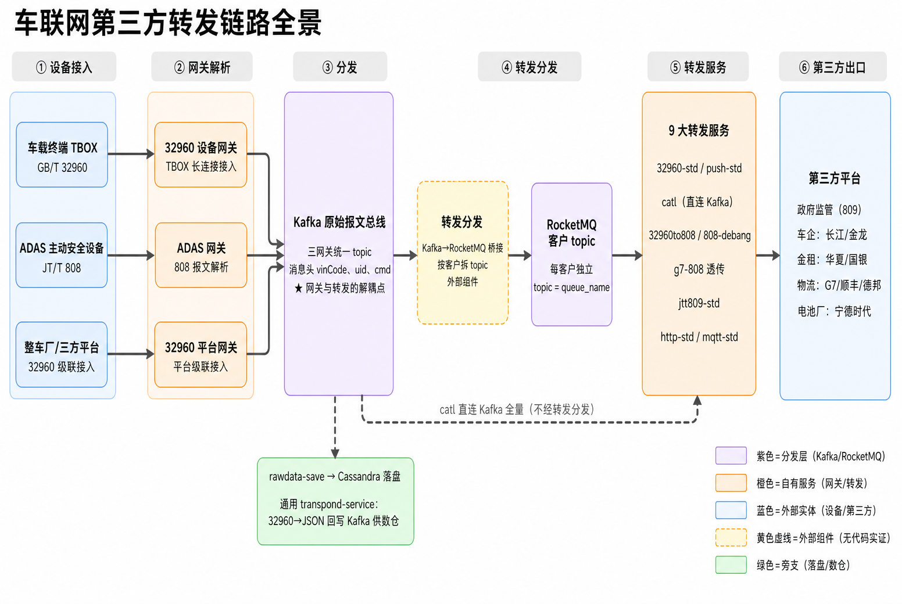
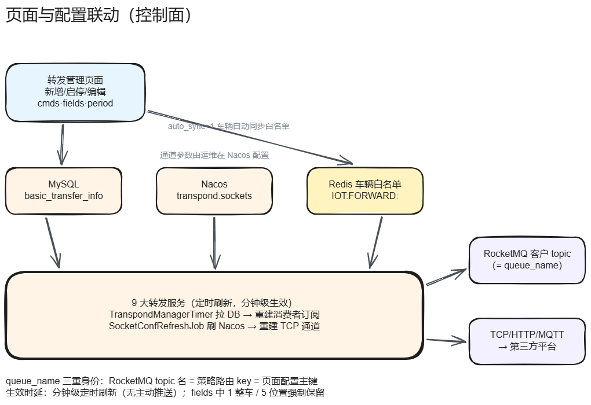
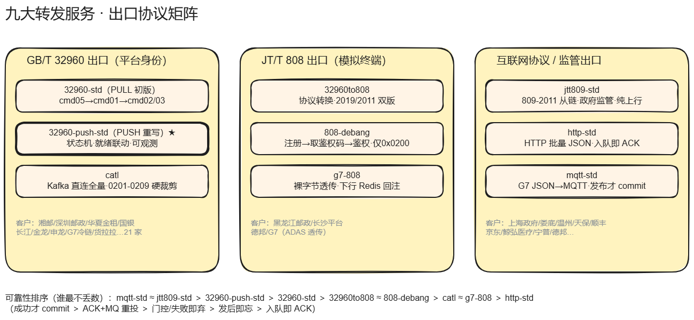

<div class="callout callout-note" markdown="1">
**📝 定位与边界**

本文是**全景梳理**：打通 设备 → 网关 → 分发（Kafka 总线） → 转发分发（数据中台） → 9 个转发服务 → 第三方平台 的完整链路，并梳理页面/配置如何联动。
全部结论来自 `D:\code\vds-new` 下 22 个仓库的代码实证（类名/文件路径可回溯）；三篇飞书设计文档需登录无法直接读取，作为权威参考挂在文末。
单服务的深度设计见既有文档：[32960标准转发服务 — 设计文档](/2026/08/03/gb32960-forward-service-design/)、[32960标准转发服务（Push版） — 设计文档](/2026/08/10/gb32960-push-service-design/)、**32960 转发服务（transpond-service）优化改造设计文档 —— Push 模式 + 线程托管 RocketMQ**。
</div>

---

## 一、链路全景（一图看懂）



端到端数据流（自左向右）：

| 阶段     | 节点                            | 干什么                                                                      | 关键证据                                                                                    |
| ------ | ----------------------------- | ------------------------------------------------------------------------ | --------------------------------------------------------------------------------------- |
| ① 接入   | 车载终端 TBOX                     | GB/T 32960 国标协议，TCP 长连接（Netty）                                           | `32960-gateway-service` 的 `NioServer`/`TboxChannelInitializer`                          |
| ① 接入   | ADAS 主动安全设备                   | JT/T 808（2013/2019 按报文位自动识别）                                             | `adas-gateway-service` 的 `AnalysisJtt808Handler`                                        |
| ① 接入   | 整车厂/第三方平台                     | GB/T 32960 平台级联（cmd05 平台登入，虚拟线程高吞吐）                                      | `platform-gateway-service` 的 `AnalysisPlatformHandler`                                  |
| ② 网关   | 三大网关                          | 解析报文 → 消息头补 `vinCode`/`uid`/`platformVinCode`/`cmd`                      | 各自的 `KafkaHeadConstants`                                                                |
| ③ 分发   | **Kafka 原始报文 topic**          | 三网关统一生产到同一配置键 `${spring.kafka.producer.topic}`——**这是网关层与转发链路的解耦点**       | `AnalysisTboxHandler.java:43` 等                                                         |
| ④ 转发分发 | **数据中台（外部组件）**                | Kafka → RocketMQ 桥接，**按客户拆 topic**（`queue_name`），客户维度在此注入；桥的是**原始二进制报文** | ⚠️ 桥接代码不在 vds-new 工作区；下游实证 `TranspondMessageListener.java:113` 直接 `getBody()` 取 32960 帧 |
| ④ 转发分发 | RocketMQ 客户 topic             | 每客户独立 topic（=`basic_transfer_info.queue_name`），消息属性带 `vinCode`/`uid`     | `TranspondConsumerRegistry` 等                                                           |
| ⑤ 转发   | 9 大转发服务                       | 消费客户 topic，按配置过滤后推第三方                                                    | `TranspondConsumerRegistry` 等                                                           |
| ⑥ 出口   | 第三方平台                         | 政府/物流/金租/车企/电池厂，协议各异                                                     | 见第三节矩阵                                                                                  |
| 旁支     | rawdata-save                  | 原始报文落盘 Cassandra（周分区）+ Redis（**没有再写了**）                                  | `TboxMessageListener`/`AdasMessageListener`                                             |
| 旁支     | dst-iot-transpond-service（通用） | 32960 二进制帧 → 字段 ID 化 JSON，**回写 Kafka 供数仓，不在转发主链上**                       | `MessageListener` → `HandlerData.send(${kafka.topic})`                                  |
| 特例     | catl 转发服务                     | 直连 Kafka 全量消费（不经中台 RocketMQ）                                             | topic=`dst-iot-transpond-catl-topic`                                                    |

<div class="callout callout-tip" markdown="1">
**💡 两级解耦的架构含义**

网关侧只知道 Kafka，不知道"客户/转发"；客户维度是数据中台在第二级注入的（客户级 topic + SocketConf）。正因为这个解耦，转发服务才能按客户×协议无限裂变出 9 个变体而网关零改动。特例：**CATL 服务直接消费 Kafka 全量 TBOX topic**（不走中台 RocketMQ），所以它叫"全量转发"。
</div>

---

## 二、节点间怎么联动 + 页面怎么联动



### 2.1 数据面联动（服务之间）

| 上游 | 下游 | 载体 | 约定 |
|---|---|---|---|
| 设备/平台/ADAS 网关 | Kafka | 原始 32960/808 二进制帧 | 消息头带 `vinCode`、`uid`、`platformVinCode`、`recvTime` |
| Kafka | 数据中台 | 同上 | 中台按转发配置拆客户 topic（外部组件，无代码实证） |
| 数据中台 | 各转发服务 | RocketMQ，topic = `queue_name` | 消息属性带 `vinCode`/`uid`，用于白名单过滤 |
| 转发服务 | 第三方平台 | TCP/HTTP/MQTT | 按客户 SocketConf 的 host/port/通道数 |
| g7-808（下行） | 设备网关 | **Redis 设备注册表 + HTTP 回注** | G7 下发指令 → `PushService` 查 `RedisConstants.getLoginKey(mobile)` 找到设备所在网关 ip:port → POST 回注。共享出口通道无法回程路由的标准解法 |

### 2.2 控制面联动（页面 → 配置 → 服务）

转发链路的"运营三件套"分布在三个存储，一致性靠**定时刷新**维持：

| 存储                                                           | 内容                                                                                                                                        | 谁写                                      | 谁读、多久读一次                                                                          |
| ------------------------------------------------------------ | ----------------------------------------------------------------------------------------------------------------------------------------- | --------------------------------------- | --------------------------------------------------------------------------------- |
| **MySQL `basic_transfer_info`**                              | 转发主配置：`queue_name`（=topic）、`is_enable`、`customer_type`、`auto_sync`、`protocol_version`、`data_source`、`period`、`cmds`、`fields`、`delay_time` | **管理页面**（新增/编辑/启停转发通道）                  | 转发服务 `TranspondFilterCacheManager` 缓存 + `TranspondManagerTimer` 定时刷新（约 3 分钟 cron） |
| **Nacos `transpond.sockets` / `http.<客户>` / `mqtt.clients`** | 每客户通道参数：host/port/topic/通道数/拉取间隔/是否需要 ACK                                                                                                 | 运维/开发手工（页面不管通道地址）                       | `SocketConfRefreshJob` 定时刷新 + 快照 equals 对比 → 消费者/Netty 通道热重建；`@RefreshScope` 热更新  |
| **Redis `IOT:FORWARD:MANAGER:`**                             | 每客户转发车辆 VIN 白名单                                                                                                                           | 页面车辆管理（`auto_sync=1` 时客户车辆增减自动同步进/出白名单） | 转发服务消费每条消息时 O(1) 校验 `containsVin`                                                 |

**页面上配一个新转发，背后发生的完整时序**：

1. 页面选择协议版本（`protocol_version`）→ 系统生成 `queue_name`（命名规律 `dst_transpond-<协议>-std-<客户拼音>_topic`）
2. 配置过滤参数：`cmds`（转发哪些指令：1 登入/2 实时/3 补发/4 登出）、`fields`（转发哪些数据块：1 整车/2 驱动电机/…/9 温度探针/10-12 地上铁自定义；**1 整车与 5 位置为强制保留**）、`period`（降频周期 ms，如国银 600000=10 分钟一条）
3. `is_enable=1` 启用；`auto_sync=1` 则把该客户绑定车辆全量写入 Redis 白名单
4. 运维在 Nacos 补 SocketConf（第三方 host/port、通道数、鉴权账号）
5. 转发服务下个刷新周期：重建 RocketMQ 消费者订阅新 topic → 建立 TCP 通道 → 按平台登入(cmd05)/终端注册鉴权(808) 流程连上第三方 → 开始转发

<div class="callout callout-warning" markdown="1">
**⚠️ 已知联动缺口**

- 页面改 `is_enable` 生效依赖定时刷新（分钟级：配置3分钟），无主动推送；
</div>

---

## 三、九大转发服务矩阵



### 3.1 总表（git 地址 + 核心差异）

所有仓库位于 `gitlab.dstcar.com`，除 g7-808 与通用 transpond-service 外均在 `FlyBees/vds/Device-connectivity-management-platform/migrate-to-szidc/` 组下。

| # | 服务 | Git 地址（组内路径） | 出口协议 | 消费 | 鉴权方式 | ACK 语义 | 一句话定位 |
|---|---|---|---|---|---|---|---|
| 1 | **32960-std** | `…/dst-iot-transpond-32960-std-service.git` | GB32960 TCP（客户端） | RocketMQ 自研 PULL | cmd05 平台登入 | 5s 过期回调→MQ 重投 | 标准国标转发初版 |
| 2 | **32960-push-std** | `…/dst-iot-transpond-32960-push-std-service.git` | 同上 | RocketMQ 框架 PUSH | 同上 | EventLoop 串行 FIFO 队列 | 初版的系统性重写（见第四节） |
| 3 | **catl** | `…/dst-iot-transpond-catl-service.git` | GB32960 TCP（**非 808**） | **Kafka 直连全量** | cmd05 平台登入 | 发后即忘 | 宁德时代"全量"转发：硬编码国标 0201-0209 裁剪 |
| 4 | **32960to808** | `…/dst-iot-transpond-32960to808-service.git` | JT/T808 **2019/2011 双版** | RocketMQ 多客户 topic（DB 驱动） | 0x0100+0x0102 乐观登录 | 应答仅做放行门控 | 协议转换器：32960→808 重组（含状态位反转） |
| 5 | **808-debang** | `…/dst-iot-transpond-808-debang-service.git` | JT/T808-2019 | RocketMQ LitePull | 0x0100 注册→0x8100 取鉴权码→0x0102 鉴权（严格状态机） | 3s 应答超时→关通道 | 最完整终端模拟，仅发 0x0200 |
| 6 | **g7-808** | `FlyBees/vds/Device-connectivity-management-platform/dst-iot-transpond-g7-808-service.git` | JT/T808 **裸字节透传** | RocketMQ ORDERLY | 不登录（报文含身份） | 发后即忘 | 零解析透传 + 下行指令 Redis 注册表 HTTP 回注 |
| 7 | **jtt809-std** | `…/dst-iot-transpond-jtt809-std-service.git` | JT/T809-**2011** 从链 TCP | RocketMQ LitePull | 0x1001 GBK 明文登录 | 发送成功才 commit | 纯上行 0x1200/0x1202 报政府监管，不加密 |
| 8 | **http-std** | `…/dst-iot-transpond-http-std-service.git` | HTTP POST JSON（批量攒批） | RocketMQ Push | 无签名 | **入队即 ACK**（丢数窗口） | 通用 HTTP 推送（京东/德邦/医疗等） |
| 9 | **mqtt-std** | `…/dst-iot-transpond-mqtt-std-service.git` | MQTT Publish（Paho 客户端池） | RocketMQ LitePull | broker 账号密码 | **发布成功才 commit** | G7 JSON→客户私有 broker，可靠性语义最正确 |

> 另有 `dst-iot-transpond-ndsd-service` 本地为空仓库（仅 .idea，无源码无 remote），配 35 号"宁德时代平台"配置行，待确认归属。

### 3.2 三种架构范式

9 个服务本质是三种范式的组合，**对接成本取决于"对方平台要什么"，而不是"我们有什么"**：

| 范式 | 代表 | 特点 |
|---|---|---|
| 国标直转发器 | 32960-std / push-std / catl | 32960 进、32960 出，只做字段裁剪，协议语义零转换 |
| 协议转换器 | 32960to808 / 808-debang | 内部 32960 模型 → 重组 808 报文（帧头/状态位/附加项逐字节重建） |
| 协议透传器 | g7-808 | 字节原样搬运，上游网关已组好 808 帧，服务不解析 |
| （推模式转换） | http-std / mqtt-std / jtt809-std | 32960 解析后按目标协议编码（JSON / MQTT / 809 二进制） |

### 3.3 可靠性分级（谁最不容易丢数）

```
mqtt-std ≈ jtt809-std > 32960-push-std > 32960-std > 32960to808 ≈ debang > catl ≈ g7-808 > http-std
（发布/发送成功才 commit）  （ACK+MQ重投）      （3s门控/放行门控）   （发后即忘）   （入队即ACK）
```

---

## 四、为什么有这么多转发服务

### 4.1 根因一：协议 × 客户 的矩阵

第三方平台各要各的协议，交叉出转发矩阵：

- **国标系**（GB/T 32960）：车企（贵州长江/申龙/厦门金龙）、金租（华夏/国银）、邮政（湘邮/深圳邮政）——数据走"平台间转发"，cmd05→cmd01→cmd02/03
- **部标 808 系**（模拟终端身份）：黑龙江邮政、长沙平台（32960→808 转换）、德邦（完整注册鉴权状态机）、G7（ADAS 原始报文透传）
- **部标 809 系**（企业从链→政府主链）：上海政府、娄底、温州绿配、天保、顺丰——监管合规上报，纯上行
- **互联网协议系**：HTTP（京东/德邦/鲸弘医疗/宁普/太原绿配/运荔枝）、MQTT（G7 物流平台）
- **专有通道**：CATL 宁德时代（直连 Kafka 全量消费 + 32960 出）

同一协议多客户 → **共用代码库 + 配置路由**（32960-std 内 4 个客户策略 bean，目前全是空壳钩子）；不同协议 → **独立仓库**（debang 用 808 必须与 32960-std 分仓）。9 个仓库共享同一套代码生成骨架（`Wrapper32960` 在 9 个仓库各有一份拷贝、`TranspondFilter/ChannelService/SuperPullConsumer` 同名同构），新客户接入 ≈ 复制骨架 + 换协议适配器 + 配 Nacos/DB。

### 4.2 根因二：升级演进（std → push-std）

**`dst-iot-transpond-32960-std-service` 升级为 `dst-iot-transpond-32960-push-std-service`**，不是业务变化，是**消费模式的系统性架构重写**——"push" 指 MQ 消费从 PULL 改为 PUSH（出口方向本来就是主动推送，没变）。六个维度的重写（详细设计见 [32960标准转发服务（Push版） — 设计文档](/2026/08/10/gb32960-push-service-design/)）：

| 维度 | std（初版） | push-std（重写版） |
|---|---|---|
| MQ 消费 | 自研 `SuperPullConsumer` 拉取循环 + 自管 offset | `DefaultMQPushConsumer` 框架托管（Javadoc 自述"替代旧 SuperPullConsumer"） |
| 连接生命周期 | while+sleep 轮询重连 | CAS 状态机 `IDLE→CONNECTING→LOGGING_IN→READY` + 指数退避加抖动 |
| **就绪联动** | 对端断连仍无效拉取→失败重试 | 通道全不 READY 时 `consumer.suspend()`，恢复 `resume()`——从源头暂停 |
| 通道选择 | 随机 | `ChannelGroup.acquireReady()` READY 轮询游标 |
| ACK 配对 | `ExpiringConcurrentLinkedQueue`（并发序错位缺陷） | EventLoop 内入队+写出串行化，FIFO 队首完成语义 |
| 可观测性 | 无 | 6 个 Micrometer 指标 + MDC + 日志采样 + Prometheus 端点 |

其余转发服务族同理按需演进：如 catl 保持"专版定制裁剪"路线，g7-808 保持"透传最简"路线——**不是所有服务都需要 push 化，只有客户量大、通道多的 32960 标准系值得**。

---

## 五、客户清单（basic_transfer_info 38 条全景）

### 5.1 按服务分组

**GB32960 标准转发系（32960-std / push-std，protocol_version=0）— 21 条**

| ID | 客户 | queue 标识 | 状态 | 周期(ms) | cmds | customer_type |
|---|---|---|---|---|---|---|
| 1 | 湘邮数据转发 | xy | ✅启用 | 20000 | 2 | 3 |
| 2 | 武汉地上铁 | whdst | ✅启用 | 10000 | 2,3 | 0 |
| 3 | 华夏金租 | hxjz | ✅启用 | 30000 | 2 | 1 |
| 4 | 武汉新创 | whxc | ✅启用 | 10000 | 2,3 | 0 |
| 5 | 合肥数据转发 | hefei | ⛔停用 | — | 2,3 | 0 |
| 6 | 贵州长江 | gzchangjiang | ✅启用 | 10000 | 2,1,3,4 | 2 |
| 7 | 申龙 | shenlong | ⛔停用 | 10000 | 2,3 | 2 |
| 8 | 厦门金龙 | xmjl | ✅启用 | 30000 | 2,3 | 2 |
| 9 | 国银 | gy | ✅启用 | **600000**（10min 降频） | 2,3 | 1 |
| 10 | 【测试】客户车辆自动同步 | test | ⛔停用 | — | 2,1,3,4 | 3 |
| 11 | G7 冷链 | g7 | ✅启用 | 10000 | 2,3 | 4 |
| 12 | 深圳邮政 | szyz | ✅启用 | 10000 | 2 | 3 |
| 18 | 顺丰国标 | sfgb | ✅启用 | 60000 | 2,3 | 4 |
| 19 | 货拉拉 | huolala | ✅启用 | 30000 | 2,3 | 4 |
| 20 | 苏州运管 | szyg | ⛔停用 | 10000 | 2,3 | 0 |
| 21 | 北京交委 | bjjw | ⛔停用 | 10000 | 2,3 | 0 |
| 22 | 马帮数据转发 | mabang | ✅启用 | 10000 | 2,3 | 4 |
| 24 | 时代新安 | shidaixinan | ✅启用 | 10000 | 2,3 | 4 |
| 35 | 宁德时代平台 | ndsd | ⛔停用 | 10000 | 2,3 | 4 |
| 36 | 新兴科技 | xxt | ✅启用 | 10000 | 2,3 | 1 |
| 38 | 太原绿配 TCP | taiyuanlvpei | ✅启用 | 10000 | 2,3 | 4 |

**32960→808 转换系（32960to808）— 2 条**

| ID | 客户 | queue 标识 | 状态 | protocol_version | customer_type |
|---|---|---|---|---|---|
| 17 | 黑龙江邮政 | heilongjiang | ✅启用 | 11 | 0 |
| 34 | 长沙数据转发 | changsha | ✅启用 | 10 | 4 |

**JT/T809 监管系（jtt809-std，protocol_version=80）— 5 条**

| ID | 客户 | queue 标识 | 状态 | customer_type |
|---|---|---|---|---|
| 15 | 顺丰 | sf | ✅启用 | 4 |
| 16 | 上海政府平台 | shanghai | ✅启用 | 0 |
| 31 | 娄底平台 | loudi | ✅启用 | 0 |
| 32 | 温州绿配平台 | wenzhou | ✅启用 | 0 |
| 33 | 天保平台 | tianbao | ✅启用 | 1 |

**HTTP 系（http-std，protocol_version=90）— 7 条**

| ID  | 客户           | queue 标识         | 状态  | data_source | 备注                     |
| --- | ------------ | ---------------- | --- | ----------- | ---------------------- |
| 23  | 德邦数据转发       | deppon           | ⛔停用 | 0(TBOX)     |                        |
| 25  | 京东主动安全       | adas-http-std-jd | ✅启用 | **1(ADAS)** | delay_time=15000（延迟转发） |
| 26  | 京东 TBOX 数据推送 | jd               | ✅启用 | 0           | auto_sync=1            |
| 27  | 鲸弘医疗         | jhyl             | ✅启用 | 0           |                        |
| 28  | 宁普           | np               | ✅启用 | 0           |                        |
| 29  | 太原绿配平台       | tylp             | ⛔停用 | 0           |                        |
| 30  | 运荔枝-鲜生活      | ylz              | ⛔停用 | 0           |                        |

**MQTT 系（mqtt-std，protocol_version=70）— 1 条**：ID 14 G7-MQTT ✅启用
**ADAS 透传（g7-808）— 1 条**：ID 13 主动安全设备转发 G7 平台 ✅启用（data_source=1，topic=`adas-transpond-g7-prod`）
**CATL 全量（Kafka 直连）— 1 条**：ID 37 宁德时代全量数据转发 ⛔停用（topic=`dst-iot-transpond-catl-topic`）

**统计**：38 条配置，启用 27 / 停用 11；覆盖 32960 国标 21 家、808 系 3 家、809 监管 5 家、HTTP 7 家、MQTT 1 家、ADAS 透传 1 家。

### 5.2 customer_type 语义（数据分布推断，待与管理服务代码核实）

| 值 | 推断语义 | 数据佐证 |
|---|---|---|
| 0 | 政府/监管/区域平台 | 上海政府、苏州运管、北京交委、娄底、温州绿配、武汉两家属地公司 |
| 1 | 金融租赁 | 华夏金租、国银、天保、新兴科技 |
| 2 | 整车厂 | 贵州长江、申龙、厦门金龙 |
| 3 | 邮政/甲方系统 | 湘邮、深圳邮政、京东 TBOX |
| 4 | 物流/企业客户 | G7、顺丰、货拉拉、德邦、马帮、时代新安、宁德时代等 19 家 |

---

## 六、常见问题排查

<div class="callout callout-tip" markdown="1">
**💡 总思路：沿链路逐段二分定位**

「第三方没收到数据」不要直接盯转发服务——先确认数据走到哪一段断了：设备 → 网关 → Kafka → 中台/RocketMQ → 转发服务 → 第三方。每段都有明确的"有没有"判据。
</div>

### 6.1 逐段定位表

| 段位 | 判据（数据到了没） | 没到怎么办 |
|---|---|---|
| ① 设备 | TBOX/ADAS 在线、有上报 | 查设备 SIM/网络；平台级联数据查对端 cmd05 平台登入 |
| ② 网关 | 网关日志有解析记录、无解析异常 | 查 Netty 通道；808 靠报文位自动识别 2013/2019，异常帧看 `AnalysisJtt808Handler` |
| ③ Kafka | 原始报文 topic 有对应 VIN 的消息 | 查网关生产配置 `${spring.kafka.producer.topic}` 与 Kafka 集群可用性 |
| ④ 中台→RocketMQ | 客户 topic（=`queue_name`）有消息 | **有堆积**=下游转发慢/停；**无消息**=中台桥未拆该客户 topic（外部组件，找中台侧确认） |
| ⑤ 转发服务 | 服务日志/指标有消费记录 | 见 6.2 高频问题速查 |
| ⑥ 第三方 | 对端平台确认接收/应答 | 查对端鉴权账号与接收能力、协议字段映射 |

### 6.2 高频问题速查

| 现象 | 最可能原因 | 排查与解决 |
|---|---|---|
| 页面新配转发不生效 | 配置靠定时刷新（`TranspondManagerTimer` 约 3 分钟 cron）；或 Nacos 未补 SocketConf | 等一个刷新周期；确认 `is_enable=1`；确认 Nacos 已配该客户 host/port/通道数/鉴权账号 |
| 某辆车数据没转发 | Redis 白名单 `IOT:FORWARD:MANAGER:` 无该 VIN | 查 `containsVin`；`auto_sync=1` 时检查客户车辆绑定是否已同步进白名单 |
| 自有车双链路数据被误滤 | `isFilterPlatformData=true` 且 vin==uid 被视作平台转发数据跳过 | 日志关键字「过滤平台转发数据」（`TranspondMessageListener`）；确认是否应关过滤 |
| 数据"延迟大" | `period` 降频（如国银 600000=10min/条）；http-std `delay_time`（京东 ADAS=15000ms） | **先核对配置再判故障**——降频是设计行为不是丢数 |
| 疑似丢数 | 各服务 ACK 语义差异大：http-std **入队即 ACK** 有丢数窗口；catl/g7 发后即忘 | 对照 3.3 可靠性分级；关键客户优先 mqtt-std / jtt809-std / push-std |
| 数据重复 | MQ 重投：std 5s 过期回调重投；push-std 无 READY 通道时 RECONSUME_LATER | 对端按 VIN+时间戳判重；看 `transpond_forward_total{result="retry"}` |
| push-std 不消费但进程正常 | 通道全不 READY 触发 `consumer.suspend()` 从源头暂停（`TranspondConsumerRegistry`） | 看日志 `not-ready:<topic>`；查 `transpond_channel_state` 是否全 ≠3(READY)；通道恢复后自动 resume |
| 通道反复断连/登不上 | 对端鉴权失败：32960 cmd05 / 808 0x0100→0x8100→0x0102 / 809 0x1001 | 查 `transpond_login_failures_total`；核对 Nacos 鉴权配置；debang 3s 应答超时主动关通道属预期 |
| 数据乱序 | std 初版 `ExpiringConcurrentLinkedQueue` 并发序错位；TBOX 离线补发（cmd03）天然乱序 | push-std EventLoop 串行 FIFO 已修前者；补发乱序属协议行为，对端按时间戳排序 |
| 字段缺失/被裁剪 | `fields` 配置裁剪（1 整车、5 位置强制保留） | 核对 `basic_transfer_info.fields`；32960to808 另注意状态位反转重组 |
| catl 全量转发异常 | **不经中台**，直连 Kafka 全量 topic | 排查路径不同：直接查 Kafka `dst-iot-transpond-catl-topic` 消费位点，别去查 RocketMQ |

### 6.3 可观测性入口（push-std 最全）

| 入口 | 内容 |
|---|---|
| Prometheus 指标 | `transpond_forward_total{topic,result=success/skip/retry}`、`transpond_channel_state{topic,ch}`（0 IDLE→3 READY）、`transpond_login_failures_total`、`transpond_pending_ack`、`transpond_rejected_total` |
| 日志关键字 | `no-transfer-info:`（缓存中无该 topic 转发配置）、`not-ready:`（无 READY 通道）、`过滤平台转发数据`；`LogSampler` 采样防刷屏 |
| 配置三件套 | MySQL `basic_transfer_info`（页面写，~3 分钟刷新）/ Nacos SocketConf（手工，`SocketConfRefreshJob` 快照比对热重建）/ Redis 白名单（`auto_sync` 即时同步） |

<div class="callout callout-warning" markdown="1">
**⚠️ 一致性缺口**

三处配置无事务一致性：页面改配置分钟级生效、Nacos 改通道靠快照比对热重建、Redis 白名单 auto_sync 即时。排障时先确认**三处是否一致**，再怀疑代码。
</div>

---

## 七、参考文档

**外部设计文档（飞书，需登录）**
- 网关设计：https://s25l93mljl.feishu.cn/wiki/XUw8wiEPiiCCkvkpm17cMcTNn0b
- 分发服务设计：https://s25l93mljl.feishu.cn/wiki/ZFPowD6CliE2kbk6bD0cMYwtnoc
- 转发分发设计：https://s25l93mljl.feishu.cn/wiki/JGl4wnQXgiPokXk2MzIc0KKwnte

**库内关联文档**
- 深度设计：[32960标准转发服务 — 设计文档](/2026/08/03/gb32960-forward-service-design/) · [32960标准转发服务（Push版） — 设计文档](/2026/08/10/gb32960-push-service-design/) · **32960 转发服务（transpond-service）优化改造设计文档 —— Push 模式 + 线程托管 RocketMQ**
- 历史资料：[32960三方数据转发](/2026/05/20/gb32960-third-party-forward/) · **32960三方数据分发** · **32960数据分发逻辑梳理**
- 网关侧：**32960设备网关** · **32960平台网关** · **主动安全设备网关** · [IoT网关设计文档](/2026/05/20/iot-gateway-design/)
- 入口：**物联网** · **项目总览**

**代码仓库（GitLab，组路径 `FlyBees/vds/Device-connectivity-management-platform/`，`migrate-to-szidc/` 子组）**
转发九服务 git 地址见 3.1 节总表；网关侧：`dst-iot-32960-gateway-service` / `dst-iot-32960-platform-gateway-service` / `dst-iot-adas-gateway-service` / `dst-iot-rawdata-save-service` / 通用 `dst-iot-transpond-service`（均在 `migrate-to-szidc/` 子组）。
