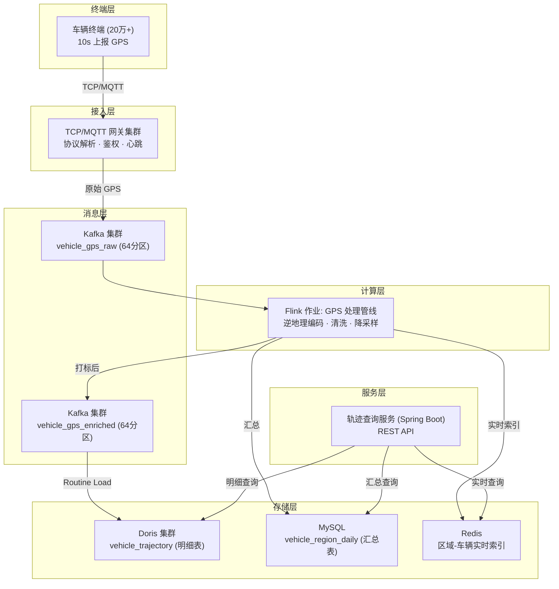
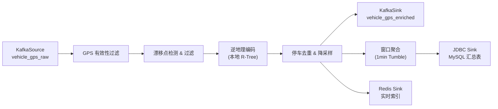
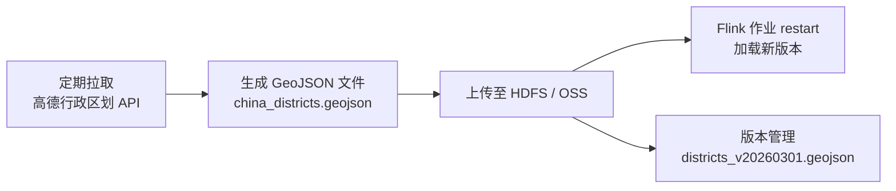

## 1. 项目背景与目标

### 1.1 业务背景

车联网平台管理 **20万+** 车辆终端，每辆车按 **10秒** 间隔上报 GPS 定位数据，高峰期同时在线车辆达 **12万辆**。业务需要支持按 **行政区域（省/市/区县）** 查询一批车辆在指定时间段内的行驶轨迹。

### 1.2 核心指标

| 指标 | 数值 | 终端总量 | 20万+ |
| --- | --- | --- | --- |
| 上报频率 | 10秒/条 | 高峰在线 | ~12万辆 |
| 高峰写入 TPS | ~12,000 条/s | 日均在线（估算） | ~8万辆 |
| 日均数据量 | ~6.9 亿条/天 | 单条原始大小 | ~250 Bytes |
| 日增原始存储 | ~160 GB/天 | 月增存储（压缩前） | ~5 TB/月 |

### 1.3 设计目标

- [ ] 支持按省/市/区 + 时间段 + 车辆列表查询行驶轨迹
- [ ] 支持查询某区域内出现过的车辆列表
- [ ] 轨迹明细查询 P99 延迟 < 3s（单车单天），批量查询 < 10s
- [ ] 数据从上报到可查延迟 < 30s
- [ ] 热数据保留 90 天，冷数据归档保留 1 年+
- [ ] 系统可水平扩展，支撑未来 50万+ 终端

---

## 2. 整体架构

### 2.1 架构总览



### 2.2 数据流全景

```javascript
车辆终端 → TCP网关 → Kafka(raw) → Flink → Kafka(enriched) → Doris(明细)
                                       │
                                       ├──→ MySQL(日汇总)
                                       └──→ Redis(实时索引)
```

---

## 3. 数据模型设计

### 3.1 Kafka 消息格式

**原始 Topic:** `vehicle_gps_raw`

```json
{
  "vehicleId": "粤B12345",
  "vin": "LSVAU2A3XEN123456",
  "lng": 114.057868,
  "lat": 22.543099,
  "speed": 65.5,
  "direction": 180,
  "altitude": 35.2,
  "mileage": 125680.5,
  "reportTime": "2026-03-26T17:30:00+08:00",
  "gpsValid": true,
  "signalType": "GPS"
}
```

**打标后 Topic:** `vehicle_gps_enriched`

```json
{
  "vehicleId": "粤B12345",
  "vin": "LSVAU2A3XEN123456",
  "lng": 114.057868,
  "lat": 22.543099,
  "speed": 65.5,
  "direction": 180,
  "altitude": 35.2,
  "mileage": 125680.5,
  "reportTime": "2026-03-26T17:30:00",
  "reportDate": "2026-03-26",
  "provinceCode": "440000",
  "province": "广东省",
  "cityCode": "440300",
  "city": "深圳市",
  "districtCode": "440305",
  "district": "南山区",
  "filtered": false,
  "sampled": true
}
```

### 3.2 Doris 明细表: `vehicle_trajectory`

```sql
CREATE TABLE vehicle_trajectory (
    -- ========== 分区 & 排序键 ==========
    report_date      DATE            NOT NULL  COMMENT '上报日期（分区键）',
    vehicle_id       VARCHAR(32)     NOT NULL  COMMENT '车辆标识',
    report_time      DATETIME        NOT NULL  COMMENT '上报时间（精确到秒）',

    -- ========== 位置信息 ==========
    lng              DOUBLE          NOT NULL  COMMENT '经度 WGS84',
    lat              DOUBLE          NOT NULL  COMMENT '纬度 WGS84',
    speed            FLOAT           NULL      COMMENT '瞬时速度 km/h',
    direction        SMALLINT        NULL      COMMENT '方向角 0-359',
    altitude         FLOAT           NULL      COMMENT '海拔 m',
    mileage          DOUBLE          NULL      COMMENT '累计里程 km',

    -- ========== 行政区划 ==========
    province_code    VARCHAR(6)      NOT NULL  COMMENT '省编码',
    province         VARCHAR(20)     NOT NULL  COMMENT '省名称',
    city_code        VARCHAR(6)      NOT NULL  COMMENT '市编码',
    city             VARCHAR(20)     NOT NULL  COMMENT '市名称',
    district_code    VARCHAR(6)      NULL      COMMENT '区县编码',
    district         VARCHAR(20)     NULL      COMMENT '区县名称',

    -- ========== 扩展字段 ==========
    vin              VARCHAR(20)     NULL      COMMENT '车架号'
)
ENGINE = OLAP
DUPLICATE KEY(report_date, vehicle_id, report_time)
PARTITION BY RANGE(report_date) ()
DISTRIBUTED BY HASH(vehicle_id) BUCKETS 32
PROPERTIES (
    "replication_num" = "3",

    -- 动态分区
    "dynamic_partition.enable" = "true",
    "dynamic_partition.time_unit" = "DAY",
    "dynamic_partition.start" = "-90",
    "dynamic_partition.end" = "3",
    "dynamic_partition.prefix" = "p",
    "dynamic_partition.buckets" = "32",

    -- 索引优化
    "bloom_filter_columns" = "vehicle_id, province_code, city_code, district_code",

    -- 存储
    "storage_medium" = "SSD",
    "storage_cooldown_time" = "2592000",
    "compression" = "ZSTD"
);
```

**设计要点：**

| 设计决策 | 理由 |
| --- | --- |
| 分区键 `report_date` | 时间范围查询直接裁剪分区，大幅减少扫描量 |
| Bloom Filter | `vehicle_id` / 区域编码加 BF，点查时快速跳过无关数据页 |
| 动态分区 90 天 | 自动创建/回收分区，无需人工维护 |

### 3.3 MySQL 汇总表: `vehicle_region_daily`

```sql
CREATE TABLE vehicle_region_daily (
    id             BIGINT AUTO_INCREMENT PRIMARY KEY,
    vehicle_id     VARCHAR(32)     NOT NULL  COMMENT '车辆标识',
    stat_date      DATE            NOT NULL  COMMENT '统计日期',
    province_code  VARCHAR(6)      NOT NULL  COMMENT '省编码',
    province       VARCHAR(20)     NOT NULL  COMMENT '省',
    city_code      VARCHAR(6)      NOT NULL  COMMENT '市编码',
    city           VARCHAR(20)     NOT NULL  COMMENT '市',
    district_code  VARCHAR(6)      NULL      COMMENT '区县编码',
    district       VARCHAR(20)     NULL      COMMENT '区县',
    point_count    INT             NOT NULL  COMMENT '轨迹点数',
    first_time     DATETIME        NOT NULL  COMMENT '首次出现时间',
    last_time      DATETIME        NOT NULL  COMMENT '最后出现时间',
    enter_lng      DOUBLE          NULL      COMMENT '进入区域经度',
    enter_lat      DOUBLE          NULL      COMMENT '进入区域纬度',
    exit_lng       DOUBLE          NULL      COMMENT '离开区域经度',
    exit_lat       DOUBLE          NULL      COMMENT '离开区域纬度',
    created_at     DATETIME        DEFAULT CURRENT_TIMESTAMP,
    updated_at     DATETIME        DEFAULT CURRENT_TIMESTAMP ON UPDATE CURRENT_TIMESTAMP,

    UNIQUE KEY uk_vehicle_date_region (vehicle_id, stat_date, province_code, city_code, district_code),
    INDEX idx_region_date (province_code, city_code, district_code, stat_date),
    INDEX idx_date (stat_date)
) ENGINE=InnoDB DEFAULT CHARSET=utf8mb4
PARTITION BY RANGE (TO_DAYS(stat_date)) (
    -- 按月分区，脚本自动维护
);
```

**数据量估算**：20万车 × 平均 3~5 个区/天 ≈ **60~100 万行/天**，MySQL 分区表完全可以承载。

### 3.4 Redis 实时索引（可选）

用于回答"某区域当前有哪些车"的实时查询：

```bash
# Key 结构
region:online:{provinceCode}:{cityCode}:{districtCode}

# Value: Sorted Set, score = 最新上报时间戳
ZADD region:online:440000:440300:440305 1711446600 "粤B12345"

# 查询深圳南山区当前在线车辆
ZRANGEBYSCORE region:online:440000:440300:440305 {now-300} +inf

# TTL: 每个 key 设置 10min 过期，Flink 持续续期
```

---

## 4. Flink 作业详细设计

### 4.1 作业拓扑



### 4.2 资源规划

| 参数 | 值 | 说明 | 并行度 | 8 | 12K TPS / 8 = 1500 条/s/slot，很轻松 |
| --- | --- | --- | --- | --- | --- |
| TaskManager | 4 台 | 每台 2 slot | 单 TM 内存 | 8 GB | R-Tree 索引约 500MB + 状态 + 缓冲 |
| Checkpoint 间隔 | 60s | exactly-once 语义 | State Backend | RocksDB | 支持大状态（停车去重用 KeyedState） |

### 4.3 核心处理逻辑

```java
public class GpsValidFilter implements FilterFunction<GpsEvent> {
    @Override
    public boolean filter(GpsEvent gps) {
        // 1. GPS 信号有效标志
        if (!gps.isGpsValid()) return false;

        // 2. 经纬度范围检查（中国境内）
        if (gps.getLng() < 73.0 || gps.getLng() > 136.0) return false;
        if (gps.getLat() < 3.0 || gps.getLat() > 54.0) return false;

        // 3. 时间合理性（不超过未来5分钟，不早于2020年）
        long now = System.currentTimeMillis();
        long reportMs = gps.getReportTime().toEpochMilli();
        if (reportMs > now + 300_000 || reportMs < 1577808000000L) return false;

        return true;
    }
}
```

```java
public class DriftDetector extends KeyedProcessFunction<String, GpsEvent, GpsEvent> {
    // 按 vehicleId 分组，维护上一个有效点
    private ValueState<GpsEvent> lastValidState;

    private static final double MAX_SPEED_MPS = 55.56; // 200km/h → m/s

    @Override
    public void processElement(GpsEvent current, Context ctx, Collector<GpsEvent> out) {
        GpsEvent lastValid = lastValidState.value();

        if (lastValid == null) {
            lastValidState.update(current);
            out.collect(current);
            return;
        }

        // 计算两点间距离和时间差
        double distance = GeoUtils.haversineDistance(
            lastValid.getLat(), lastValid.getLng(),
            current.getLat(), current.getLng()
        );
        double timeDiffSec = (current.getReportTimeMs() - lastValid.getReportTimeMs()) / 1000.0;

        if (timeDiffSec <= 0) return; // 时间异常

        double speedMps = distance / timeDiffSec;

        if (speedMps <= MAX_SPEED_MPS) {
            // 有效点
            lastValidState.update(current);
            out.collect(current);
        }
        // else: 漂移点，丢弃不输出
    }
}
```

```java
public class RegionEnricher extends RichMapFunction<GpsEvent, EnrichedGpsEvent> {

    private transient STRtree regionIndex;           // JTS R-Tree
    private transient List<RegionPolygon> regions;   // 区域多边形列表
    private transient GeometryFactory gf;

    // LRU 缓存: geohash(6位,约1.2km精度) → RegionInfo
    private transient LinkedHashMap<String, RegionInfo> geoHashCache;
    private static final int CACHE_SIZE = 100_000;

    @Override
    public void open(Configuration params) throws Exception {
        gf = new GeometryFactory();

        // 1. 加载行政区划边界数据
        //    数据来源: 高德开放平台 / 民政部 / github.com/modood/Administrative-divisions-of-China
        //    格式: GeoJSON, 含省/市/区县三级约 3,200+ 个多边形
        InputStream is = getRuntimeContext()
            .getDistributedCache()
            .getFile("china_districts.geojson")
            .toURI().toURL().openStream();

        regions = GeoJsonParser.parseRegions(is);

        // 2. 构建 R-Tree 空间索引
        regionIndex = new STRtree();
        for (RegionPolygon rp : regions) {
            regionIndex.insert(rp.getGeometry().getEnvelopeInternal(), rp);
        }
        regionIndex.build();

        // 3. 初始化 GeoHash 缓存
        geoHashCache = new LinkedHashMap<>(CACHE_SIZE, 0.75f, true) {
            @Override
            protected boolean removeEldestEntry(Map.Entry eldest) {
                return size() > CACHE_SIZE;
            }
        };

        log.info("RegionEnricher 初始化完成, 加载 {} 个区域多边形, R-Tree 构建成功",
                 regions.size());
    }

    @Override
    public EnrichedGpsEvent map(GpsEvent gps) {
        // 先查 GeoHash 缓存
        String geoHash = GeoHash.encode(gps.getLat(), gps.getLng(), 6);
        RegionInfo cached = geoHashCache.get(geoHash);
        if (cached != null) {
            return buildEnriched(gps, cached);
        }

        // 缓存未命中，执行 R-Tree 查询
        Point point = gf.createPoint(new Coordinate(gps.getLng(), gps.getLat()));
        Envelope searchEnv = new Envelope(point.getCoordinate());

        @SuppressWarnings("unchecked")
        List<RegionPolygon> candidates = regionIndex.query(searchEnv);

        RegionInfo result = RegionInfo.UNKNOWN;
        for (RegionPolygon rp : candidates) {
            if (rp.getGeometry().contains(point)) {
                result = rp.getRegionInfo();
                break;
            }
        }

        // 写入缓存
        geoHashCache.put(geoHash, result);
        return buildEnriched(gps, result);
    }

    private EnrichedGpsEvent buildEnriched(GpsEvent gps, RegionInfo region) {
        return EnrichedGpsEvent.builder()
            .vehicleId(gps.getVehicleId())
            .vin(gps.getVin())
            .lng(gps.getLng())
            .lat(gps.getLat())
            .speed(gps.getSpeed())
            .direction(gps.getDirection())
            .altitude(gps.getAltitude())
            .mileage(gps.getMileage())
            .reportTime(gps.getReportTime())
            .reportDate(gps.getReportTime().toLocalDate())
            .provinceCode(region.getProvinceCode())
            .province(region.getProvince())
            .cityCode(region.getCityCode())
            .city(region.getCity())
            .districtCode(region.getDistrictCode())
            .district(region.getDistrict())
            .build();
    }
}
```

**性能分析：**

| 环节 | 耗时 | 说明 |
| --- | --- | --- |
| R-Tree 候选筛选 | **< 0.1ms** | 通常返回 1~3 个候选区域 |
| **整体单条处理 < 0.1ms（均摊）** |   | 缓存命中率高时均摊极低 |

单 slot 可轻松处理 **2万+ TPS**，8 并行度理论上限 16万 TPS，远超 12K 高峰需求。

```java
public class TrajectoryCompressor 
    extends KeyedProcessFunction<String, EnrichedGpsEvent, EnrichedGpsEvent> {

    private ValueState<EnrichedGpsEvent> lastEmittedState;  // 上一个输出的点
    private ValueState<Integer> skipCountState;             // 连续跳过计数

    // 停车判定: 距离 < 10m 且 速度 < 3km/h
    private static final double PARK_DISTANCE_M = 10.0;
    private static final double PARK_SPEED_KMH = 3.0;

    // 降采样: 直线行驶偏移角 < 5° 时可跳过，但最多跳过 5 个点（保证至少 60s 一条）
    private static final double STRAIGHT_ANGLE_THRESHOLD = 5.0;
    private static final int MAX_SKIP = 5;

    @Override
    public void processElement(EnrichedGpsEvent current, Context ctx,
                               Collector<EnrichedGpsEvent> out) throws Exception {
        EnrichedGpsEvent lastEmitted = lastEmittedState.value();
        int skipCount = skipCountState.value() == null ? 0 : skipCountState.value();

        if (lastEmitted == null) {
            emit(current, out);
            return;
        }

        double distance = GeoUtils.haversineDistance(
            lastEmitted.getLat(), lastEmitted.getLng(),
            current.getLat(), current.getLng());

        // ---- 停车去重 ----
        if (distance < PARK_DISTANCE_M && current.getSpeed() < PARK_SPEED_KMH) {
            // 停车状态：每 60s 保留一条（避免完全丢失）
            long gap = current.getReportTimeMs() - lastEmitted.getReportTimeMs();
            if (gap >= 60_000) {
                emit(current, out);
            }
            return;
        }

        // ---- 直线行驶降采样 ----
        double angleDiff = Math.abs(normalizeAngle(
            current.getDirection() - lastEmitted.getDirection()));
        if (angleDiff < STRAIGHT_ANGLE_THRESHOLD && skipCount < MAX_SKIP) {
            skipCountState.update(skipCount + 1);
            return;
        }

        // 正常输出
        emit(current, out);
    }

    private void emit(EnrichedGpsEvent event, Collector<EnrichedGpsEvent> out) {
        lastEmittedState.update(event);
        skipCountState.update(0);
        out.collect(event);
    }
}
```

**降采样效果预估：**

| 场景 | 原始数据占比 | 压缩后保留率 | 说明 |
| --- | --- | --- | --- |
| 直线行驶 | ~40% | ~50% | 高速/国道直线段降频 |
| **整体** | **100%** | **~40~50%** | **日均从 6.9亿 降至 3~3.5亿条** |

### 4.4 行政区划数据管理

| 来源 | 说明 | 更新频率 | 高德开放平台 行政区划 API | 最权威，含区县级边界 GeoJSON | 每年 1~2 次 |
| --- | --- | --- | --- | --- | --- |
| GitHub: modood/Administrative-divisions-of-China | 省市区三级，含编码 | 不定期 | 民政部行政区划代码 | 编码标准，无边界 | 每年 |



- 行政区划调整非常低频（一年 1~2 次），Flink 作业重启加载即可
- 保留历史版本，支持回溯某个时间点使用的区划版本

---

## 5. Kafka 集群设计

### 5.1 Topic 规划

| Topic | 分区数 | 副本数 | 保留时间 | 压缩 | 说明 | `vehicle_gps_raw` | 64 | 3 | 7 天 | lz4 | 原始 GPS 数据 |
| --- | --- | --- | --- | --- | --- | --- | --- | --- | --- | --- | --- |
| `vehicle_gps_enriched` | 64 | 3 | 3 天 | zstd | 打标后数据，供 Doris 消费 | `vehicle_gps_dead_letter` | 8 | 3 | 30 天 | none | 处理失败的消息 |

### 5.2 分区策略

```java
// Producer 端按 vehicleId hash 分区
// 保证同一辆车的数据有序
props.put(ProducerConfig.PARTITIONER_CLASS_CONFIG, 
    "org.apache.kafka.clients.producer.internals.DefaultPartitioner");
// key = vehicleId
producer.send(new ProducerRecord<>("vehicle_gps_raw", vehicleId, gpsJson));
```

### 5.3 Kafka 集群规格

| 参数 | 建议值 |
| --- | --- |
| 单 Broker 磁盘 | 4TB SSD × 2（RAID0） |
| JVM 堆内存 | 6 GB |
| `num.io.threads` | 8 |

---

## 6. Doris 集群设计

### 6.1 集群规格

| 角色 | 数量 | 规格 | 说明 |
| --- | --- | --- | --- |
| BE（Backend） | 5 | 32C 64G 4TB SSD × 2 | 数据存储和计算 |

### 6.2 数据导入：Routine Load

```sql
CREATE ROUTINE LOAD vehicle_trajectory_load ON vehicle_trajectory
PROPERTIES (
    "desired_concurrent_number" = "6",
    "max_batch_interval" = "15",
    "max_batch_rows" = "500000",
    "max_error_number" = "1000",
    "format" = "json",
    "json_root" = "",
    "strip_outer_array" = "false"
)
FROM KAFKA (
    "kafka_broker_list" = "kafka01:9092,kafka02:9092,kafka03:9092",
    "kafka_topic" = "vehicle_gps_enriched",
    "kafka_partitions" = "0,1,2,...,63",
    "property.kafka_default_offsets" = "OFFSET_END",
    "property.group.id" = "doris_trajectory_consumer"
);
```

### 6.3 冷热数据分层

```javascript
热数据 (0~30天)   → SSD，高速查询
温数据 (31~90天)  → HDD，可接受延迟
冷数据 (90天+)    → 导出至 HDFS/OSS 归档，Doris 删除分区
```

冷数据归档脚本（定时任务）：

```bash
#!/bin/bash
# 导出超过 90 天的分区数据到 HDFS
ARCHIVE_DATE=$(date -d "-91 days" +%Y-%m-%d)

# 1. 通过 Doris Export 导出
mysql -h doris-fe -P 9030 -e "
  EXPORT TABLE vehicle_trajectory
  PARTITION (p${ARCHIVE_DATE//-/})
  TO 'hdfs://cluster/archive/vehicle_trajectory/'
  PROPERTIES ('column_separator'='\t', 'format'='parquet');
"

# 2. 验证导出完整性后，Doris 动态分区会自动回收
```

### 6.4 存储空间估算

| 阶段 | 日增（压缩后） | 90天热数据 | 说明 | 降采样前 | ~160 GB | ~14.4 TB | 不推荐 |
| --- | --- | --- | --- | --- | --- | --- | --- |
| 降采样后 | ~70 GB | **~6.3 TB** | ZSTD 压缩 3x | 3副本 | ~210 GB | **~18.9 TB** | Doris 3 副本 |

5 台 BE × 8TB/台 = 40TB 总容量，保留 90 天热数据绰绰有余。

---

## 7. 查询服务设计

### 7.1 API 接口定义

`POST /api/v1/trajectory/query`

**Request:**

```json
{
  "vehicleIds": ["粤B12345", "粤B67890"],
  "startTime": "2026-03-20 00:00:00",
  "endTime": "2026-03-26 23:59:59",
  "region": {
    "province": "广东省",
    "city": "深圳市",
    "district": "南山区"
  },
  "page": 1,
  "pageSize": 5000
}
```

**Response:**

```json
{
  "code": 0,
  "data": {
    "total": 12560,
    "hasMore": true,
    "trajectories": {
      "粤B12345": [
        {
          "lng": 114.057868,
          "lat": 22.543099,
          "speed": 65.5,
          "direction": 180,
          "reportTime": "2026-03-20 08:30:10",
          "district": "南山区"
        }
      ],
      "粤B67890": []
    }
  }
}
```

`POST /api/v1/trajectory/vehicles-in-region`

**Request:**

```json
{
  "region": {
    "province": "广东省",
    "city": "深圳市",
    "district": "南山区"
  },
  "startDate": "2026-03-20",
  "endDate": "2026-03-26",
  "page": 1,
  "pageSize": 100
}
```

**Response:**

```json
{
  "code": 0,
  "data": {
    "total": 3256,
    "vehicles": [
      {
        "vehicleId": "粤B12345",
        "firstSeenTime": "2026-03-20 08:30:10",
        "lastSeenTime": "2026-03-26 17:20:00",
        "totalPoints": 4523,
        "daysPresent": 7
      }
    ]
  }
}
```

### 7.2 查询路由策略

```java
@Service
public class TrajectoryQueryService {

    @Autowired
    private DorisJdbcTemplate dorisTemplate;   // Doris 明细查询
    @Autowired
    private MysqlJdbcTemplate mysqlTemplate;   // MySQL 汇总查询

    /**
     * 区域轨迹查询 - 路由策略
     */
    public TrajectoryResult query(TrajectoryQueryRequest req) {

        // 场景1: 已知车辆ID + 区域 + 时间 → 直接查 Doris
        if (CollUtil.isNotEmpty(req.getVehicleIds())) {
            return queryDorisDirectly(req);
        }

        // 场景2: 只知道区域 + 时间，要找有哪些车 → 先查 MySQL 汇总
        List<String> vehicleIds = queryVehiclesFromMysql(req);

        if (vehicleIds.isEmpty()) {
            return TrajectoryResult.empty();
        }

        // 再用车辆ID列表查 Doris 拉明细
        req.setVehicleIds(vehicleIds);
        return queryDorisDirectly(req);
    }

    /**
     * Doris 明细查询
     */
    private TrajectoryResult queryDorisDirectly(TrajectoryQueryRequest req) {
        StringBuilder sql = new StringBuilder();
        sql.append("SELECT vehicle_id, report_time, lng, lat, speed, direction, district ");
        sql.append("FROM vehicle_trajectory ");
        sql.append("WHERE report_date BETWEEN ? AND ? ");

        List<Object> params = new ArrayList<>();
        params.add(req.getStartDate());
        params.add(req.getEndDate());

        // 区域过滤
        if (StrUtil.isNotBlank(req.getRegion().getProvince())) {
            sql.append("AND province = ? ");
            params.add(req.getRegion().getProvince());
        }
        if (StrUtil.isNotBlank(req.getRegion().getCity())) {
            sql.append("AND city = ? ");
            params.add(req.getRegion().getCity());
        }
        if (StrUtil.isNotBlank(req.getRegion().getDistrict())) {
            sql.append("AND district = ? ");
            params.add(req.getRegion().getDistrict());
        }

        // 车辆过滤
        if (CollUtil.isNotEmpty(req.getVehicleIds())) {
            String placeholders = req.getVehicleIds().stream()
                .map(v -> "?").collect(Collectors.joining(","));
            sql.append("AND vehicle_id IN (").append(placeholders).append(") ");
            params.addAll(req.getVehicleIds());
        }

        sql.append("ORDER BY vehicle_id, report_time ");
        sql.append("LIMIT ? OFFSET ? ");
        params.add(req.getPageSize());
        params.add((req.getPage() - 1) * req.getPageSize());

        return dorisTemplate.query(sql.toString(), params.toArray());
    }
}
```

### 7.3 查询性能优化

| 优化手段 | 说明 |
| --- | --- |
| **Bloom Filter** | `vehicle_id` / `province_code` 快速跳过无关 Bucket |
| **分页查询** | 大结果集分页返回，避免 OOM |
| **异步导出** | 超大范围查询走异步任务，结果存 OSS 下载 |

---

## 8. 部署架构与资源清单

### 8.1 服务器规划

| 角色 | 数量 | 规格 | 用途 |
| --- | --- | --- | --- |
| Flink TaskManager | 4 | 8C 16G | 实时计算 |
| Doris FE | 3 | 8C 16G, 200GB SSD | 元数据管理 |
| MySQL | 2 | 8C 32G, 1TB SSD | 主从，汇总表 |
| 应用服务 | 3 | 8C 16G | Spring Boot 查询服务 |

**合计 27 台**

### 8.2 监控告警

| 监控项 | 阈值 | 说明 |
| --- | --- | --- |
| Flink Checkpoint 耗时 | > 30s | 状态快照过慢 |
| Doris BE 磁盘使用率 | > 80% | 需要扩容或加速归档 |
| GPS 漂移点比例 | > 5% | 终端硬件问题 |

---

## 9. 里程碑计划

| 阶段 | 内容 | 周期 |
| --- | --- | --- |
| **P2: 汇总能力** | MySQL 汇总表、区域车辆查询、Redis 实时索引 | 1~2 周 |
| **P4: 运维完善** | 冷数据归档、监控告警、容量规划、压测验证 | 1~2 周 |

---

## 10. 关键风险与应对

| 风险 | 影响 | 应对措施 | 行政区划边界精度不足 | 边界附近车辆区域判断错误 | 使用高德区县级高精度边界数据 |
| --- | --- | --- | --- | --- | --- |
| GPS 漂移严重 | 轨迹数据噪音大 | Flink 多级过滤 + 离线修正 | Doris 磁盘空间增长快 | 存储成本高 | 降采样 + 冷热分层 + 定期归档 |
| 高峰写入压力 | Routine Load 延迟 | 增加 BE 节点 / 调大并发数 | 大范围查询慢 | 查全省一个月数据量巨大 | 强制分页 + 异步导出 + 汇总表预查 |

**DataV 行政区划数据拉取脚本**

**DataV 行政区划数据拉取工具（Java 版）**
