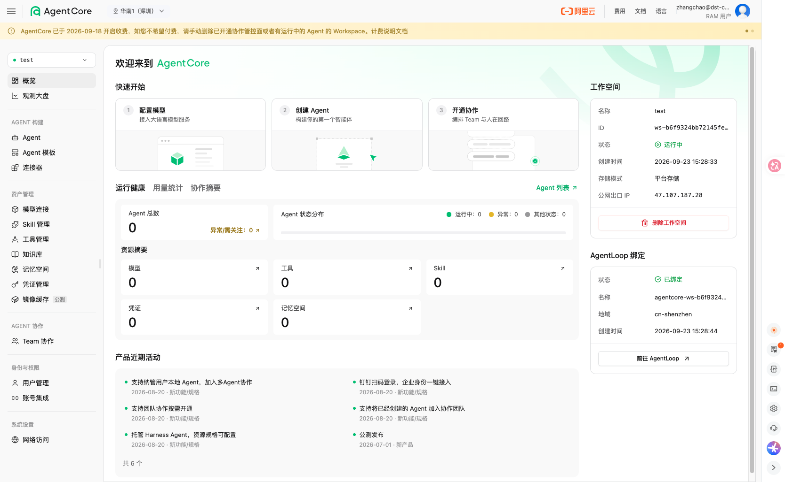

**💡 一句话定位**

AgentCore 是阿里云的**智能体构建和治理平台**（归属云原生应用平台产品线），以「构建与运行、协作与治理、观测与评估」三大能力覆盖 Agent 全生命周期，把自研、开源 Harness、商业 SaaS Agent 多来源统管于一个平台——官方口号：**建得快、管得住、协作好**。

## 本系列笔记

| 篇目 | 内容 |
| --- | --- |
| [AgentCore 是什么：定位、作用与核心概念](/2026/10/27/agentcore-01-what-is/) | 是什么、有什么作用、核心概念（Workspace/Agent/Skill/MCP/Team） |
| [AgentCore 产品功能详解](/2026/10/27/agentcore-02-features/) | 控制台各模块详解：Agent 四形态、资产、协作、观测 |
| [AgentCore 实战：创建 Agent 与 AG-UI 调用](/2026/10/27/agentcore-05-practice/) | 快速开始、部署方式、AG-UI 协议与会话机制 |
| [AgentCore SDK 开发指南（Java 为主）](/2026/10/27/agentcore-04-sdk-java/) | SDK 模块、五大资源调用、Spring AI / LangChain4j / AgentScope 适配 |
| [AgentCore 高代码与纳管 Agent 部署手册](/2026/10/27/agentcore-07-deployment/) | 镜像/代码包部署、镜像缓存、本地 CLI Agent 纳管全流程 |
| [AgentCore 对接企业中间件：数据库、Nacos 与私网服务](/2026/10/27/agentcore-06-enterprise-middleware/) | 数据库两条对接路径、Nacos 真实角色、VPC 打通清单 |
| [AgentCore 计费说明与使用约束清单](/2026/10/27/agentcore-08-billing/) | 计费项与 CU 换算、约束和坑位清单 |
| [AgentCore 与主流 Agent 平台对比](/2026/10/27/agentcore-03-comparison/) | vs 百炼 / Dify / Coze / LangGraph 等 |

*AgentCore 控制台（2026-10-27 实拍，Workspace「test」，地域华南1-深圳）*

## 关键入口

| 入口 | 地址 |
| --- | --- |
| 控制台 | https://agentcore.console.aliyun.com |
| 官方文档 | https://help.aliyun.com/zh/agentcore/ |
| 官网产品页 | https://www.aliyun.com/product/agentcore |
| 我的工作台 | `https://agentcore.console.aliyun.com/workspaces/ws-b6f9324bb72145febc507/overview` |

**⚠️ 域名易错点**

控制台域名是 `agentcore.console.aliyun.com`（**aliyun.com**）。`aliyuncs.com` 是阿里云 API 域名，控制台用它会解析失败。

## 推荐学习路径

1. **概念先行**：先读 [AgentCore 是什么：定位、作用与核心概念](/2026/10/27/agentcore-01-what-is/)，理解 Workspace → Agent → Team 的资源模型
2. **动手**：照 [AgentCore 实战：创建 Agent 与 AG-UI 调用](/2026/10/27/agentcore-05-practice/) 的快速开始，10 分钟创建一个 QwenPaw 问答 Agent 并用 curl 跑通 AG-UI 对话
3. **深入功能**：按需读 [AgentCore 产品功能详解](/2026/10/27/agentcore-02-features/) 的对应模块（Skill 版本管理、记忆空间、知识库连接各有专门设计）
4. **上线前必读**：[AgentCore 计费说明与使用约束清单](/2026/10/27/agentcore-08-billing/)——2026-09-18 起已计费，且有不少「暂不支持」项

## 官方生态速记

- 依赖产品：云监控 CMS（Tracing）、PrivateLink（私网访问）、SchedulerX3（定时任务调度，需购买）
- 用户支持：AC 用户支持钉钉群 `185130001370`
- 支持地域：杭州 / 上海 / 深圳 / 北京 / 新加坡
